# Battery Hall

The Battery Hall is a large energy store. Battery Cells hold the charge, Inverters set how fast it charges and
discharges, Battery Coolers carry the heat of the transfer losses away. It is the everyday store between
generators and consumers; a Capacitor Bank covers short peaks, an SMES huge rates.

* **Capacity:** 8,000,000 E per Battery Cell (`batteryCellCapacity`).
* **Rate** in each direction: the lower of 4,000 E/t per Inverter and 1,000 E/t per Battery Cell.
* **Efficiency:** 97 % per direction up to 45 °C, falling to 85 % at 80 °C. The losses become heat in the hall.
* **Temperature:** above 60 °C the rate falls (to 20 % at 80 °C). At 80 °C the hall disconnects until it has cooled
  below 50 °C.
* **Cooling:** every Battery Cooler cools passively; with cooling water (Fluid Input Port) each cooler also heats up to
  10 mB/t of water into Hot Coolant (10 HU per mB), which leaves through the Fluid Output Port. Tanks: 16,000 mB each.
* Self-discharge: 0.1 % per hour of game time.

The example below is 5x4x4 with eight Battery Cells, two Inverters and two Battery Coolers inside: 64,000,000 E at up
to 8,000 E/t each way.

## Rules
* **Size:** at least 4x3x4 (width x height x depth), at most 16 in every direction (`maxStructureSize`).
* **Frame (edges and corners):** Battery Hall Casing only.
* **Walls:** Battery Hall Casing, Turbine Sight Glass, Inspection Hatch, plus controller and ports (in the faces, not
  on edges).
* **Ports:**
  * Energy Input Port: charging.
  * Energy Output Port: discharging (pushed out, within the rate).
  * Fluid Input Port: cooling water in. Fluid Output Port: Hot Coolant out.
* **Inside:** air, Battery Cells, Inverters, Battery Coolers, anywhere.
* **Required:** at least 1 Battery Cell and 1 Inverter.
* **Controller:** the Battery Hall Controller faces out; the block right behind it must be an interior block.

## Running it
Connect generators to the Energy Input Ports and consumers to the Energy Output Ports. The screen shows the state
(Idle, Charging, Discharging, "Hot: rate reduced", "Too hot: disconnected"), energy, water, cells, inverters,
coolers, rate, input, output, temperature, efficiency, loss heat, coolant flow and protection.

* **S** switches the thermal disconnect ("Protection"). It is on by default. With it off ("Thermal disconnect OFF:
  cells can run away") the hall keeps running above 80 °C, the cells heat themselves, and at 140 °C they burn
  through: a thermal runaway explosion that empties the store (blocks and fire only with `incidentTerrainDamage`). In
  `safeMode` the disconnect cannot be switched off.
* For heavy use add coolers and water; more Inverters raise the rate only up to 1,000 E/t per cell.

**CC: Tweaked:** readings `energyStored()`, `powerOutput()`, `temperature()`, `reactorState()`; command
`setProtection(boolean)`.

## Common error messages
| Message | What to do |
|---|---|
| Missing parts: (part:count) | Add at least one Battery Cell and one Inverter. |
| Structure too small ((size)) | Build at least 4 wide, 3 high, 4 deep. |
| Wrong block at (position) (expected: (allowed parts)) | Edges need Battery Hall Casing; inside only cells, inverters, coolers and air. |
| Port not allowed here: (position) ((port type)) | Only energy and fluid ports work here. |
| Structure too large or not closed near (position) | Close the box or keep it within `maxStructureSize`. |
| The controller must sit in a wall, front facing out | Place the controller in a wall face, front facing out, with the interior behind it. |
| Second controller at (position) | Remove the extra controller. |

## Sight glass

Every wall block that is not on an edge may be **Turbine Sight Glass** instead of the casing. The plant works the same, and through the glass you see what happens inside while it runs. The example below has Turbine Sight Glass in its front.

## Step by step

The example below is 5 wide, 4 high and 4 deep. The example forms as shown (checked in the game when the pictures were taken).

Each step shows the plant from the front left after one more layer is placed (from the bottom up), and a top-down map of that layer: the back of the plant at the top, the front with the controller at the bottom. The letters match the parts lists.

**All parts of the example:**

| | Key | Block | Count |
|---|---|---|---|
| 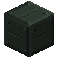 | A | Battery Hall Casing | 58 |
| 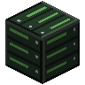 | E | Battery Cell | 8 |
|  | B | Turbine Sight Glass | 5 |
| 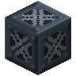 | H | Battery Cooler | 2 |
| 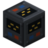 | F | Inverter | 2 |
| 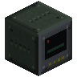 | C | Battery Hall Controller | 1 |
|  | D | Energy Input Port | 1 |
|  | G | Energy Output Port | 1 |
|  | I | Fluid Input Port | 1 |
|  | J | Fluid Output Port | 1 |

### Step 1: Layer 1

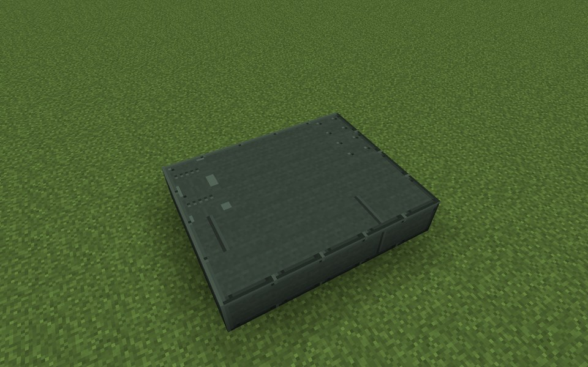

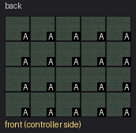

Parts in this step: Battery Hall Casing (A) ×20

### Step 2: Layer 2

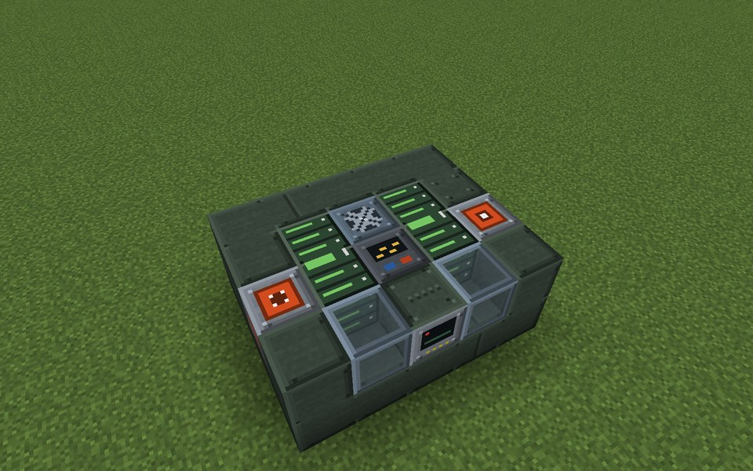

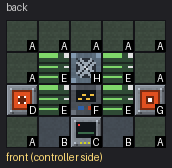

Parts in this step: Battery Hall Casing (A) ×9, Battery Cell (E) ×4, Battery Cooler (H) ×1, Battery Hall Controller (C) ×1, Inverter (F) ×1, Energy Input Port (D) ×1, Energy Output Port (G) ×1, Turbine Sight Glass (B) ×2

### Step 3: Layer 3

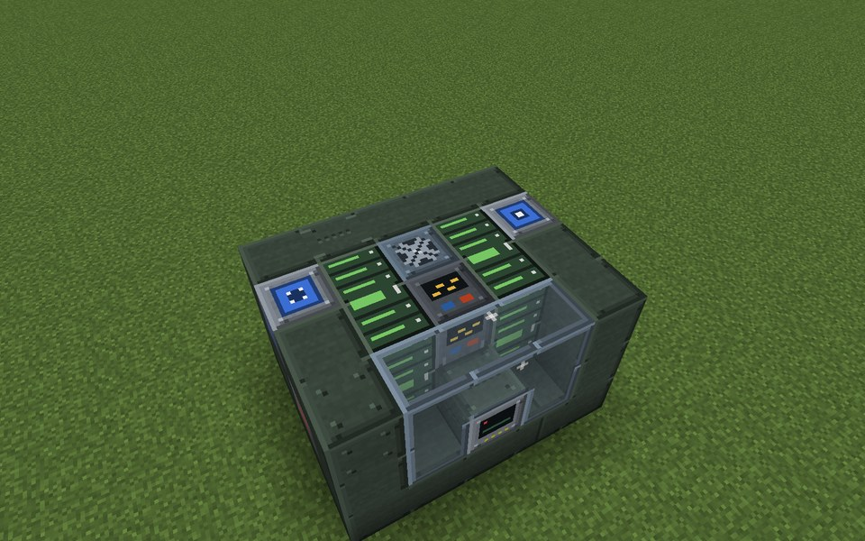

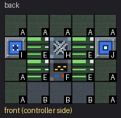

Parts in this step: Battery Hall Casing (A) ×9, Battery Cell (E) ×4, Battery Cooler (H) ×1, Inverter (F) ×1, Fluid Input Port (I) ×1, Fluid Output Port (J) ×1, Turbine Sight Glass (B) ×3

### Step 4: Layer 4

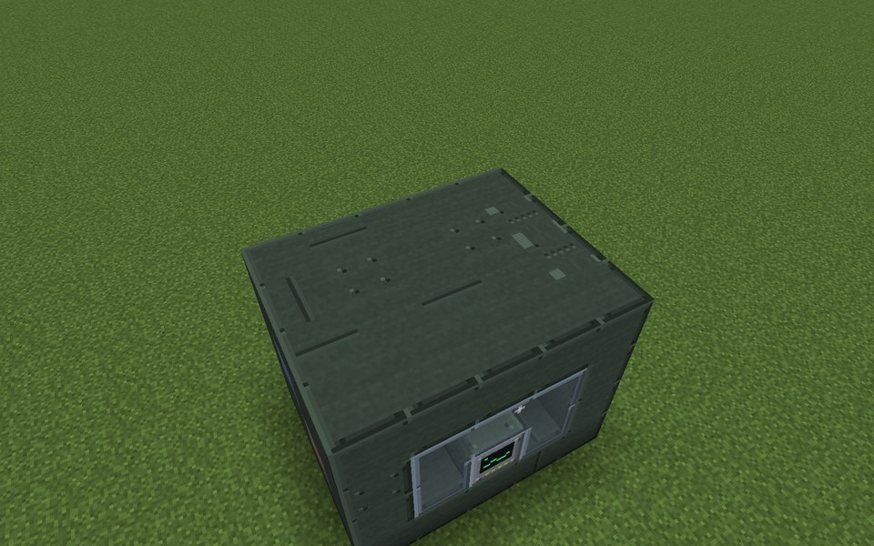

Parts in this step: Battery Hall Casing (A) ×20

### Finished

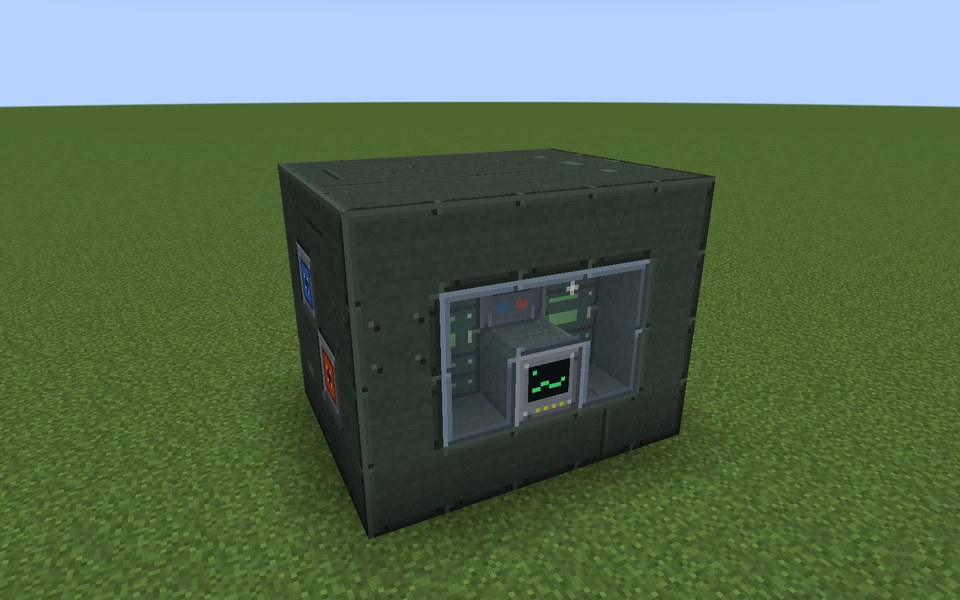

### In operation

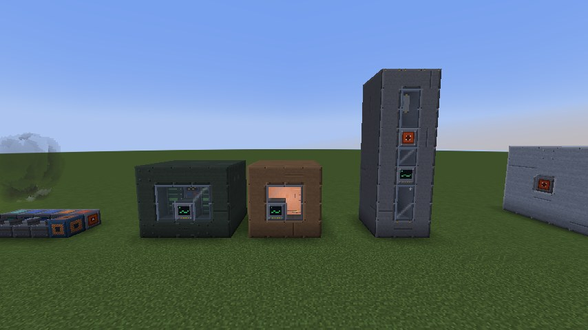

From the left: Battery Hall, Molten-Salt Store and Gravity Store, each with a sight-glass front.
