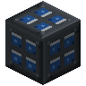
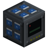
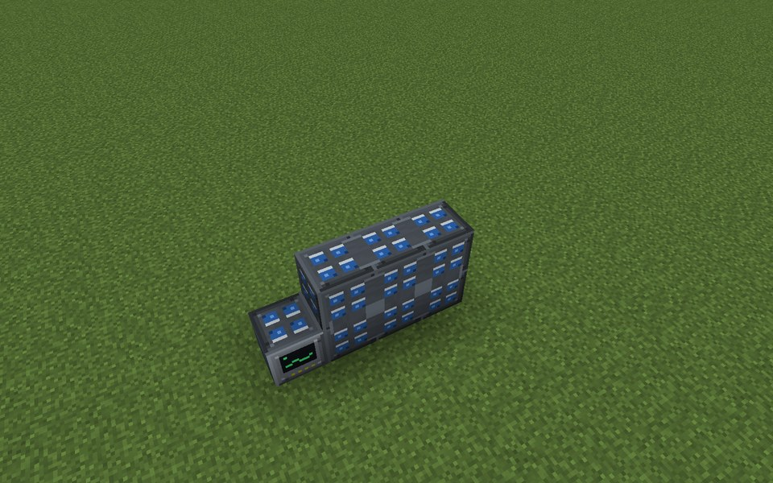
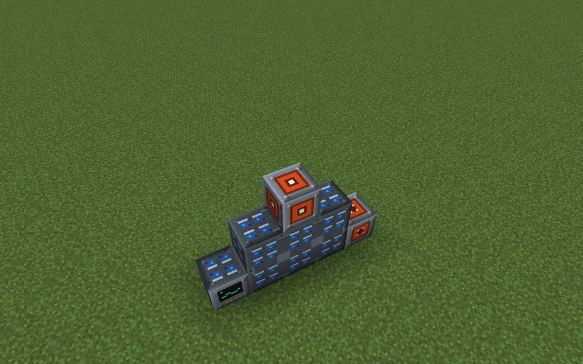
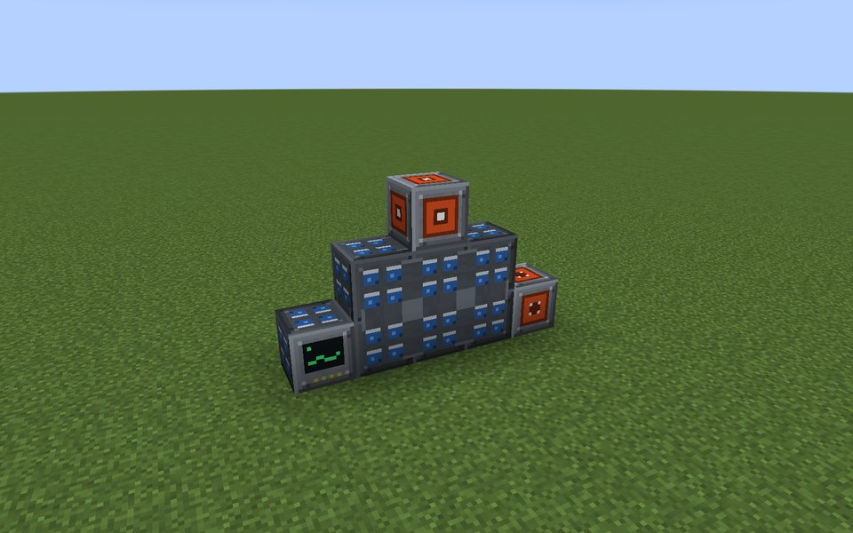
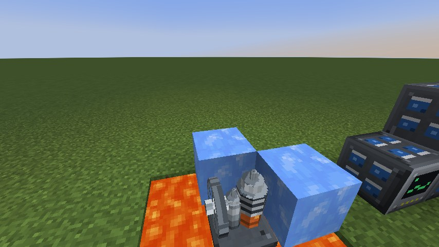

# Capacitor Bank

The Capacitor Bank is a tiny store with an enormous rate: it can empty itself in a single tick. Use it to cover short
peaks, to smooth a fluctuating source, or to release a burst of energy on a redstone signal. It is not meant to hold
energy for long.

* **Capacity and rate:** each Capacitor Module adds 25,000 E of capacity and 25,000 E/t of charge and discharge rate.
* **Self-discharge:** 0.2 % of the content per second.
* **Heat:** throughput heats the bank with its square. From 70 °C the rate is throttled, down to 20 % at 100 °C.
  Passive cooling allows about 40 % of the full rate (charge and discharge together) continuously.
* **Redstone:** a signal at the controller can release or block the output (see below).

The example below is a Capacitor Bank Controller with six Capacitor Modules beside it (3 long, 2 high), an Energy
Input Port at the end of the modules and an Energy Output Port on top: 150,000 E at up to 150,000 E/t each way.

## Rules
* **Shape:** any shape. Every Capacitor Module that touches the controller or another module of the bank face to face
  belongs to it.
* **Limits:** at most 128 modules (`maxCapacitorModules`), all within 16 blocks of the controller on every axis.
* **Ports:** Energy Input Ports and Energy Output Ports that touch a module or the controller join the bank. Their
  outward side points away from the block they touch.
* **No casing, no walls.**
* **Required:** at least 1 Capacitor Module.

## Running it
Connect sources to an Energy Input Port and consumers to an Energy Output Port. The screen shows the redstone mode and
whether the bank is releasing, energy, modules, rate, input, output, temperature, throttle and self-discharge.

* **Redstone mode (`>`):** "Always gives energy" (default), "Gives energy only with a signal", "A signal blocks the
  output". The signal is read at the controller block. Charging works in every mode.
* The release state shows "Released" or "Holding the charge".
* Keep the average throughput below about 40 % of the rate, or the bank heats up and throttles itself.
* Every module counts: adding or removing one re-forms the bank with the new capacity. A module that does not touch
  the bank (only an edge or corner) is not part of it.
* When the bank breaks the charge stays, but nothing moves until it forms again.
* Typical uses: a buffer behind a Wind Turbine or Solar Array, or a bank that a redstone clock or a Sensor Module
  releases into a consumer only when needed.
* The bank has no incidents.

**CC: Tweaked:** readings `energyStored()`, `powerOutput()`, `temperature()`; command `setRedstoneMode(mode)`
(`always`, `release_on_signal`, `block_on_signal`).

## Common error messages
| Message | What to do |
|---|---|
| Missing parts: capacitor_module | Place at least one Capacitor Module touching the controller. |
| Too many modules (limit (limit)) near (position) | Remove modules or raise `maxCapacitorModules`. |
| Part of the structure is not loaded (position) | Load the chunks of the whole bank. |

## Step by step

The example below is 5 wide, 3 high and 1 deep. The example forms as shown (checked in the game when the pictures were taken).

**All parts of the example:**

| | Key | Block | Count |
|---|---|---|---|
|  | B | Capacitor Module | 6 |
|  | A | Capacitor Bank Controller | 1 |
|  | C | Energy Input Port | 1 |
|  | D | Energy Output Port | 1 |

### Step 1: Controller and modules

Parts in this step: Capacitor Bank Controller (A) ×1, Capacitor Module (B) ×6

### Step 2: Energy ports

Parts in this step: Energy Input Port (C) ×1, Energy Output Port (D) ×1

### Finished

### In operation

