# Centrifuge Cascade

The Centrifuge Cascade enriches uranium for the fission reactor. It takes Yellowcake in batches of four and turns each
batch into one Enriched Uranium and three Depleted Uranium.

* **Separative work:** each Gas Centrifuge delivers 1 unit of separative work (SWU) per tick while it gets 40 E/t.
  A batch needs 2,400 SWU. More centrifuges make it faster, never more product.
* **Energy:** up to 40 E/t per centrifuge, through Energy Input Ports (buffer 500,000 E, takes up to 10,000 E/t).
  With too little energy fewer centrifuges work.
* **Items:** 2 input slots (only items in the `quantavolt:materials/yellowcake` tag), 4 output slots. A finished batch
  waits until both products fit into the output.

Enriched Uranium is the material for uranium fuel; the fission reactor then burns Uranium Fuel Rods.

The example below is 5x4x4 with twelve Gas Centrifuges (3 x 2 x 2 inside): it needs 480 E/t and finishes a batch
every 200 ticks (10 seconds).

## Rules
* **Size:** at least 3x4x4 (width x height x depth), at most 16 in every direction (`maxStructureSize`).
* **Frame (edges and corners):** Centrifuge Casing only.
* **Walls:** Centrifuge Casing, Turbine Sight Glass, Inspection Hatch, plus controller and ports (in the faces, not on
  edges).
* **Ports:**
  * Item Input Port: Yellowcake in.
  * Item Output Port: Enriched and Depleted Uranium out.
  * Energy Input Port: energy in.
* **Inside:** air and Gas Centrifuges, anywhere.
* **Required:** at least 2 Gas Centrifuges.
* **Controller:** the Centrifuge Cascade Controller faces out; the block right behind it must be an interior block.

## Running it
Feed Yellowcake and energy, take the products out of the Item Output Port. The cascade has no buttons. Its screen
shows the state ("Waiting for yellowcake (4 per batch)", "Waiting for energy", "Enriching"), energy, separative work,
SWU per tick and the number of centrifuges. While it works the centrifuges are drawn spinning.

* A batch starts only when one input slot holds at least four Yellowcake.
* The cascade has no incidents.

**CC: Tweaked:** reading `energyStored()`; `getInfo()` returns the screen values. No commands.

## Common error messages
| Message | What to do |
|---|---|
| The controller must sit in a wall, front facing out | Place the controller in a wall face, front facing out, with the interior behind it. |
| Structure too small ((size)) | Build at least 3 wide, 4 high, 4 deep. |
| Wrong block at (position) (expected: (allowed parts)) | Edges need Centrifuge Casing; inside only air and Gas Centrifuges. |
| Missing parts: centrifuge:2 | Put at least two Gas Centrifuges inside. |
| Port not allowed here: (position) ((port type)) | Only item in/out and energy in ports work here. |
| Structure too large or not closed near (position) | Close the box or keep it within `maxStructureSize`. |
| Second controller at (position) | Remove the extra controller. |

## Sight glass

Every wall block that is not on an edge may be **Turbine Sight Glass** instead of the casing. The plant works the same, and through the glass you see what happens inside while it runs. The example below has Turbine Sight Glass in its front.

## Step by step

The example below is 5 wide, 4 high and 4 deep. The example forms as shown (checked in the game when the pictures were taken).

Each step shows the plant from the front left after one more layer is placed (from the bottom up), and a top-down map of that layer: the back of the plant at the top, the front with the controller at the bottom. The letters match the parts lists.

**All parts of the example:**

| | Key | Block | Count |
|---|---|---|---|
| 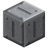 | A | Centrifuge Casing | 59 |
| 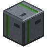 | E | Gas Centrifuge | 12 |
|  | B | Turbine Sight Glass | 5 |
| 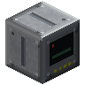 | C | Centrifuge Cascade Controller | 1 |
|  | G | Energy Input Port | 1 |
|  | D | Item Input Port | 1 |
|  | F | Item Output Port | 1 |

### Step 1: Layer 1

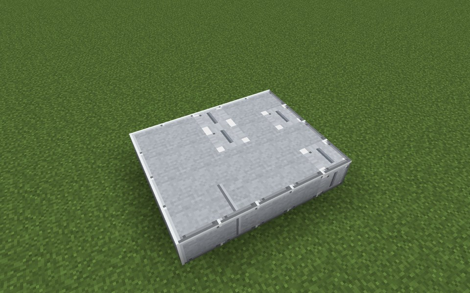

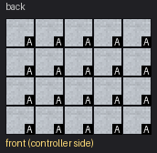

Parts in this step: Centrifuge Casing (A) ×20

### Step 2: Layer 2

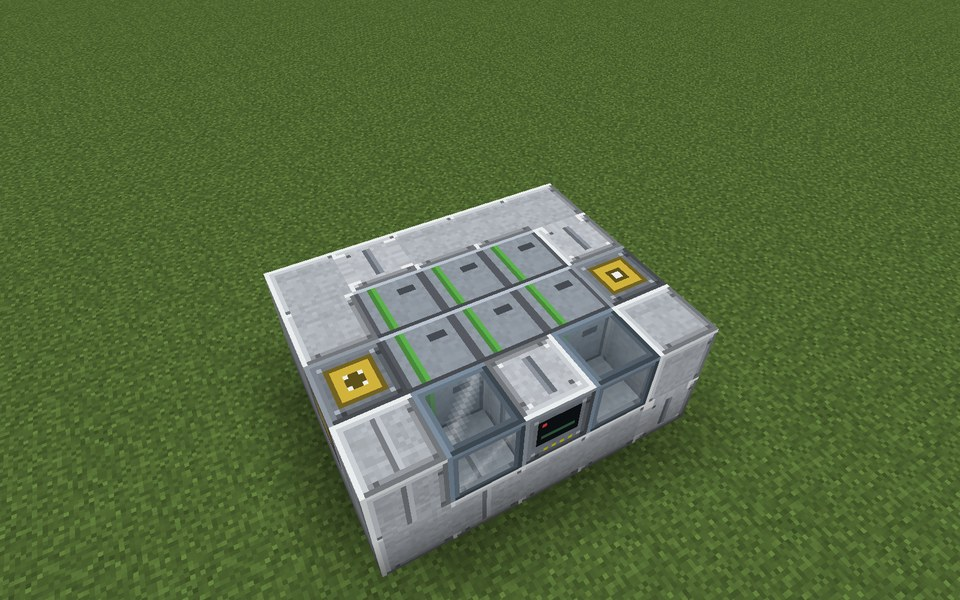

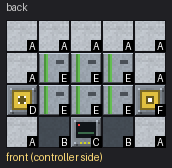

Parts in this step: Gas Centrifuge (E) ×6, Centrifuge Casing (A) ×9, Centrifuge Cascade Controller (C) ×1, Item Input Port (D) ×1, Item Output Port (F) ×1, Turbine Sight Glass (B) ×2

### Step 3: Layer 3

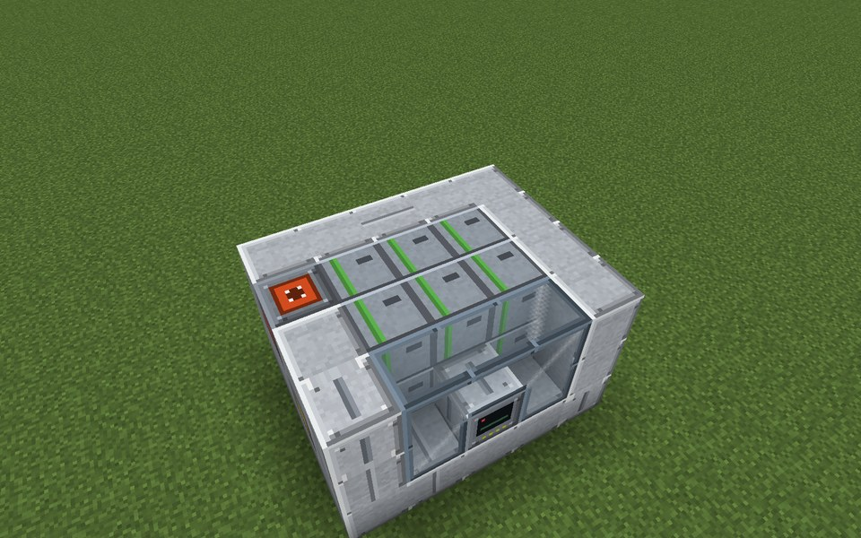

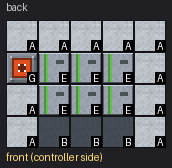

Parts in this step: Gas Centrifuge (E) ×6, Centrifuge Casing (A) ×10, Energy Input Port (G) ×1, Turbine Sight Glass (B) ×3

### Step 4: Layer 4

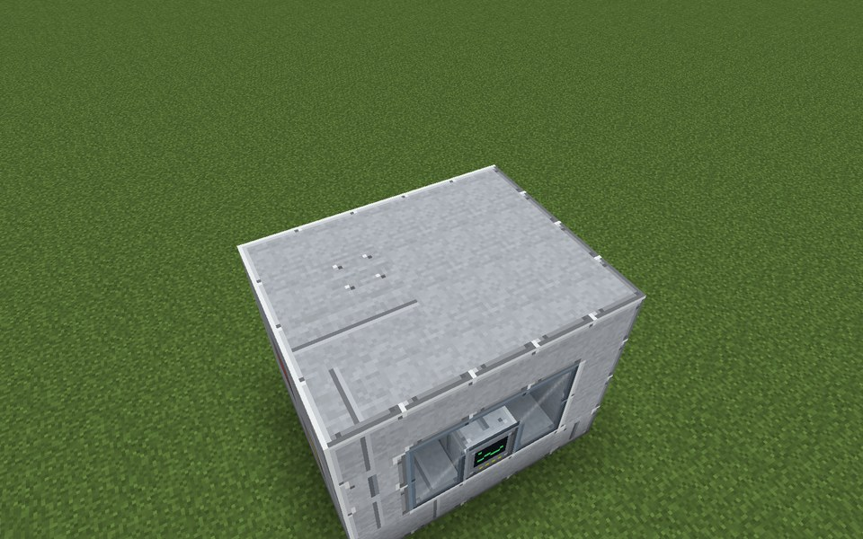

Parts in this step: Centrifuge Casing (A) ×20

### Finished

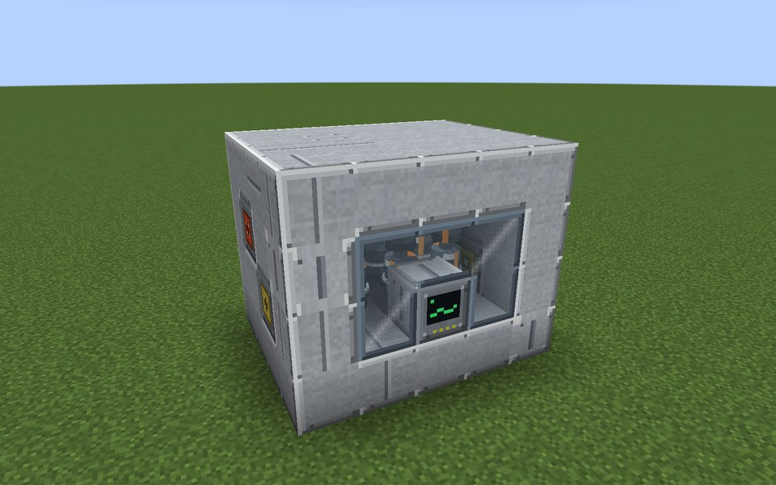

### In operation

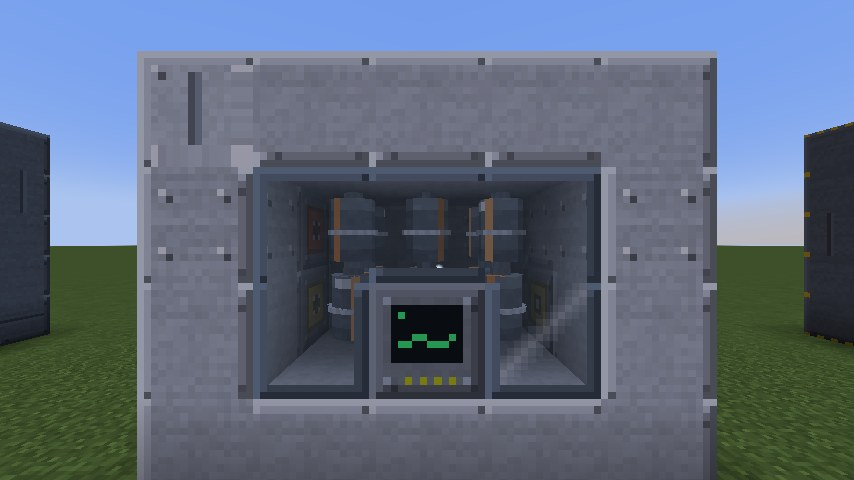
