# Dimensional Store

The Dimensional Store keeps energy in a pocket of space behind a Dimension Core. Its capacity is practically unlimited
(1,000,000,000,000,000 E, `dimensionCapacity`); what limits it is the link. It is the end-game store; the Dimension
Core is crafted with two Singularity Capsules from a Micro Black Hole Plant.

* **Opening:** the first 50,000,000,000 E that come in (`dimensionOpenEnergy`) open the pocket; whatever arrives beyond
  that becomes the first content.
* **Rate:** 1,000,000 E/t per Transfer Channel in each direction.
* **Upkeep:** 5,000 E/t per Transfer Channel and 20,000 E/t per Dimensional Stabiliser, paid from the stored energy.
* **Link stability** moves slowly towards a target: 0.9, +0.08 per Dimensional Stabiliser, -0.06 per Transfer
  Channel, -0.15 x the transfer load (throughput relative to the rate). Unpaid upkeep pulls the target to zero.
  * Below 50 % a share of every transfer is lost.
  * Below 20 % the link disconnects (no transfer) until it has recovered above 35 %.
  * Below 5 % the pocket collapses: an implosion pulls in and hurts living things nearby (nothing in `safeMode`) and
    the store loses 1 % of its content per second.
* Self-discharge: 0.01 % per hour of game time.

The example below is 5x5x5: the Dimension Core in the center, a Transfer Channel on each side of it and a column of
three Dimensional Stabilisers behind it. It moves 2,000,000 E/t each way at 70,000 E/t upkeep, and its link settles at
full stability.

## Rules
* **Size:** a cube with an odd edge, at least 5x5x5, at most `maxStructureSize` (default 16, so 15 is the largest odd
  edge).
* **Frame (edges and corners):** Dimensional Casing only.
* **Walls:** Dimensional Casing, Reactor Sight Glass, Inspection Hatch, plus controller and ports (in the faces, not on
  edges).
* **Ports:**
  * Energy Input Port: opening charge and charging.
  * Energy Output Port: discharging (pushed out, within the rate).
* **Inside:** the Dimension Core exactly in the center; everywhere else air, Transfer Channels or Dimensional
  Stabilisers.
* **Required:** the Dimension Core and at least 1 Transfer Channel.
* **Controller:** the Dimensional Store Controller faces out; the block right behind it must be an interior block.

## Running it
Connect a strong energy source to the Energy Input Port; the pocket opens by itself once the opening charge is in.
The store has no buttons. Its screen shows the link state ("Pocket closed", "Opening the pocket", "Linked",
"Disconnected (stabilising)"), energy, capacity, rate, input, output, link stability and where it settles, upkeep,
transfer loss, channels, stabilizers and the opening charge.

* More channels give more rate but strain the link; add stabilizers to keep the target above 50 %. Running at the full
  rate also lowers it.
* Keep some energy in the store: the upkeep is paid from its content.
* Violet sparkles at the controller warn of a lossy link.

**CC: Tweaked:** readings `energyStored()`, `powerOutput()`, `stability()`, `reactorState()`. No commands.

## Common error messages
| Message | What to do |
|---|---|
| The Little Star must be a cube with odd edge length (is (size)) | This message appears for this plant too: make all edges equal and odd. |
| Wrong block at (position) (expected: dimension_core) | Put the Dimension Core exactly in the center of the cube. |
| Wrong block at (position) (expected: air\|dimensional_stabiliser\|transfer_channel) | Only one Dimension Core, in the center; other interior blocks must be channels, stabilizers or air. |
| Missing parts: transfer_channel:1 | Add at least one Transfer Channel. |
| Structure too small ((size)) | The edge must be at least 5. |
| Port not allowed here: (position) ((port type)) | Only energy ports work here. |
| The controller must sit in a wall, front facing out | Place the controller in a wall face, front facing out, with the interior behind it. |

## Sight glass

Every wall block that is not on an edge may be **Reactor Sight Glass** instead of the casing. The plant works the same, and through the glass you see what happens inside while it runs. The example below has Reactor Sight Glass in its front.

## Step by step

The example below is 5 wide, 5 high and 5 deep. The example forms as shown (checked in the game when the pictures were taken).

Each step shows the plant from the front left after one more layer is placed (from the bottom up), and a top-down map of that layer: the back of the plant at the top, the front with the controller at the bottom. The letters match the parts lists.

**All parts of the example:**

| | Key | Block | Count |
|---|---|---|---|
|  | A | Dimensional Casing | 87 |
|  | B | Reactor Sight Glass | 8 |
|  | D | Dimensional Stabiliser | 3 |
|  | F | Transfer Channel | 2 |
|  | G | Dimension Core | 1 |
|  | C | Dimensional Store Controller | 1 |
|  | E | Energy Input Port | 1 |
|  | H | Energy Output Port | 1 |

### Step 1: Layer 1

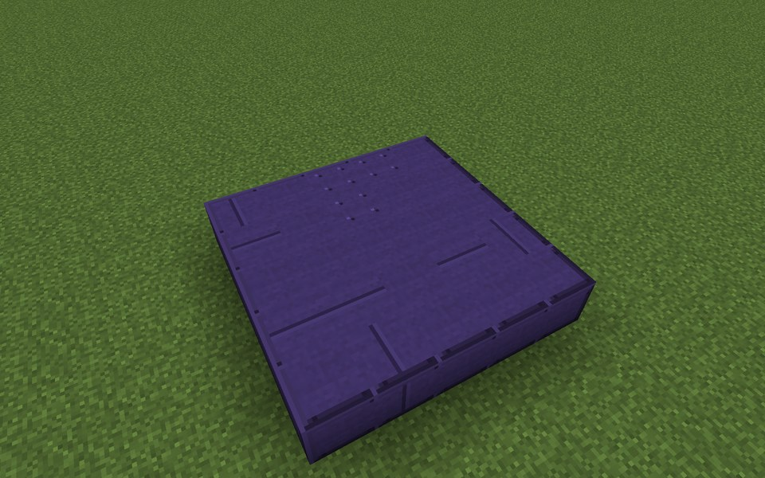

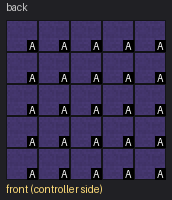

Parts in this step: Dimensional Casing (A) ×25

### Step 2: Layer 2

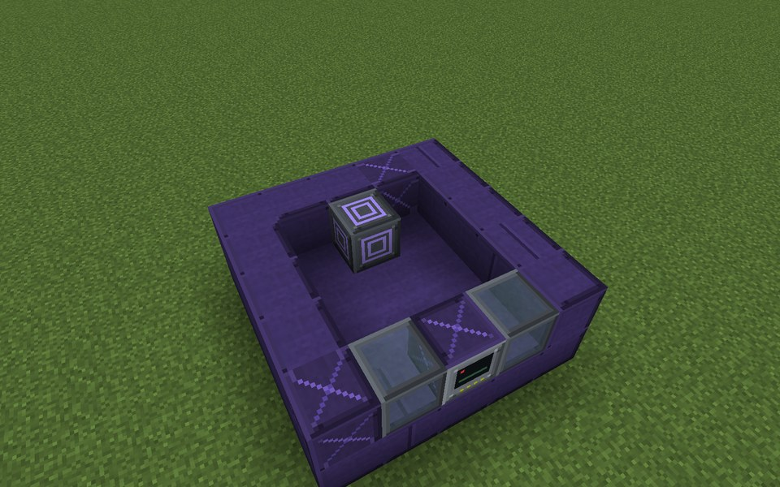

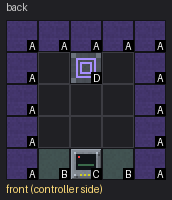

Parts in this step: Dimensional Casing (A) ×13, Dimensional Store Controller (C) ×1, Dimensional Stabiliser (D) ×1, Reactor Sight Glass (B) ×2

### Step 3: Layer 3

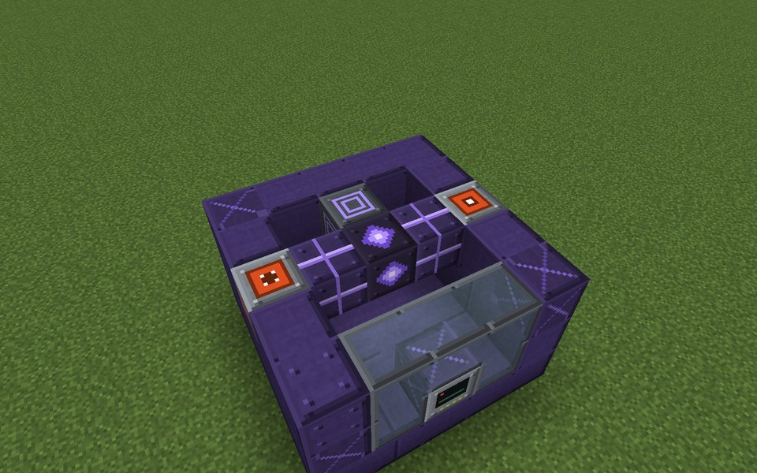

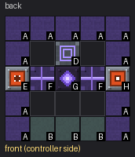

Parts in this step: Dimension Core (G) ×1, Dimensional Casing (A) ×11, Dimensional Stabiliser (D) ×1, Energy Input Port (E) ×1, Energy Output Port (H) ×1, Reactor Sight Glass (B) ×3, Transfer Channel (F) ×2

### Step 4: Layer 4

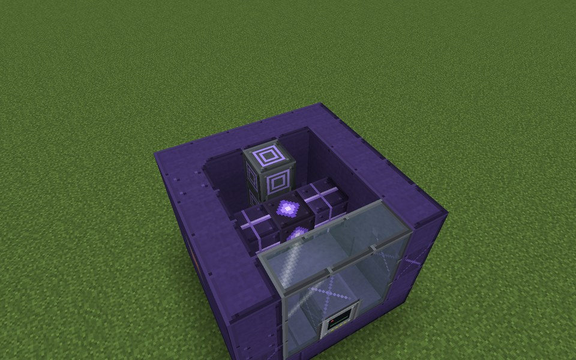

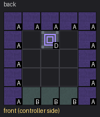

Parts in this step: Dimensional Casing (A) ×13, Dimensional Stabiliser (D) ×1, Reactor Sight Glass (B) ×3

### Step 5: Layer 5

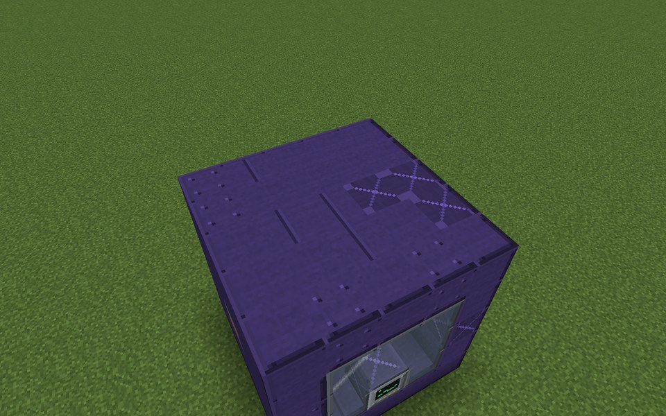

Parts in this step: Dimensional Casing (A) ×25

### Finished

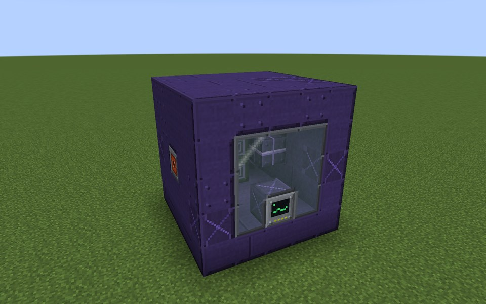

### In operation

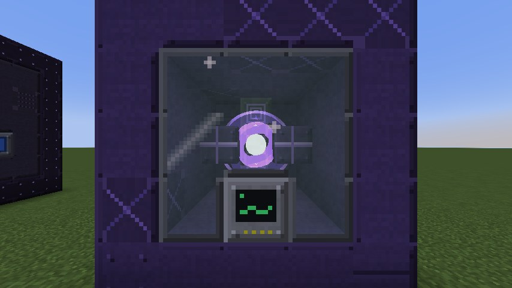
