# Fission Reactor

The Fission Reactor burns Uranium Fuel Rods and turns their heat into Hot Coolant. A Heat Exchanger next to it boils
feedwater with that Hot Coolant, returns the coolant as water, and the steam drives Steam Turbines. Fuel comes from
the Centrifuge Cascade (Enriched Uranium) via fuel rods.

* **Fuel:** every Fuel Assembly holds one Uranium Fuel Rod (item tag `quantavolt:fission_fuel`). A rod holds
  10,000,000 HU (divided by `fuelConsumptionMultiplier`). At full neutron flux each loaded assembly makes 400 HU/t.
  Spent rods leave as Depleted Fuel Rods.
* **Reactivity** grows with Graphite Moderator (full moderation at 0.75 moderator blocks per loaded rod) and falls
  with control rod insertion and with temperature (a hotter core settles by itself). One Control Rod covers four
  assemblies; with fewer rods even full insertion cannot shut the core down completely.
* **Cooling:** above 100 °C every Coolant Channel turns up to 50 mB/t water into Hot Coolant; each mB carries 10 HU
  away. Tanks: 16,000 mB water, 16,000 mB Hot Coolant; 4 fuel slots, 5 output slots.
* Even after a shutdown, decay heat keeps warming the core for a while.

The example below is 5x5x5 with a 3x3x3 core. The front slice holds two Control Rod columns (6 rods) with a column
of Coolant Channels between them, the middle slice six Fuel Assemblies beside a column of three Graphite Moderators,
the back slice three Fuel Assemblies between six Coolant Channels. That makes 9 assemblies (up to 3,600 HU/t), 9
Coolant Channels (up to 4,500 HU/t of cooling) and Reactor Instrumentation in the roof.

## Rules
* **Size:** at least 5x5x5 (width x height x depth), at most 15 in every direction (`maxFissionReactorSize`).
* **Frame (edges and corners):** Reactor Casing only.
* **Walls:** Reactor Casing, Reactor Sight Glass, Inspection Hatch, Reactor Instrumentation, Emergency Shutdown, plus
  controller and ports (in the faces, not on edges).
* **Ports:**
  * Item Input Port: Uranium Fuel Rods in.
  * Item Output Port: Depleted Fuel Rods out.
  * Fluid Input Port: cooling water in.
  * Fluid Output Port: Hot Coolant out (to a Heat Exchanger).
* **Inside:** air, Fuel Assemblies, Control Rods, Graphite Moderators, Coolant Channels.
* **Control rods** are driven in from the roof: every Control Rod must be part of a column of Control Rods that reaches
  the top interior layer.
* **Required:** at least 1 Fuel Assembly, 1 Control Rod and 1 Coolant Channel.
* **Wall parts:** Reactor Instrumentation (optional) enables the automatic SCRAM. An Emergency Shutdown block
  (optional) scrams the reactor when it receives a redstone signal.

## Running it
Load fuel rods and water, pipe the Hot Coolant to a Heat Exchanger and its returned water back. The control rods start
fully inserted. The screen shows status, alarm, core and coolant temperature, flux, reactivity, rod position and
target, thermal output, heat removed, cooling capacity, fuel and core damage.

* One Heat Exchanger moves up to 100 mB/t Hot Coolant (1,000 HU/t); a strong reactor needs several.
* **Rods:** `+`/`-` insert or withdraw the rod target by 10 % (the rods move 1 % per tick).
* **SCRAM** drives all rods in fast; **Reset** clears it. Fresh rods are not loaded while the reactor is scrammed.
* **Auto-SCRAM** (button "Auto-SCRAM", needs Reactor Instrumentation, on by default): scrams at the set temperature
  (default 900 °C, `-`/`+` by 50 °C, 300–1200 °C) and when the coolant falls short above 600 °C.
* **Alarms:** warning from 600 °C, overheating from 900 °C, "Coolant problem" when the channels move less than half
  the coolant they should (no water, or the Hot Coolant tank is full), "Fuel damage!" above 1,200 °C (damage accumulates). At 1,800 °C or 100 % damage the reactor
  fails: the fuel is destroyed and a meltdown explosion follows (blocks only with `incidentTerrainDamage`, nothing in
  `safeMode`). Then let the core cool below 100 °C and press Reset.
* Reset is refused while the alarm is overheating or fuel damage.

**CC: Tweaked:** readings `temperature()`, `coolantTemperature()`, `reactorFlux()`, `controlRodPosition()`,
`powerOutput()` (HU/t), `fuelLevel()` (%), `alarmState()`, `reactorState()`; commands `setControlRodTarget(percent)`,
`scram()`, `reset()`, `setAutoScram(boolean)`, `setAutoScramTemperature(celsius)`.

## Common error messages
| Message | What to do |
|---|---|
| Control rods must form columns up to the top interior layer (near (position)) | Fill the column above that Control Rod with Control Rods up to the roof. |
| Missing parts: (part:count) | Add at least one Fuel Assembly, Control Rod and Coolant Channel. |
| Wrong block at (position) (expected: (allowed parts)) | Edges need Reactor Casing; inside only the core parts listed above. |
| Structure too small ((size)) | Build at least 5x5x5. |
| Structure too large or not closed near (position) | Close the box or keep it within `maxFissionReactorSize`. |
| Port not allowed here: (position) ((port type)) | Only item and fluid ports work here. |
| The controller must sit in a wall, front facing out | Place the controller in a wall face, front facing out, with the core behind it. |

## Sight glass

Every wall block that is not on an edge may be **Reactor Sight Glass** instead of the casing. The plant works the same, and through the glass you see what happens inside while it runs. The example below has Reactor Sight Glass in its front.

## Step by step

The example below is 5 wide, 5 high and 5 deep. The example forms as shown (checked in the game when the pictures were taken).

Each step shows the plant from the front left after one more layer is placed (from the bottom up), and a top-down map of that layer: the back of the plant at the top, the front with the controller at the bottom. The letters match the parts lists.

**All parts of the example:**

| | Key | Block | Count |
|---|---|---|---|
| 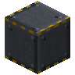 | A | Reactor Casing | 84 |
| 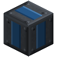 | D | Coolant Channel | 9 |
|  | F | Fuel Assembly | 9 |
|  | B | Reactor Sight Glass | 8 |
|  | C | Control Rod | 6 |
| 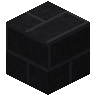 | G | Graphite Moderator | 3 |
| 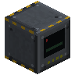 | I | Fission Reactor Controller | 1 |
|  | J | Fluid Input Port | 1 |
|  | K | Fluid Output Port | 1 |
| 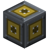 | E | Item Input Port | 1 |
| 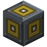 | H | Item Output Port | 1 |
| 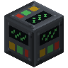 | L | Reactor Instrumentation | 1 |

### Step 1: Layer 1

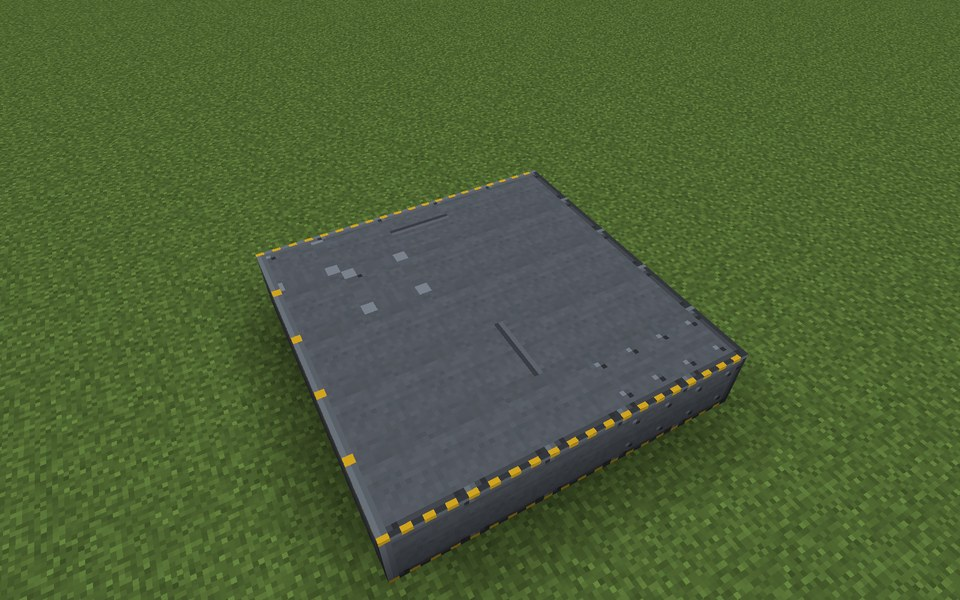

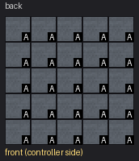

Parts in this step: Reactor Casing (A) ×25

### Step 2: Layer 2

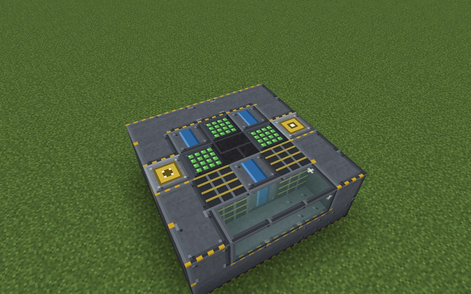

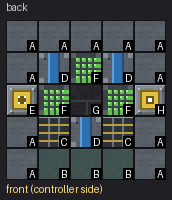

Parts in this step: Control Rod (C) ×2, Coolant Channel (D) ×3, Fuel Assembly (F) ×3, Item Input Port (E) ×1, Item Output Port (H) ×1, Graphite Moderator (G) ×1, Reactor Casing (A) ×11, Reactor Sight Glass (B) ×3

### Step 3: Layer 3

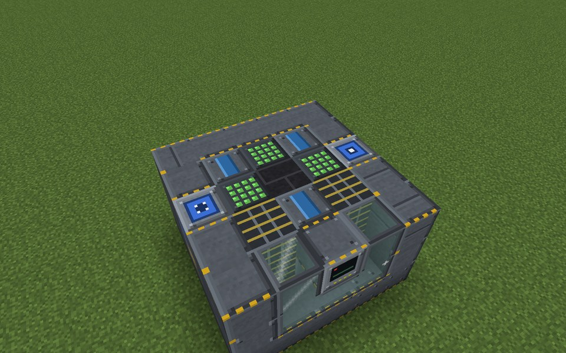

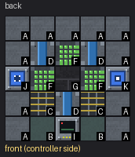

Parts in this step: Control Rod (C) ×2, Coolant Channel (D) ×3, Fission Reactor Controller (I) ×1, Fluid Input Port (J) ×1, Fluid Output Port (K) ×1, Fuel Assembly (F) ×3, Graphite Moderator (G) ×1, Reactor Casing (A) ×11, Reactor Sight Glass (B) ×2

### Step 4: Layer 4

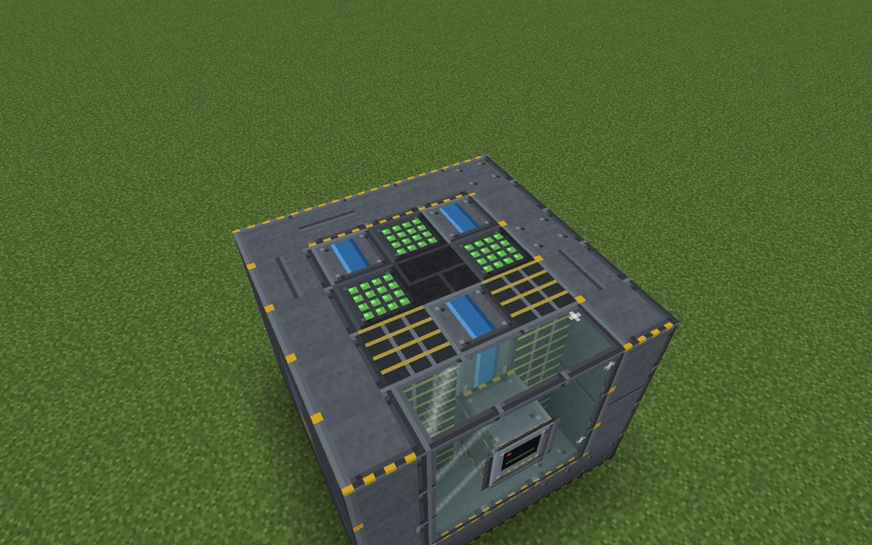

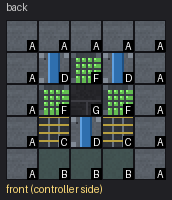

Parts in this step: Control Rod (C) ×2, Coolant Channel (D) ×3, Fuel Assembly (F) ×3, Graphite Moderator (G) ×1, Reactor Casing (A) ×13, Reactor Sight Glass (B) ×3

### Step 5: Layer 5

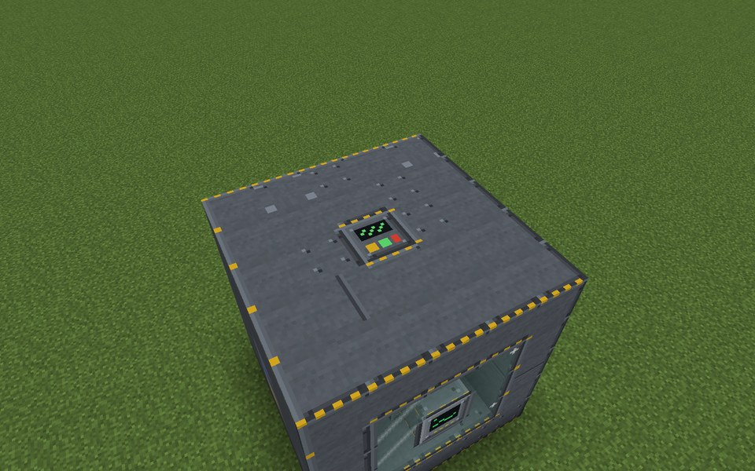

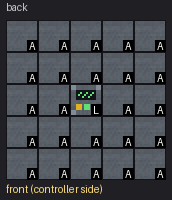

Parts in this step: Reactor Casing (A) ×24, Reactor Instrumentation (L) ×1

### Finished

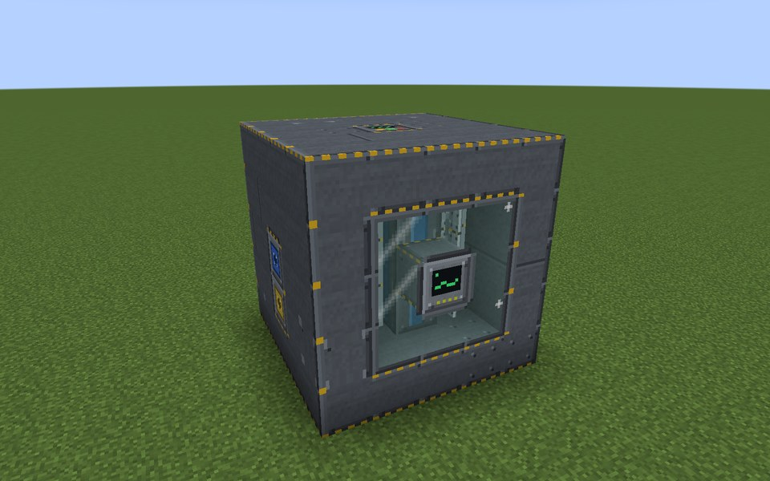

### In operation

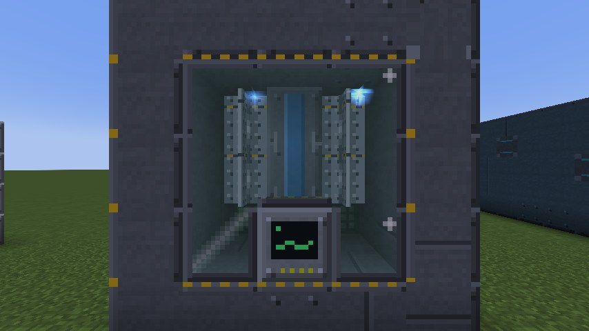
