# Gas Derrick

The Gas Derrick extracts Natural Gas from the gas field of the region its controller stands in (regions of
128 × 128 blocks; see [Natural Gas](Natural-Gas) for the fields and the Gas Prospector that finds them). It is a lattice
tower 3 blocks wide and deep: the higher the tower, the more it can extract.

* **Capacity:** 60 mB/t at height 6, 40 mB/t more for every further block of height, 300 mB/t at height 12.
* **Field:** a derrick never takes more than the field's current rate (small field up to 120 mB/t, large field up to
  480 mB/t, falling to a quarter as the field empties). All derricks in one region share that rate.
* **Energy:** 0.5 E per mB (150 E/t at 300 mB/t).
* **Buffers:** 32,000 mB natural gas, 20,000 E (up to 2,000 E/t in).

The example below is 8 high (140 mB/t), with the controller in the front wall next to the Wellhead, a Gas Output Port
in one side wall and an Energy Input Port in the opposite side wall, both on the same layer as the controller.

## Rules
* **Size:** exactly 3 wide and 3 deep, 6 to 12 high (floor and roof included).
* **Frame (edges and corners):** Derrick Frame only. In a 3×3 tower that is every block of the outer shell except the
  middle block of each face.
* **Walls (the middle block of each face):** Derrick Frame, Inspection Hatch, plus controller and ports. On the sides
  these are the middle column from the second layer up to the second-highest; on the floor and the roof the centre
  block.
* **Ports:**
  * Gas Output Port: natural gas out (pulled by Pipster gas pipes).
  * Energy Input Port: energy in.
* **Inside (the mast):** a Wellhead on the lowest interior layer, directly above the floor; Drill Pipe on every layer
  above it up to the roof. Nothing else, not even air.
* **Controller:** the Gas Derrick Controller sits in the middle of a side face, front facing out; the block right
  behind it is part of the mast. Its lowest place is the second layer, next to the Wellhead.

## Running it
Connect a cable to the Energy Input Port and a gas pipe to the Gas Output Port. The screen (controller, port or
Inspection Hatch) shows the state, the field (*Small field*, *Large field*, *No field in this region*), *Field content*
(what is left), *Field pressure* (the share left), *Field rate* (shared by all derricks of the region), *Derrick
capacity*, *Extraction* (taken in the last tick) and the natural gas and energy buffers. While the derrick extracts, its drill
string turns (since 1.0.0), the faster the higher the rate; a small flame with smoke burns at the crown.

| State | Meaning |
|---|---|
| Extracting | Running. |
| No natural gas in this region | The region of the controller has no field (or the dimension has no natural gas). Use the Gas Prospector to find one. |
| Field depleted | The field is empty for good. |
| Output full | The gas buffer is full: pipe the gas away. |
| No energy | Feed energy into the Energy Input Port. |

* Building the tower higher or lower re-forms it with the new capacity.
* A field empties for good. Breaking or rebuilding the derrick does not refill it: what was taken is stored per
  region in the world, not in the derrick.
* While it extracts, a small flame burns at the top of the tower.
* The derrick has no incidents.

## Common error messages
| Message | What to do |
|---|---|
| The controller must sit in a wall, front facing out | Place the controller in the middle of a side face (not in the floor layer), front facing out, with the mast behind it. |
| Structure too small ((size)) | Build the tower at least 6 high. |
| Structure too large or not closed near (position) | Keep it exactly 3 wide and 3 deep and at most 12 high, with a closed roof. |
| Wrong block at (position) (expected: (allowed parts)) | Edges need Derrick Frame; the mast needs the Wellhead directly above the floor and Drill Pipe above it. |
| Port not allowed here: (position) ((port type)) | Only Gas Output and Energy Input Ports work here. |
| Second controller at (position) | Remove the extra controller. |
| Part of the structure is not loaded (position) | Load the chunks of the whole tower. |

## Step by step

The example below is 3 wide, 8 high and 3 deep. The example forms as shown (checked in the game when the pictures were taken).

Each step shows the plant from the front left after one more layer is placed (from the bottom up), and a top-down map of that layer: the back of the plant at the top, the front with the controller at the bottom. The letters match the parts lists.

**All parts of the example:**

| | Key | Block | Count |
|---|---|---|---|
| 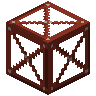 | A | Derrick Frame | 63 |
|  | F | Drill Pipe | 5 |
| 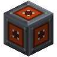 | E | Energy Input Port | 1 |
| 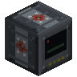 | B | Gas Derrick Controller | 1 |
| 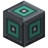 | C | Gas Output Port | 1 |
| 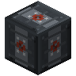 | D | Wellhead | 1 |

### Step 1: Layer 1

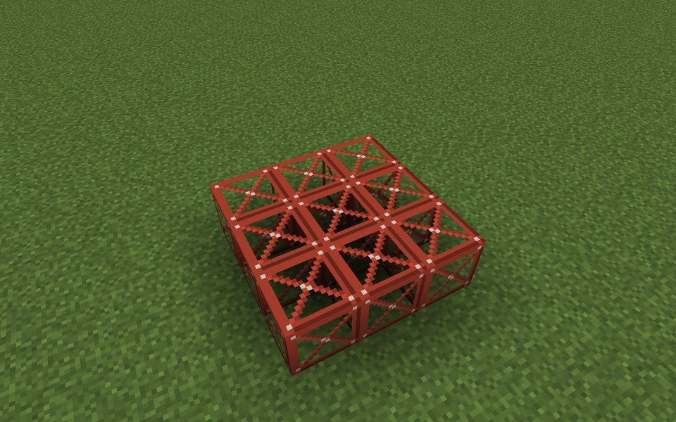

Parts in this step: Derrick Frame (A) ×9

### Step 2: Layer 2

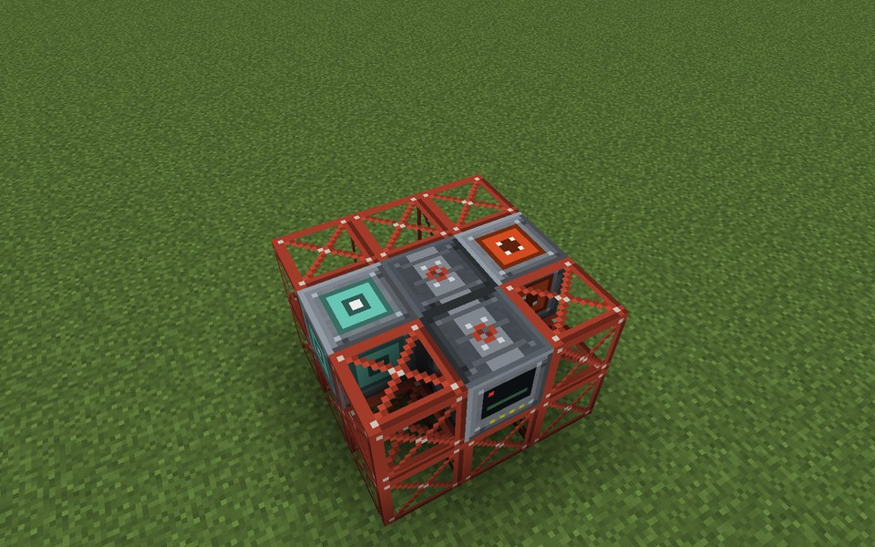

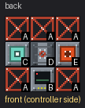

Parts in this step: Derrick Frame (A) ×5, Energy Input Port (E) ×1, Gas Derrick Controller (B) ×1, Gas Output Port (C) ×1, Wellhead (D) ×1

### Step 3: Layers 3–7 (identical)

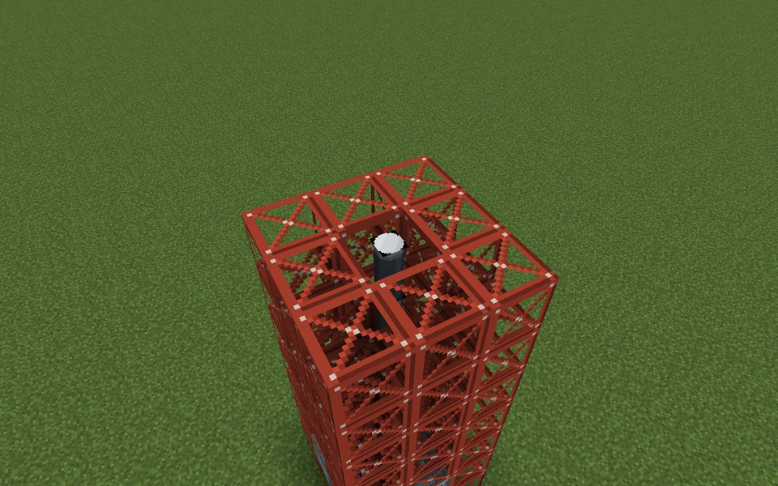

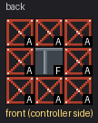

Place this layer 5 times on top of each other.

Parts in this step: Derrick Frame (A) ×40, Drill Pipe (F) ×5

### Step 4: Layer 8

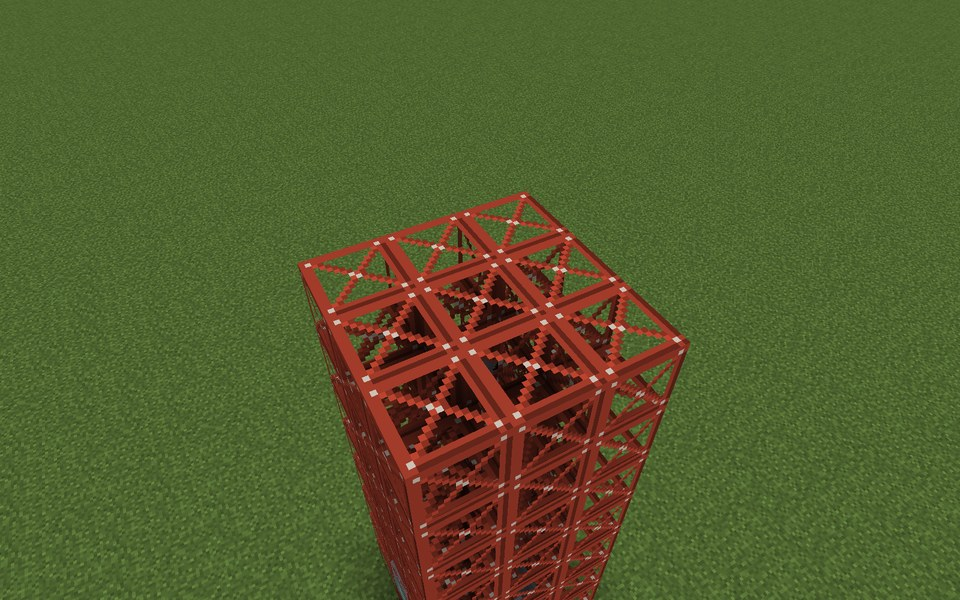

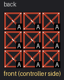

Parts in this step: Derrick Frame (A) ×9

### Finished

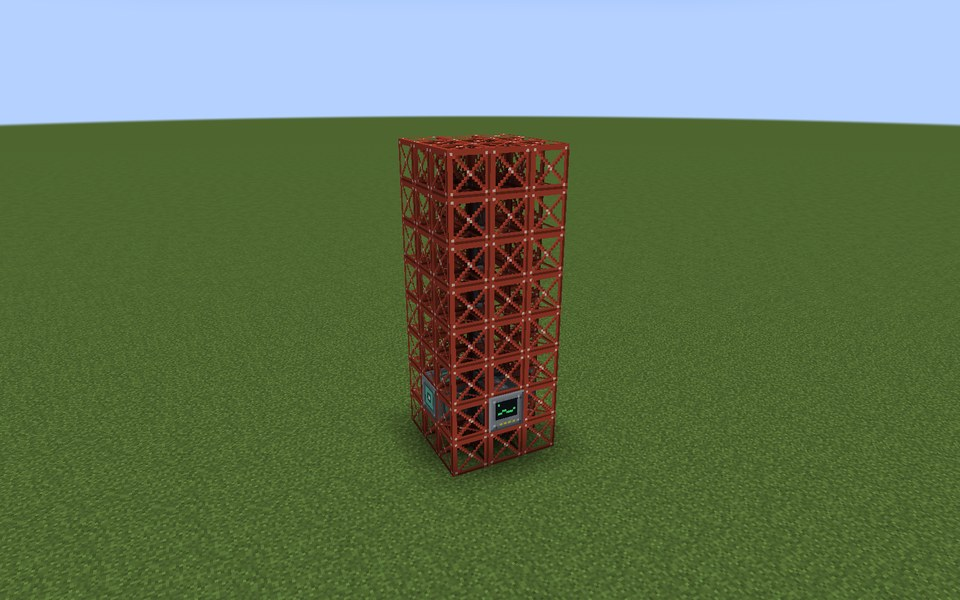

### In operation

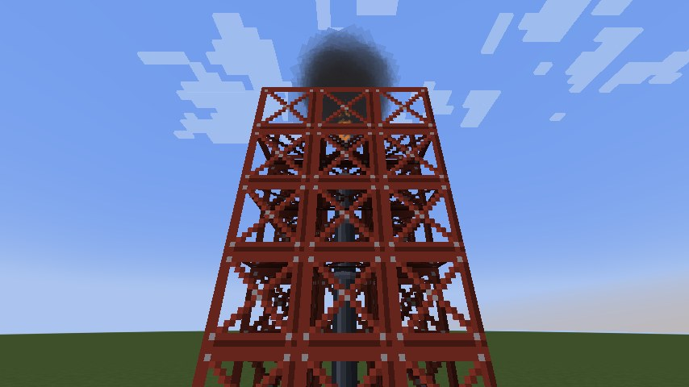
