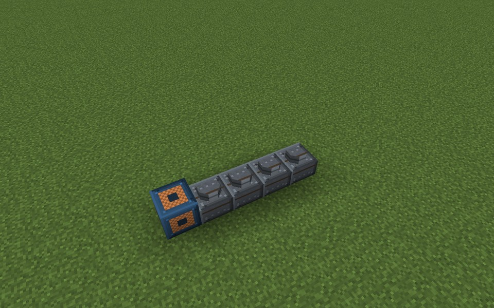
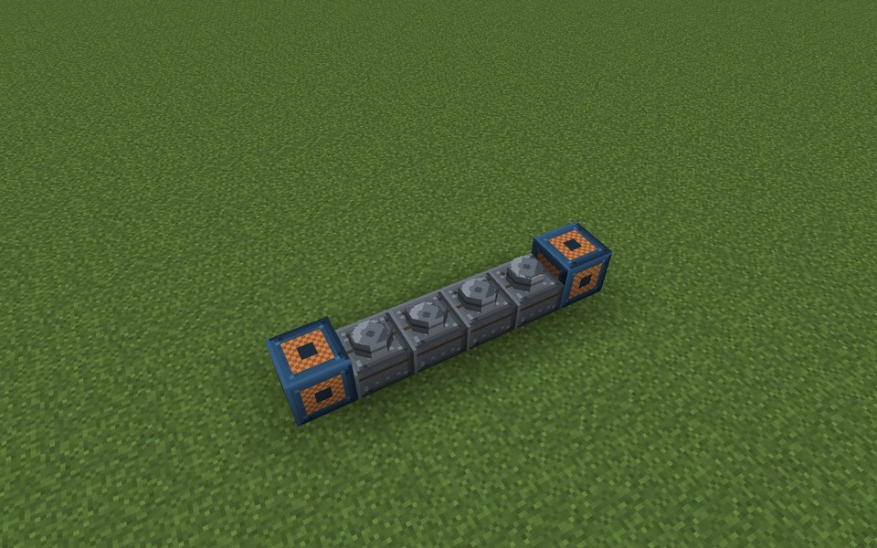
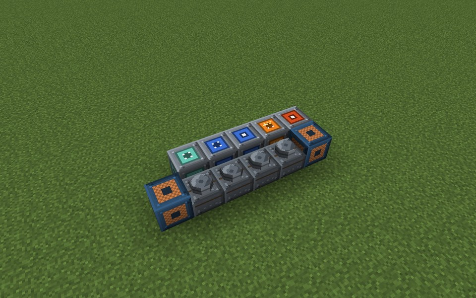
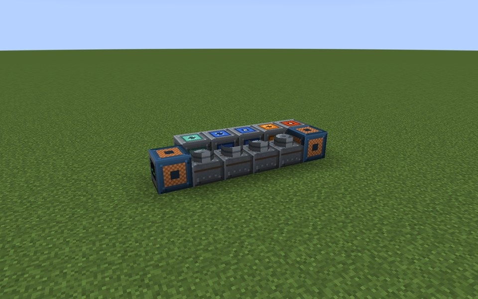
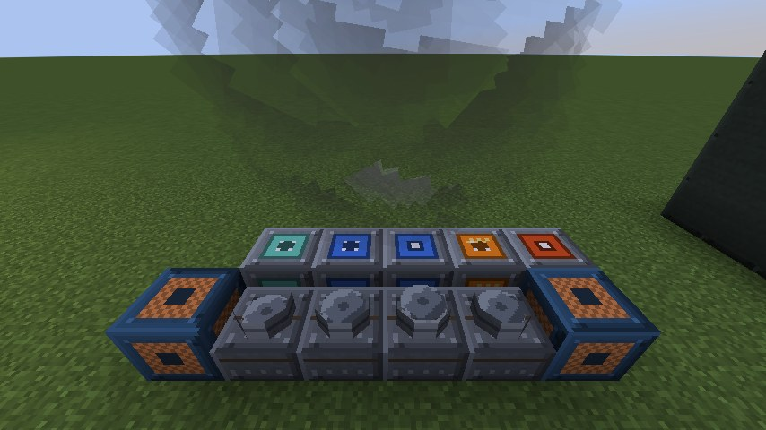

# Gas Engine

The Gas Engine is a piston engine with a generator: a compact, load-following plant for Syngas, Hydrogen or Natural Gas. It is a
straight line of blocks instead of a box, starts in two seconds and follows the demand. Its exhaust heat can feed a
boiler or heat store through a Heat Port; its cooling water leaves as Hot Coolant.

* **Output:** up to 80 E/t per Engine Cylinder. The output follows its target with a ramp of about two seconds.
* **Fuel:** Syngas (4 HU/mB), Hydrogen (6 HU/mB) or Natural Gas (8 HU/mB); with oxygen (oxyfuel, 1 mB per 2 mB fuel) a fifth less fuel for the same power. Electrical efficiency 32 %; Hydrogen above 75 % load knocks and
  drops to 26 %. At full load one cylinder burns 62.5 mB/t Syngas.
* **Heat:** 60 % of the waste heat leaves as exhaust heat through Heat Ports (what nobody takes is vented), the rest
  heats the engine block. Above 80 °C the thermostat opens and cooling water (up to 12 mB/t per cylinder) carries the
  heat away as Hot Coolant. Without cooling the engine derates above 110 °C and stops at 130 °C.
* **Tanks and buffer:** 32,000 mB fuel, 8,000 mB water, 8,000 mB Hot Coolant, 200,000 E.

The example below has the Gas Engine Controller facing west, four Engine Cylinders behind it and the Engine Generator
at the end, with a Gas Input, Fluid Input, Fluid Output, Heat Port and Energy Output Port beside the line. It delivers
up to 320 E/t.

## Rules
* **Shape:** the Gas Engine Controller faces outward (sideways, not up or down). Straight behind it lie 1 to 8 Engine
  Cylinders in a line, closed by exactly one Engine Generator.
* **Ports:** port blocks that touch a cylinder or the generator (any side) join the engine. Ports that touch only the
  controller do not count. Allowed:
  * Gas Input Port: Syngas, Hydrogen or Natural Gas in, and oxygen for oxyfuel.
  * Energy Output Port: energy out.
  * Heat Port: exhaust heat out to an adjacent Heat Port or Stirling Generator.
  * Fluid Input Port: cooling water in. Fluid Output Port: Hot Coolant out.
* **No casing, no walls, no interior.**
* **Required:** at least 1 Engine Cylinder and the Engine Generator.

## Running it
Pipe in fuel and water, connect a cable to an Energy Output Port, then switch the engine on with **I/O** (it cranks for
40 ticks before it runs). The screen shows state ("Off", "Cranking", "Running", "No fuel", "Overheated, stopped"),
mode, energy, fuel, water, Hot Coolant, output, load target, setpoint, maximum output, fuel flow, exhaust heat, engine
block temperature, efficiency and cylinders.

* **Mode (`>`):** "Follow demand (own buffer)" (default) runs at full load while the buffer is at most 20 % full and
  idles when it is 80 % full; "Fixed setpoint" runs at the setpoint (`-`/`+` by 60 E/t).
* When the buffer is full the engine idles down instead of wasting fuel.
* After an overheat stop it can be started again only below 70 °C. Smoke at the controller warns above 110 °C.
* The engine has no explosion or other incident.
* Fuel use scales with `fuelConsumptionMultiplier`, output with `generatorOutputMultiplier`.

**CC: Tweaked:** readings `powerOutput()`, `energyStored()`, `fuelLevel()` (mB), `temperature()`, `reactorState()`;
commands `start()`, `shutdown()`, `setPowerSetpoint(ePerTick)` (0 to 80 per cylinder), `setFollowDemand(boolean)`.

## Common error messages
| Message | What to do |
|---|---|
| The controller must sit in a wall, front facing out | Turn the controller so it faces sideways, away from the line. |
| Missing parts: engine_cylinder:1 | Put at least one Engine Cylinder directly behind the controller. |
| The line behind the controller must end with engine_generator (near (position)) | Close the cylinder line with an Engine Generator; nothing else may interrupt the line. |
| Structure too large or not closed near (position) | More than 8 cylinders: shorten the line. |
| Part of the structure is not loaded (position) | Load the chunks of the whole engine. |

## Step by step

The example below is 6 wide, 1 high and 2 deep. The example forms as shown (checked in the game when the pictures were taken).

**All parts of the example:**

| | Key | Block | Count |
|---|---|---|---|
|  | B | Engine Cylinder | 4 |
|  | H | Energy Output Port | 1 |
|  | C | Engine Generator | 1 |
|  | E | Fluid Input Port | 1 |
|  | F | Fluid Output Port | 1 |
|  | A | Gas Engine Controller | 1 |
|  | D | Gas Input Port | 1 |
|  | G | Heat Port | 1 |

### Step 1: Controller and cylinders

Parts in this step: Engine Cylinder (B) ×4, Gas Engine Controller (A) ×1

### Step 2: Generator at the end

Parts in this step: Engine Generator (C) ×1

### Step 3: Ports beside the line

Parts in this step: Energy Output Port (H) ×1, Fluid Input Port (E) ×1, Fluid Output Port (F) ×1, Gas Input Port (D) ×1, Heat Port (G) ×1

### Finished

### In operation

