# Gas Turbine

The Gas Turbine burns fuel gas (Syngas, Hydrogen or Natural Gas) and drives a generator on one shaft: compressor, combustion,
turbine, generator, in this order from the controller wall to the back. Half of the fuel heat leaves as hot exhaust;
a Heat Port hands it to an Industrial Boiler next to it, whose steam drives a Steam Turbine (combined cycle).

* **Fuel:** Natural Gas 8 HU/mB, Hydrogen 6 HU/mB, Syngas 4 HU/mB. Gas compressed in a Gas Compressor gives 25 % more (Hydrogen 7, Syngas
  5 HU/mB). Syngas comes from the Gasifier, Hydrogen from the Electrolyzer, Natural Gas from a Gas Derrick.
* **Oxyfuel:** Oxygen through the same Gas Input Port goes into its own tank; with 1 mB oxygen per 2 mB fuel the gas gives 25 % more heat. Natural gas at full fuel flow is limited by the turbine blades (450 E/t each): add blades or lower the setpoint.
* **Fuel flow** is limited by the setpoint, by the Combustion Liners (150 mB/t each) and by the air of the Compressor
  Blades (75 mB/t each): the lower of the two limits counts.
* **Shaft:** up to 45 % of the fuel heat reaches the rotor (times the blade efficiency, at most 450 E/t per Rotor
  Blade). 50 % leaves as exhaust heat through Heat Ports; exhaust nobody takes goes up the stack.
* **Coils:** each Generator Coil takes up to 600 E/t out of the rotor, scaled with the speed (rated speed 3,600 rpm).
* **Tank and buffer:** 32,000 mB fuel, 2,000,000 E. Energy Output Ports push the energy into neighbors.

The example below is 5x5x7: behind the controller wall one slice of four Compressor Blades, one slice of four
Combustion Liners, two slices of four Rotor Blades and one slice of four Generator Coils, with the Rotor Shaft through
the center. It burns at most 300 mB/t (the compressor limit).

## Rules
* **Size:** at least 5x5x6 (width x height x depth), at most 16 in every direction (`maxStructureSize`). Width and
  height must be odd.
* **Frame (edges and corners):** Gas Turbine Casing only.
* **Walls:** Gas Turbine Casing, Turbine Sight Glass, Inspection Hatch, plus controller and ports (in the faces, not
  on edges).
* **Ports:**
  * Gas Input Port: fuel gas in.
  * Energy Output Port: energy out.
  * Heat Port: exhaust heat out to an adjacent Heat Port (e.g. of an Industrial Boiler or Molten-Salt Store) or a
    Stirling Generator.
* **Inside:**
  * The center line from the controller wall to the back wall must be Rotor Shaft all the way (controller on an end
    wall of the shaft).
  * Everything else: air, Compressor Blades, Combustion Liners, Rotor Blades, Generator Coils.
  * Each slice across the shaft holds only one kind of stage part. Going from the controller wall inwards the stages
    must come in the order compressor, combustion, turbine (Rotor Blades), generator. Each stage may use several
    slices; slices with only air may sit anywhere.
* **Required:** at least 1 Compressor Blade, 1 Combustion Liner, 1 Rotor Blade and 1 Generator Coil.
* **Controller:** the Gas Turbine Controller faces out; the block right behind it must be an interior block.

## Running it
Pipe fuel gas in, connect a cable to the Energy Output Port and, for combined cycle, put a boiler's Heat Port right
against the turbine's Heat Port. The screen shows fuel, energy, speed, fuel flow and setpoint, power, efficiency,
exhaust heat, generator and protection state.

* **Fuel setpoint:** `-`/`+` change it by 5 mB/t (default 150 mB/t, at most the fuel limit above).
* **I/O** engages or disengages the generator; **S** switches the overspeed trip.
* Overspeed works like in the Steam Turbine, at higher speeds: warning above 4,200 rpm, trip above 4,800 rpm (valve
  opens again below 3,600 rpm). With the trip off the blades wear above 4,800 rpm and the rotor finally bursts in an
  explosion (blocks only with `incidentTerrainDamage`; the trip cannot be switched off in `safeMode`).
* Fuel use scales with `fuelConsumptionMultiplier`, output with `generatorOutputMultiplier`.

**CC: Tweaked:** readings `turbineRpm()`, `powerOutput()`, `energyStored()`, `fuelLevel()` (mB); commands
`setFuelFlow(mbPerTick)`, `setGenerator(boolean)`, `setOverspeedTrip(boolean)`.

## Common error messages
| Message | What to do |
|---|---|
| The controller must sit in a wall, front facing out | Put the controller in the compressor-end wall of the shaft, facing out. |
| Structure too small ((size)) | Build at least 5 wide, 5 high, 6 deep. |
| The turbine cross-section must be odd ((size)) | Make width and height odd. |
| Stages out of order near (position) (compressor, combustion, turbine, generator) | Reorder the slices: compressor nearest the controller, generator at the back. |
| Blades and coils in the same slice near (position) | Each slice may hold only one kind of stage part. |
| Wrong block at (position) (expected: rotor_shaft) | Complete the Rotor Shaft along the center line. |
| Missing parts: (part:count) | Add the missing stage (each needs at least one block). |
| Port not allowed here: (position) ((port type)) | Only gas in, energy out and Heat Ports work here. |
| Structure too large or not closed near (position) | Close the box or keep it within `maxStructureSize`. |

## Sight glass

Every wall block that is not on an edge may be **Turbine Sight Glass** instead of the casing. The plant works the same, and through the glass you see what happens inside while it runs. The example below has Turbine Sight Glass in its left side (the long side, so all stages are seen at once).

## Step by step

The example below is 5 wide, 5 high and 7 deep. The example forms as shown (checked in the game when the pictures were taken).

Each step shows the plant from the front left after one more layer is placed (from the bottom up), and a top-down map of that layer: the back of the plant at the top, the front with the controller at the bottom. The letters match the parts lists.

**All parts of the example:**

| | Key | Block | Count |
|---|---|---|---|
| 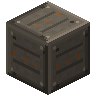 | A | Gas Turbine Casing | 111 |
| 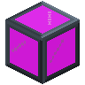 | C | Turbine Sight Glass | 15 |
| 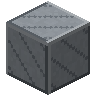 | F | Rotor Blade | 8 |
| 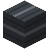 | H | Rotor Shaft | 5 |
| 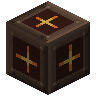 | E | Combustion Liner | 4 |
| 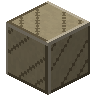 | D | Compressor Blade | 4 |
| 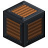 | G | Generator Coil | 4 |
| 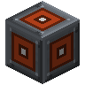 | K | Energy Output Port | 1 |
| 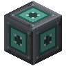 | I | Gas Input Port | 1 |
| 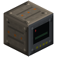 | B | Gas Turbine Controller | 1 |
| 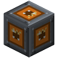 | J | Heat Port | 1 |

### Step 1: Layer 1

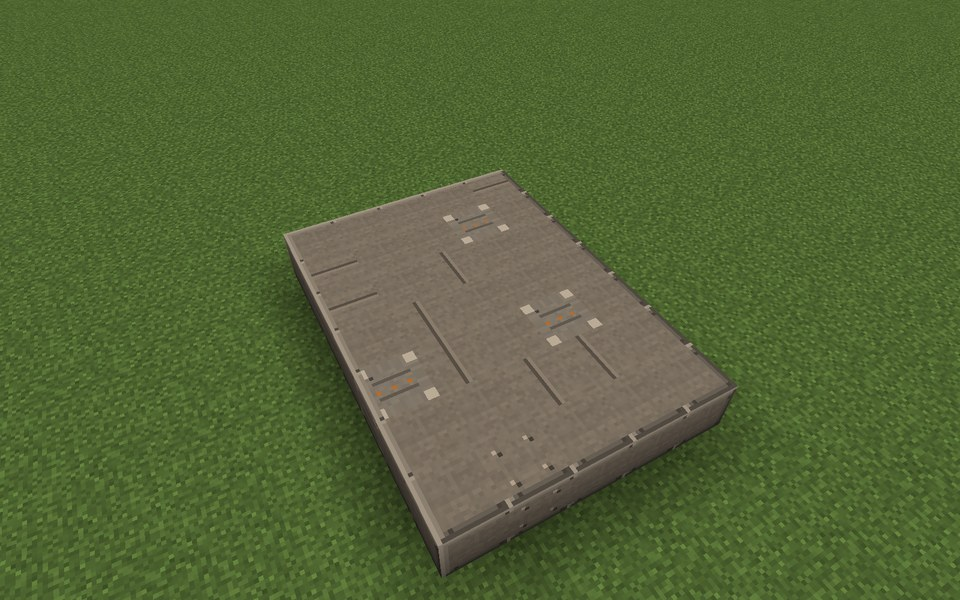

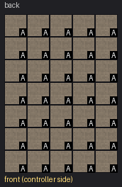

Parts in this step: Gas Turbine Casing (A) ×35

### Step 2: Layer 2

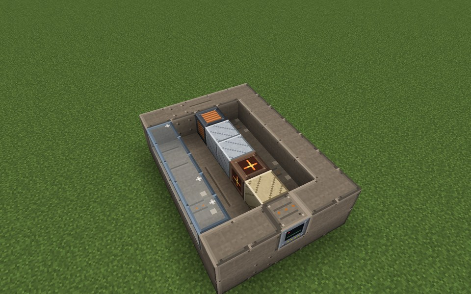

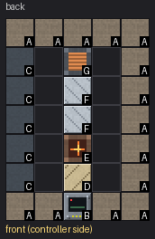

Parts in this step: Combustion Liner (E) ×1, Compressor Blade (D) ×1, Gas Turbine Casing (A) ×14, Gas Turbine Controller (B) ×1, Generator Coil (G) ×1, Rotor Blade (F) ×2, Turbine Sight Glass (C) ×5

### Step 3: Layer 3

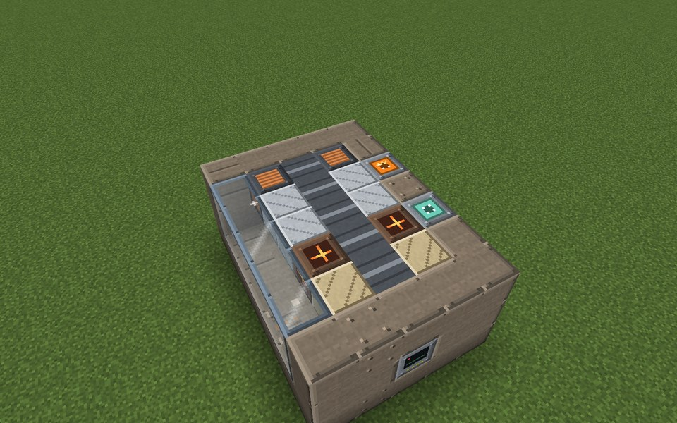

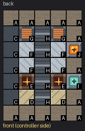

Parts in this step: Combustion Liner (E) ×2, Compressor Blade (D) ×2, Gas Input Port (I) ×1, Gas Turbine Casing (A) ×13, Generator Coil (G) ×2, Heat Port (J) ×1, Rotor Blade (F) ×4, Rotor Shaft (H) ×5, Turbine Sight Glass (C) ×5

### Step 4: Layer 4

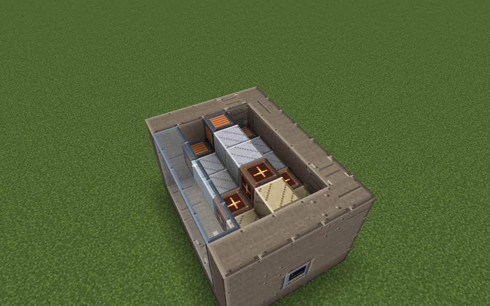

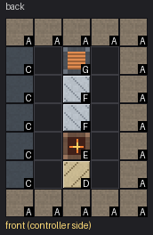

Parts in this step: Combustion Liner (E) ×1, Compressor Blade (D) ×1, Gas Turbine Casing (A) ×15, Generator Coil (G) ×1, Rotor Blade (F) ×2, Turbine Sight Glass (C) ×5

### Step 5: Layer 5

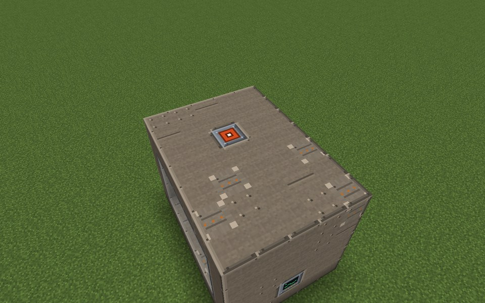

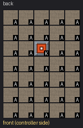

Parts in this step: Energy Output Port (K) ×1, Gas Turbine Casing (A) ×34

### Finished

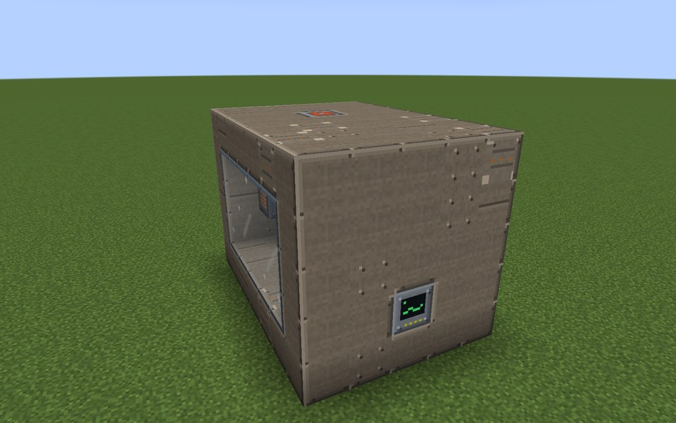

### In operation

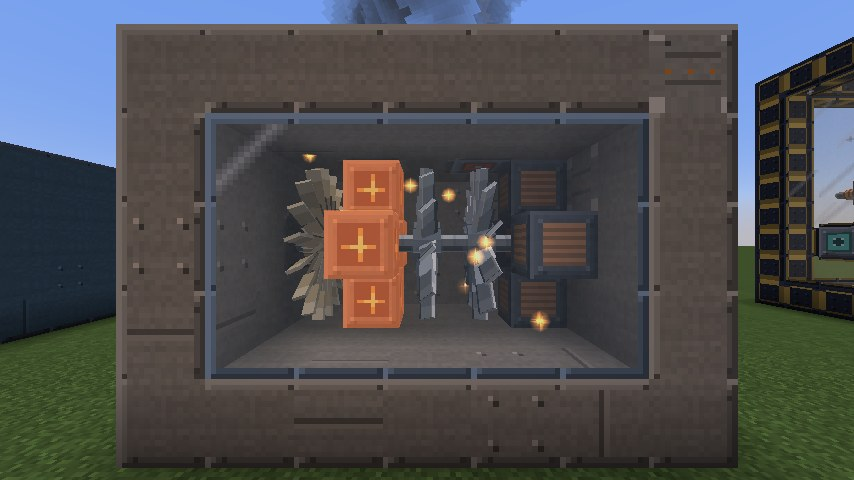
