# Gasifier

The Gasifier turns solid fuel and steam into Syngas and Ash. Syngas is the fuel of the Gas Turbine (combined cycle
with a boiler), the Gas Engine and, less efficiently, the Industrial Boiler.

* **Batches:** every Reaction Chamber runs one batch at a time. A batch takes 160 ticks (8 seconds), consumes one fuel
  item and 250 mB steam and then releases its Syngas. The chambers all start together when the previous batches have
  finished.
* **Syngas per item:** Coal or Charcoal 34,000 mB, Block of Coal 306,000 mB, Biomass 7,000 mB (divided by
  `fuelConsumptionMultiplier`). Which items count is set by the item tags `quantavolt:gasifier_fuel/coal`,
  `quantavolt:gasifier_fuel/coal_block` and `quantavolt:gasifier_fuel/biomass`.
* **Ash:** one Ash for every four fuel items, into a 4-slot output.
* **Tanks:** 16,000 mB steam, 64,000 mB Syngas; 9 fuel slots. A finished batch waits while the Syngas tank is full.

Steam comes from an Industrial Boiler (or any steam in `#quantavolt:steam`). The steam a batch needs is small compared
with the fuel value of the Syngas it makes.

The example below is the smallest gasifier, 3x4x3, with two Reaction Chambers stacked inside: two batches at once,
so up to two fuel items and 500 mB steam every 8 seconds.

## Rules
* **Size:** at least 3x4x3 (width x height x depth), at most 16 in every direction (`maxStructureSize`).
* **Frame (edges and corners):** Gasifier Casing only.
* **Walls:** Gasifier Casing, Boiler Sight Glass, Inspection Hatch, plus controller and ports (in the faces, not on
  edges).
* **Ports:**
  * Item Input Port: fuel in.
  * Fluid Input Port: steam in.
  * Gas Output Port: Syngas out (Pipster gas pipe).
  * Item Output Port: Ash out.
* **Inside:** air and Reaction Chambers, anywhere.
* **Required:** at least 1 Reaction Chamber.
* **Controller:** the Gasifier Controller faces out; the block right behind it must be an interior block.

## Running it
Feed fuel and steam, pull Syngas out through a gas pipe and take the Ash out. The gasifier has no buttons; its screen
(controller or Inspection Hatch) shows steam, Syngas, batch progress, active batches, Reaction Chambers and Ash.

* Batches only start when there is fuel and at least 250 mB steam per chamber that starts.
* The gasifier never overheats and has no incidents.
* Fuel and Ash drop when the controller is broken.

**CC: Tweaked:** the controller is a `quantavolt` peripheral; `getInfo()` returns the screen values. The gasifier has
no commands.

## Common error messages
| Message | What to do |
|---|---|
| The controller must sit in a wall, front facing out | Place the controller in a wall face, front facing out, with the interior behind it. |
| Structure too small ((size)) | Build at least 3 wide, 4 high, 3 deep. |
| Wrong block at (position) (expected: (allowed parts)) | Edges need Gasifier Casing; inside only air and Reaction Chambers. |
| Missing parts: (part:count) | Put at least one Reaction Chamber inside. |
| Port not allowed here: (position) ((port type)) | Only item in/out, fluid in and gas out ports work here. |
| Structure too large or not closed near (position) | Close the box or keep it within `maxStructureSize`. |
| Second controller at (position) | Remove the extra controller. |

## Sight glass

Every wall block that is not on an edge may be **Boiler Sight Glass** instead of the casing. The plant works the same, and through the glass you see what happens inside while it runs. The example below has Boiler Sight Glass in its front.

## Step by step

The example below is 3 wide, 4 high and 3 deep. The example forms as shown (checked in the game when the pictures were taken).

Each step shows the plant from the front left after one more layer is placed (from the bottom up), and a top-down map of that layer: the back of the plant at the top, the front with the controller at the bottom. The letters match the parts lists.

**All parts of the example:**

| | Key | Block | Count |
|---|---|---|---|
| 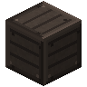 | A | Gasifier Casing | 28 |
| 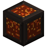 | D | Reaction Chamber | 2 |
| 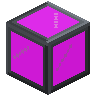 | G | Boiler Sight Glass | 1 |
|  | E | Fluid Input Port | 1 |
|  | H | Gas Output Port | 1 |
| 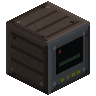 | B | Gasifier Controller | 1 |
|  | C | Item Input Port | 1 |
|  | F | Item Output Port | 1 |

### Step 1: Layer 1

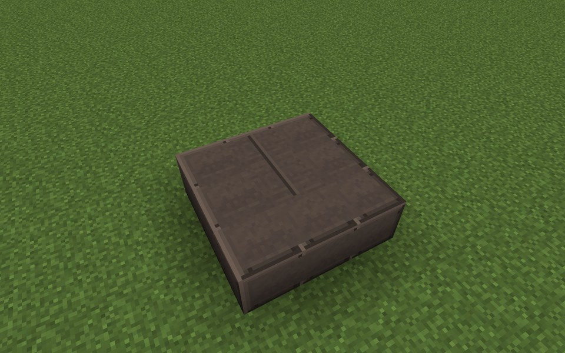

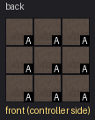

Parts in this step: Gasifier Casing (A) ×9

### Step 2: Layer 2

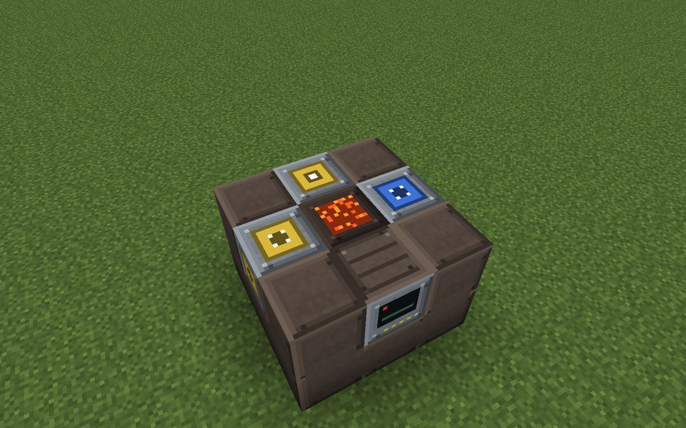

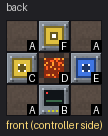

Parts in this step: Fluid Input Port (E) ×1, Gasifier Casing (A) ×4, Reaction Chamber (D) ×1, Gasifier Controller (B) ×1, Item Input Port (C) ×1, Item Output Port (F) ×1

### Step 3: Layer 3

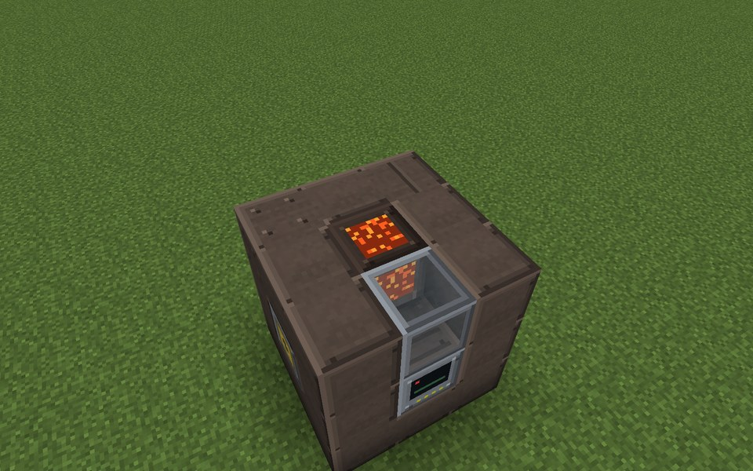

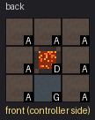

Parts in this step: Boiler Sight Glass (G) ×1, Gasifier Casing (A) ×7, Reaction Chamber (D) ×1

### Step 4: Layer 4

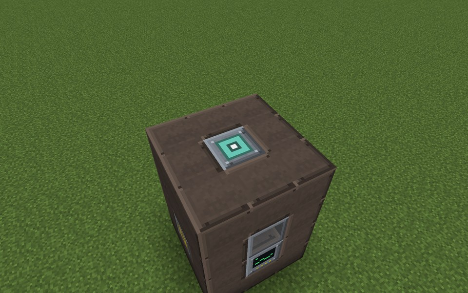

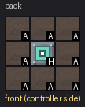

Parts in this step: Gas Output Port (H) ×1, Gasifier Casing (A) ×8

### Finished

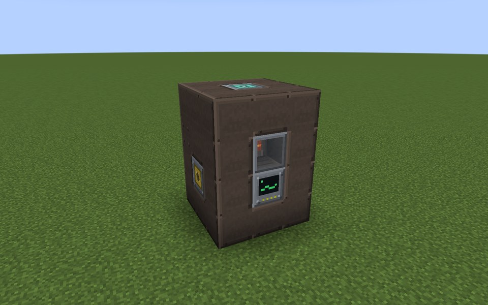
