# Gravity Store

The Gravity Store keeps energy as height: charging lifts Gravity Weights up the shaft, discharging lowers them through
the winch motor-generators. It has no self-discharge and no heat; it is a simple, safe store for the mid game.

* **Capacity:** weights x lift height x 20,000 E (`gravityEnergyPerWeightBlock`). The lift height is the interior
  height above the weight layer (shaft height minus 3).
* **Rate** in each direction: the lower of 2,500 E/t per Gravity Winch and the lifting speed of the weights
  (1,000 E/t per weight with the default energy per block).
* **Efficiency:** 90 % in each direction.
* The stored energy decides the drawn height of the weights, so you can see the charge through sight glass.

The example below is a shaft 3x7x3: one Gravity Weight on the shaft floor, four blocks of free lift above it and one
Gravity Winch in the roof. It stores 80,000 E at up to 1,000 E/t.

## Rules
* **Size:** at least 3 wide, 5 high, 3 deep. Width and depth at most 16 (`maxStructureSize`), height at most 64.
* **Frame (edges and corners):** Gravity Shaft Casing only.
* **Walls:** Gravity Shaft Casing, Turbine Sight Glass, Inspection Hatch, Gravity Winch, plus controller and ports (in
  the faces, not on edges).
* **Winches:** Gravity Winches belong in the roof only (anywhere in the roof face, not on its edges).
* **Ports:**
  * Energy Input Port: charging.
  * Energy Output Port: discharging (pushed out, within the rate).
* **Inside:** Gravity Weights on the lowest interior layer only; everything above them must be air (the weights travel
  there).
* **Required:** at least 1 Gravity Weight and 1 Gravity Winch.
* **Controller:** the Gravity Store Controller faces out; the block right behind it must be an interior block (air
  above the weights is fine).

## Running it
Connect generators to the Energy Input Port and consumers to the Energy Output Port; the store does the rest. It has no
buttons. Its screen shows energy, weights, lift height, the current height of the weights, winches, rate, input and
output.

* A tall shaft stores more, but the rate grows only with winches and weights: each winch carries 2,500 E/t, each
  weight 1,000 E/t, and the smaller total is the rate.
* The store has no incidents.

**CC: Tweaked:** readings `energyStored()`, `powerOutput()`. No commands.

## Common error messages
| Message | What to do |
|---|---|
| Winches belong in the roof of the shaft ((position)) | Move that Gravity Winch into the roof. |
| Wrong block at (position) (expected: air) | Something stands above the weight layer; only weights on the floor, air above. |
| Missing parts: (part:count) | Add at least one Gravity Weight and one Gravity Winch. |
| Structure too small ((size)) | Build at least 3 wide, 5 high, 3 deep. |
| Structure too large or not closed near (position) | Close the shaft, or keep it within 16 wide/deep and 64 high. |
| Port not allowed here: (position) ((port type)) | Only energy ports work here. |
| The controller must sit in a wall, front facing out | Place the controller in a side wall, front facing out, with the shaft behind it. |

## Sight glass

Every wall block that is not on an edge may be **Turbine Sight Glass** instead of the casing. The plant works the same, and through the glass you see what happens inside while it runs. The example below has Turbine Sight Glass in its front.

## Step by step

The example below is 3 wide, 7 high and 3 deep. The example forms as shown (checked in the game when the pictures were taken).

Each step shows the plant from the front left after one more layer is placed (from the bottom up), and a top-down map of that layer: the back of the plant at the top, the front with the controller at the bottom. The letters match the parts lists.

**All parts of the example:**

| | Key | Block | Count |
|---|---|---|---|
|  | A | Gravity Shaft Casing | 50 |
|  | B | Turbine Sight Glass | 4 |
|  | E | Energy Input Port | 1 |
|  | F | Energy Output Port | 1 |
|  | D | Gravity Store Controller | 1 |
|  | C | Gravity Weight | 1 |
|  | G | Gravity Winch | 1 |

### Step 1: Layer 1

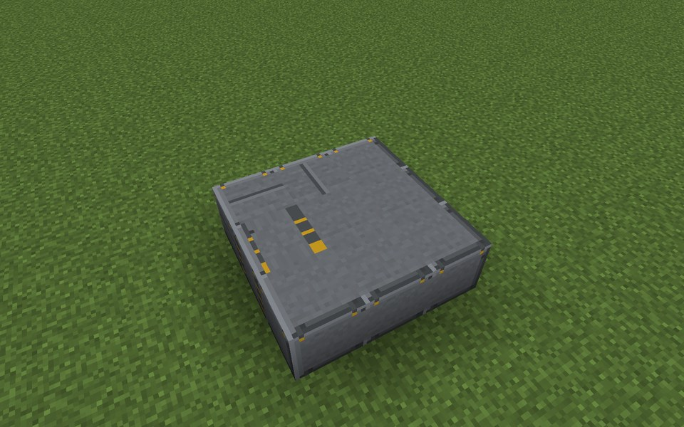

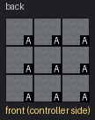

Parts in this step: Gravity Shaft Casing (A) ×9

### Step 2: Layer 2

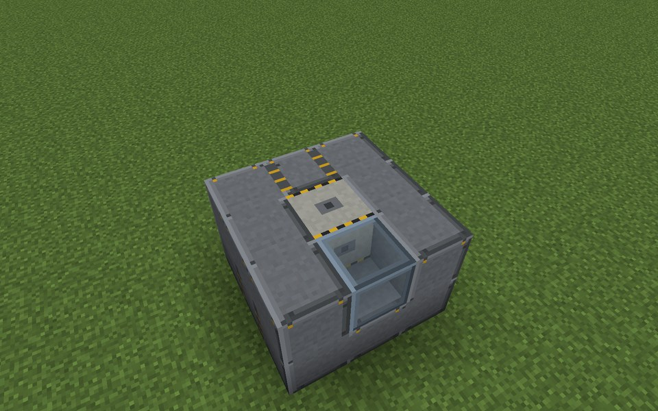

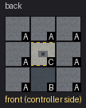

Parts in this step: Gravity Shaft Casing (A) ×7, Gravity Weight (C) ×1, Turbine Sight Glass (B) ×1

### Step 3: Layer 3

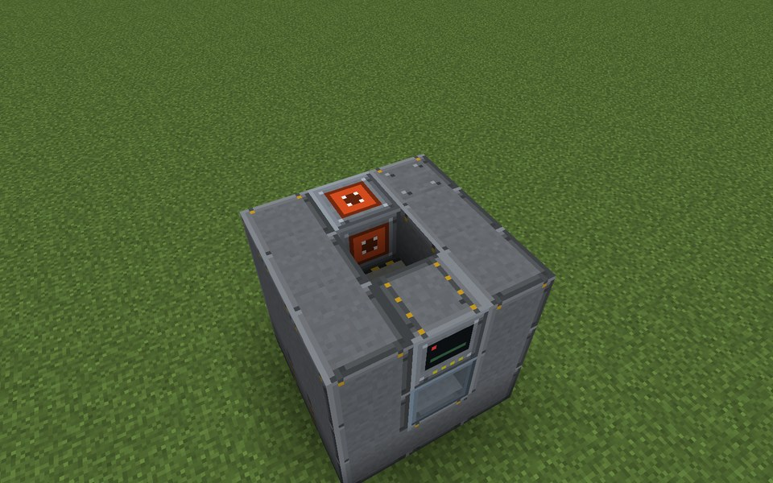

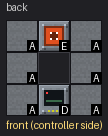

Parts in this step: Energy Input Port (E) ×1, Gravity Shaft Casing (A) ×6, Gravity Store Controller (D) ×1

### Step 4: Layer 4

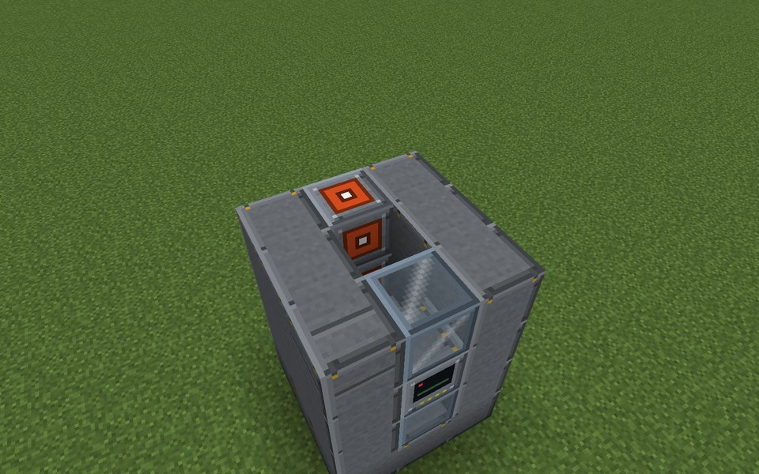

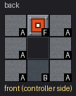

Parts in this step: Energy Output Port (F) ×1, Gravity Shaft Casing (A) ×6, Turbine Sight Glass (B) ×1

### Step 5: Layers 5–6 (identical)

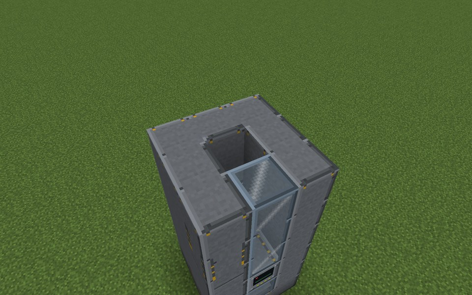

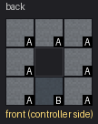

Place this layer 2 times on top of each other.

Parts in this step: Gravity Shaft Casing (A) ×14, Turbine Sight Glass (B) ×2

### Step 6: Layer 7

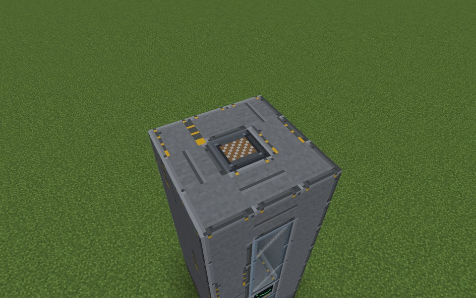

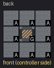

Parts in this step: Gravity Shaft Casing (A) ×8, Gravity Winch (G) ×1

### Finished

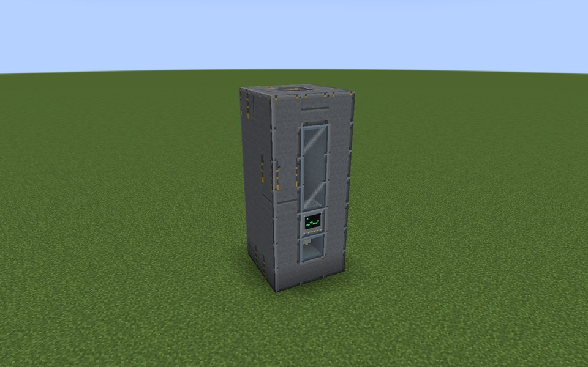

### In operation

From the left: Battery Hall, Molten-Salt Store and Gravity Store, each with a sight-glass front.
