# Hawking Reactor

The Hawking Reactor takes power straight from the evaporation of a tiny singularity. It starts from a Singularity
Capsule split off a Micro Black Hole Plant and then lives on Compressed Matter. A smaller singularity evaporates
faster and gives more power, but the operating point is unstable: the control has to feed back exactly what
evaporates, and the Matter Injectors limit how much it can feed.

* **Power:** the singularity loses 0.4 / mass² ME per tick; the Radiation Collectors turn 90 % of that mass energy
  into electricity (one ME = 10,000,000 E, `energyPerMassUnit`). Hot collectors catch less.
* **Feed:** each Matter Injector feeds up to 0.05 ME/t. The screen shows the safe power these injectors can sustain:
  about 405,000 E/t per injector with the default config.
* **Start:** a capsule (3 ME) in the Item Input Port starts an empty reactor; it then charges 100,000,000 E from the
  input buffer (1,000,000,000 E). Containment costs 50,000 E/t, from the input buffer first, then from the output
  buffer (200,000,000 E).
* **Cooling:** 5 % waste heat goes into the collectors; Coolant Channels carry it away as Hot Coolant, up to
  400 mB/t water per channel. At 40,000 HU of collector heat per Coolant Channel the reactor shuts down safely.
* Matter storage: 1,000 ME.

The example below is 7x7x7: vacuum within one block of the center, 74 Radiation Collectors and 24 Coolant Channels
around it, one Matter Injector and the Gravimetry block in the side walls. It has no Energy Input Port, so add one
before you insert a capsule: the start charge and the containment come only through it.

## Rules
* **Size:** a cube with an odd edge, at least 7x7x7, at most `maxStructureSize` (default 16, so 15 is the largest odd
  edge).
* **Frame (edges and corners):** Singularity Frame only.
* **Walls:** Singularity Casing, Reactor Sight Glass, Inspection Hatch, Matter Injector, Gravimetry, plus controller
  and ports (in the faces, not on edges).
* **Ports:**
  * Energy Input Port: start charge and containment. Energy Output Port: output.
  * Item Input Port: Singularity Capsules and Compressed Matter in.
  * Fluid Input Port: water in. Fluid Output Port: Hot Coolant out.
* **Inside:** air within one block of the center (largest axis difference 0 or 1); everywhere else Radiation
  Collectors or Coolant Channels, no air.
* **Required:** at least 1 Radiation Collector, 1 Matter Injector and 1 Gravimetry (the control needs it).

## Running it
Charge the input buffer, load Compressed Matter, connect water and a Hot Coolant drain, set the power setpoint, then
put a Singularity Capsule into the Item Input Port. Phases: empty, starting, running, shutting down.

* **Setpoint:** `-`/`+` by 250,000 E/t (default 1,000,000 E/t). The control steers the mass towards the one that gives
  this power. **Keep the setpoint below the shown safe power:** above it the injectors cannot keep up, the
  singularity shrinks faster and faster and evaporates. With one injector the default setpoint is already too high.
* **Stop** feeds the singularity up to a safe size (needs matter) and dissolves it through the collectors.
  **Reset** clears a failure once the collectors have cooled down.
* **Failures:** evaporation, no matter or lost containment end in a radiation flash that hurts living things nearby
  (nothing in `safeMode`). Smoke warns of hot collectors, violet sparkles of low stability.
* The input slot holds one item stack: a capsule left in it while the reactor runs blocks the matter feed.

**CC: Tweaked:** readings `singularityMass()`, `stability()`, `powerOutput()`, `energyStored()`, `fuelLevel()` (ME),
`reactorState()`, `alarmState()`; commands `shutdown()`, `reset()`, `setPowerSetpoint(ePerTick)`.

## Common error messages
| Message | What to do |
|---|---|
| The Little Star must be a cube with odd edge length (is (size)) | This message appears for this plant too: make all edges equal and odd. |
| Wrong block at (position) (expected: air) | Keep the center and the blocks next to it empty. |
| Wrong block at (position) (expected: coolant_channel\|radiation_collector) | Fill the rest of the interior completely with collectors and coolant channels. |
| Missing parts: (part:count) | Add a Radiation Collector, a Matter Injector or the Gravimetry block. |
| Structure too small ((size)) | The edge must be at least 7. |
| Port not allowed here: (position) ((port type)) | Item output, gas and Heat Ports do not work here. |

## Sight glass

Every wall block that is not on an edge may be **Reactor Sight Glass** instead of the casing. The plant works the same, and through the glass you see what happens inside while it runs. The example below has Reactor Sight Glass in its front.

## Step by step

The example below is 7 wide, 7 high and 7 deep. The example forms as shown (checked in the game when the pictures were taken).

Each step shows the plant from the front left after one more layer is placed (from the bottom up), and a top-down map of that layer: the back of the plant at the top, the front with the controller at the bottom. The letters match the parts lists.

**All parts of the example:**

| | Key | Block | Count |
|---|---|---|---|
|  | B | Singularity Casing | 118 |
|  | E | Radiation Collector | 74 |
|  | A | Singularity Frame | 68 |
|  | F | Coolant Channel | 24 |
|  | C | Reactor Sight Glass | 24 |
|  | M | Energy Input Port | 1 |
|  | G | Energy Output Port | 1 |
|  | H | Fluid Input Port | 1 |
|  | J | Fluid Output Port | 1 |
|  | L | Gravimetry | 1 |
|  | D | Hawking Reactor Controller | 1 |
|  | I | Item Input Port | 1 |
|  | K | Matter Injector | 1 |

### Step 1: Layer 1

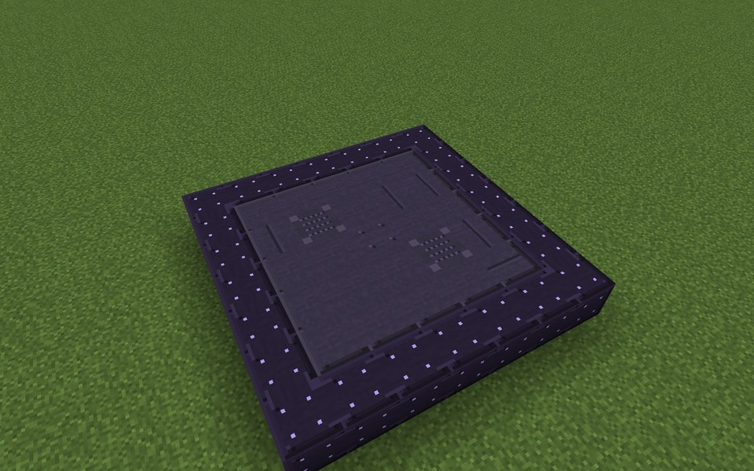

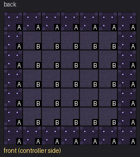

Parts in this step: Singularity Casing (B) ×25, Singularity Frame (A) ×24

### Step 2: Layer 2

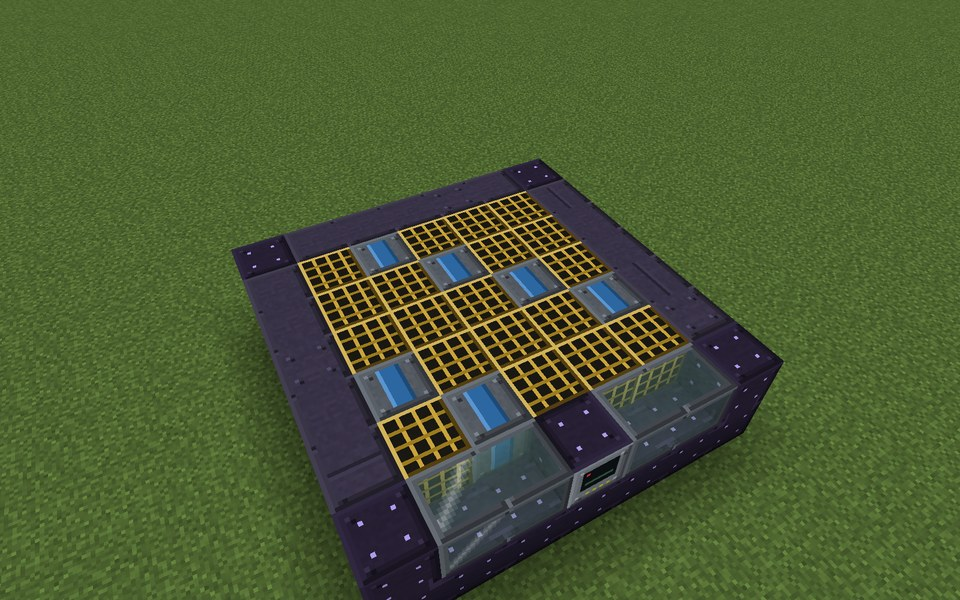

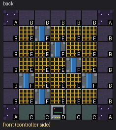

Parts in this step: Coolant Channel (F) ×6, Hawking Reactor Controller (D) ×1, Radiation Collector (E) ×19, Reactor Sight Glass (C) ×4, Singularity Casing (B) ×15, Singularity Frame (A) ×4

### Step 3: Layer 3

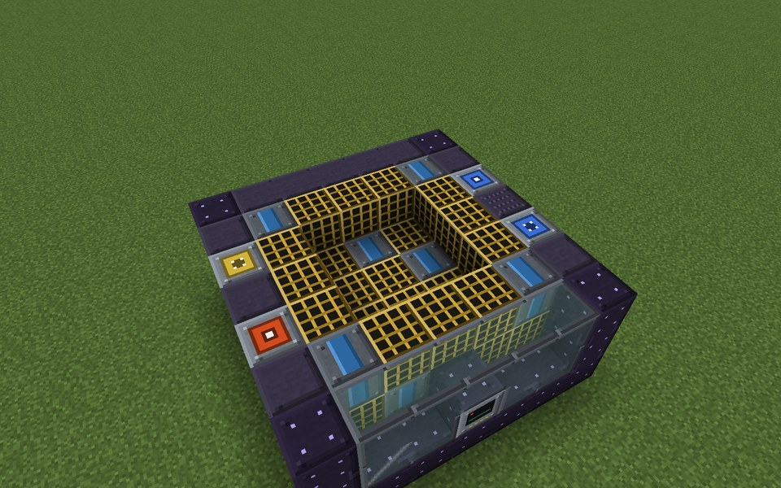

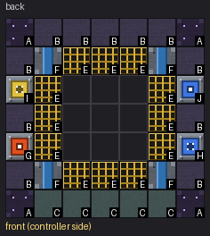

Parts in this step: Coolant Channel (F) ×4, Energy Output Port (G) ×1, Fluid Input Port (H) ×1, Fluid Output Port (J) ×1, Item Input Port (I) ×1, Radiation Collector (E) ×12, Reactor Sight Glass (C) ×5, Singularity Casing (B) ×11, Singularity Frame (A) ×4

### Step 4: Layer 4

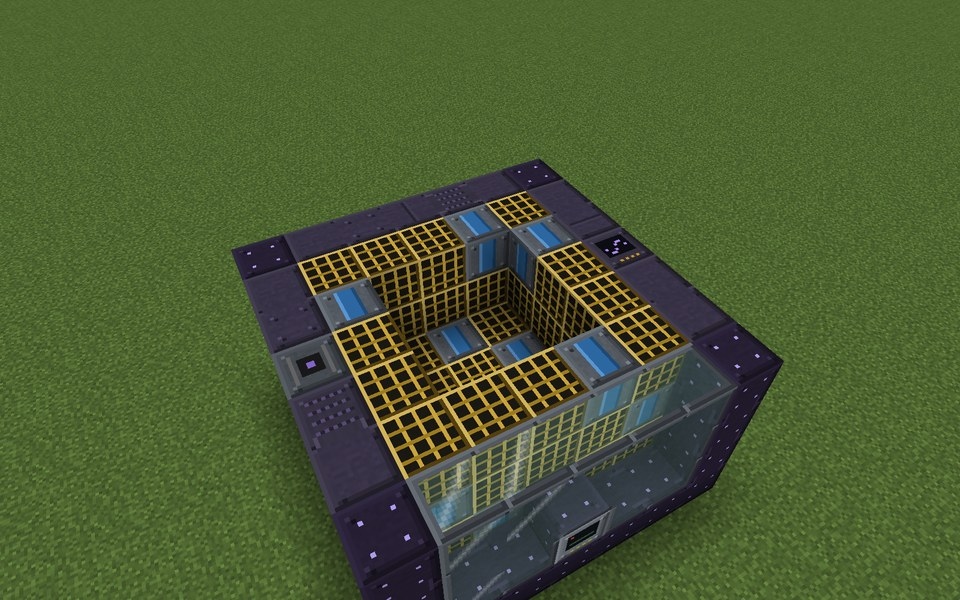

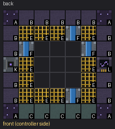

Parts in this step: Coolant Channel (F) ×4, Gravimetry (L) ×1, Matter Injector (K) ×1, Radiation Collector (E) ×12, Reactor Sight Glass (C) ×5, Singularity Casing (B) ×13, Singularity Frame (A) ×4

### Step 5: Layer 5

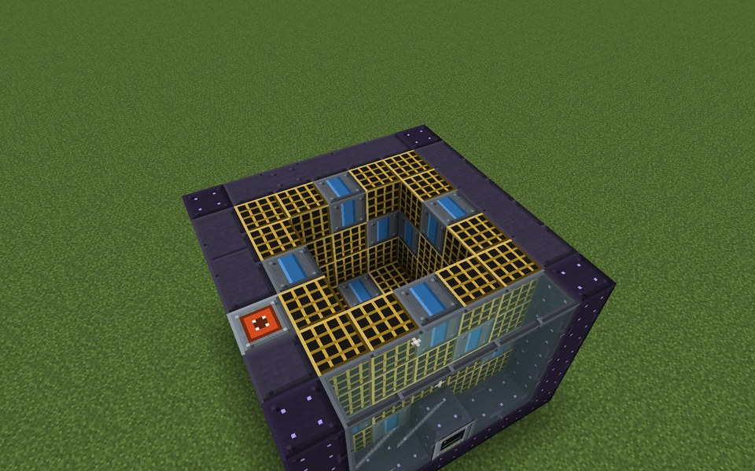

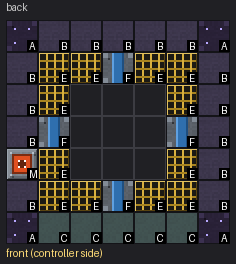

Parts in this step: Coolant Channel (F) ×4, Energy Input Port (M) ×1, Radiation Collector (E) ×12, Reactor Sight Glass (C) ×5, Singularity Casing (B) ×14, Singularity Frame (A) ×4

### Step 6: Layer 6

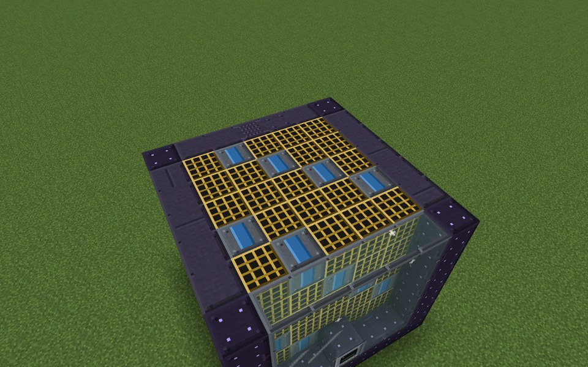

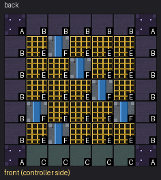

Parts in this step: Coolant Channel (F) ×6, Radiation Collector (E) ×19, Reactor Sight Glass (C) ×5, Singularity Casing (B) ×15, Singularity Frame (A) ×4

### Step 7: Layer 7

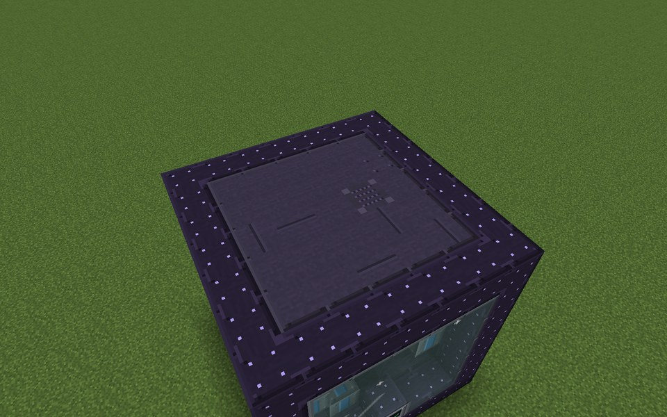

Parts in this step: Singularity Casing (B) ×25, Singularity Frame (A) ×24

### Finished

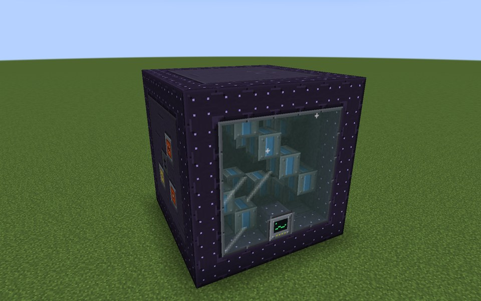

### In operation

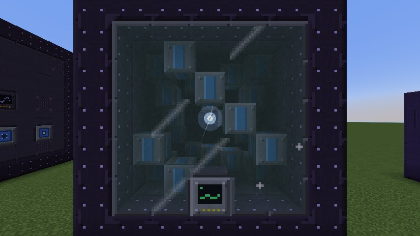
