# Industrial Boiler

The Industrial Boiler turns water into steam. It burns solid fuel (anything with a furnace burn time, plus Biomass) or
fuel gas (Syngas or Natural Gas) in its Combustion Chambers, or it takes heat from other plants through Heat Ports. Its steam drives the
Steam Turbine and the Gasifier.

* **Heat:** each Combustion Chamber burns up to 100 HU/t, but only while the boiler is below its setpoint. One
  burn tick of fuel gives 100 HU (coal: 160,000 HU), Biomass burns for 400 ticks. Syngas gives only 1 HU per mB here (Natural Gas 2 HU/mB; with oxygen 25 % more);
  the Gas Turbine uses it far better.
* **Steam:** above 100 °C the Heat Exchanger Tubes boil water, up to 40 mB/t steam per tube. The full rate is reached
  at 250 °C; below that it scales with the temperature. Water expands 1:10, so 1 mB water gives 10 mB steam and
  1 HU makes 1 mB steam.
* **Heat Ports** accept heat from a neighboring plant (gas turbine exhaust, gas engine, molten-salt store, tokamak,
  Little Star, solar receiver …), at most 40 HU/t per tube.
* **Tanks:** 16,000 mB water, 64,000 mB steam, 16,000 mB fuel gas (Syngas or Natural Gas), 16,000 mB oxygen; 9 fuel slots.

The example below is 5x5x5: nine Combustion Chambers on the floor of the interior and eighteen Heat Exchanger Tubes
above them. It burns up to 900 HU/t and boils up to 720 mB/t steam (72 mB/t water).

## Rules
* **Size:** at least 3x4x3 (width x height x depth), at most 16 in every direction (`maxStructureSize`). Any box shape
  is fine; the boiler finds its size from the controller.
* **Frame (edges and corners):** Boiler Casing only.
* **Walls:** Boiler Casing, Boiler Sight Glass, Inspection Hatch, Safety Valve, plus the controller and ports. Ports
  and the controller must sit in a wall face, not on an edge.
* **Ports:**
  * Fluid Input Port: water in.
  * Fluid Output Port: steam out (pull it with a pipe).
  * Item Input Port: solid fuel in.
  * Gas Input Port: Syngas or Natural Gas in, and oxygen for oxyfuel.
  * Heat Port: heat in from an adjacent plant's Heat Port.
* **Inside:** air, Combustion Chambers and Heat Exchanger Tubes. Combustion Chambers may only stand on the lowest
  interior layer; tubes may go anywhere inside.
* **Required:** at least 1 Combustion Chamber and 1 Heat Exchanger Tubes block.
* **Controller:** the Industrial Boiler Controller sits in a wall with its front facing out; the block right behind
  it must be an interior block (air or a part), not another wall block.

## Running it
Fill water and fuel (or fuel gas, or connect a Heat Port), then pipe the steam away. Right-click the controller (or any
Inspection Hatch) for the screen: water, steam and fuel gas tanks, oxygen, temperature, setpoint, load, heat in, steam rate,
stored fuel heat, chambers, tubes and Safety Valves.

* **Setpoint:** the `-`/`+` buttons change it by 10 °C (100–350 °C, default 250 °C). The chambers only burn while
  the boiler is below the setpoint, so fuel alone cannot overheat it.
* **Overpressure:** heat from Heat Ports keeps coming even above the setpoint. If the steam cannot leave (full steam
  tank, no pipe), the temperature rises. From 380 °C the screen warns and each Safety Valve in the walls blows off up
  to 1,000 HU/t as steam ("Overpressure: safety valves blowing off"). Without valves the screen shows "OVERPRESSURE:
  steam cannot leave, the shell will burst"; at 450 °C the shell bursts in an explosion and the water and steam are
  lost. Blocks are only destroyed with `incidentTerrainDamage`; with `safeMode` the boiler refuses outside heat above
  380 °C instead of bursting.
* Fuel consumption scales with `fuelConsumptionMultiplier`.

**CC: Tweaked:** readings `temperature()`, `steamFlow()`, `fuelLevel()` (stored fuel heat in HU); command
`setSetpoint(celsius)` (100–350).

## Common error messages
| Message | What to do |
|---|---|
| The controller must sit in a wall, front facing out | Place the controller in a wall face (not an edge, not on top) with its front facing outward and the interior behind it. |
| Structure too small ((size)) | Make the box at least 3 wide, 4 high and 3 deep. |
| Structure too large or not closed near (position) | A wall is missing, or the box exceeds `maxStructureSize`. Close the box at the position shown. |
| Wrong block at (position) (expected: (allowed parts)) | Replace the block: edges need Boiler Casing, walls the wall blocks above, inside only the allowed parts. "combustion_chamber@floor" means a Combustion Chamber is above the lowest interior layer. |
| Port not allowed here: (position) ((port type)) | The boiler has no use for this port type (e.g. an Energy port). Replace it. |
| Missing parts: (part:count) | Add at least one Combustion Chamber and one Heat Exchanger Tubes block. |
| Second controller at (position) | Only one controller per boiler; remove the other one. |
| Part of the structure is not loaded (position) | Load the chunks of the whole boiler. |

## Sight glass

Every wall block that is not on an edge may be **Boiler Sight Glass** instead of the casing. The plant works the same, and through the glass you see what happens inside while it runs. The example below has Boiler Sight Glass in its front.

## Step by step

The example below is 5 wide, 5 high and 5 deep. The example forms as shown (checked in the game when the pictures were taken).

Each step shows the plant from the front left after one more layer is placed (from the bottom up), and a top-down map of that layer: the back of the plant at the top, the front with the controller at the bottom. The letters match the parts lists.

**All parts of the example:**

| | Key | Block | Count |
|---|---|---|---|
|  | A | Boiler Casing | 86 |
|  | E | Heat Exchanger Tubes | 18 |
|  | C | Combustion Chamber | 9 |
|  | B | Boiler Sight Glass | 8 |
|  | D | Industrial Boiler Controller | 1 |
|  | G | Fluid Input Port | 1 |
|  | H | Fluid Output Port | 1 |
|  | F | Item Input Port | 1 |

### Step 1: Layer 1

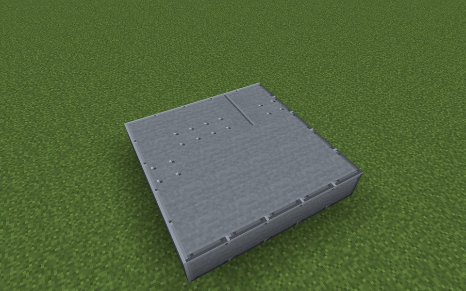

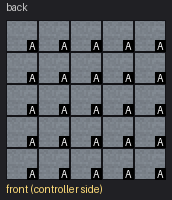

Parts in this step: Boiler Casing (A) ×25

### Step 2: Layer 2

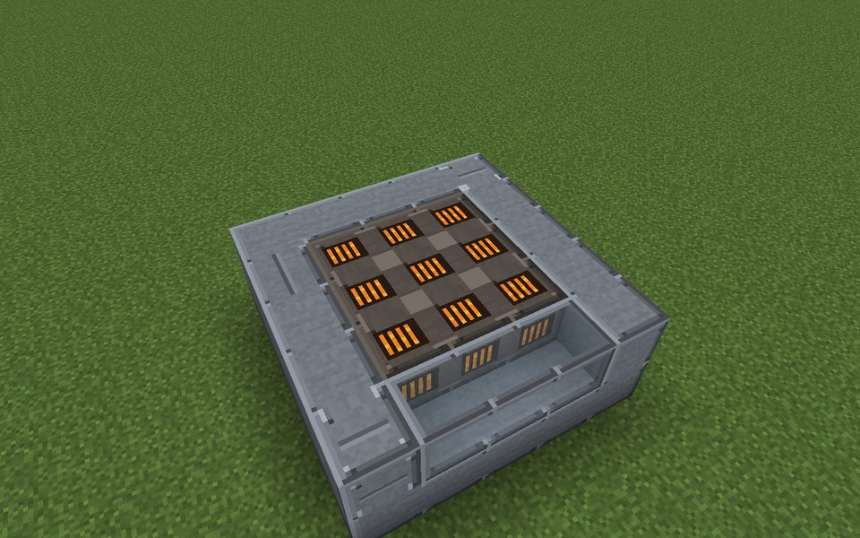

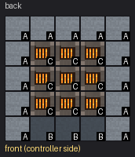

Parts in this step: Boiler Casing (A) ×13, Boiler Sight Glass (B) ×3, Combustion Chamber (C) ×9

### Step 3: Layer 3

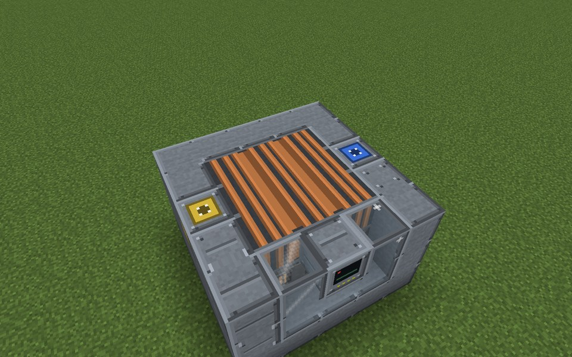

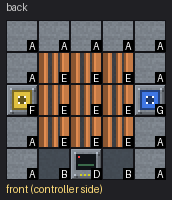

Parts in this step: Boiler Casing (A) ×11, Industrial Boiler Controller (D) ×1, Boiler Sight Glass (B) ×2, Fluid Input Port (G) ×1, Heat Exchanger Tubes (E) ×9, Item Input Port (F) ×1

### Step 4: Layer 4

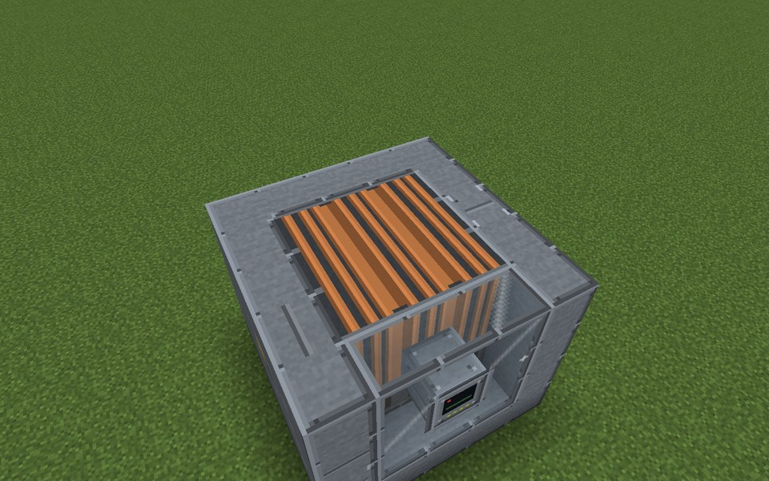

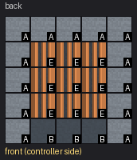

Parts in this step: Boiler Casing (A) ×13, Boiler Sight Glass (B) ×3, Heat Exchanger Tubes (E) ×9

### Step 5: Layer 5

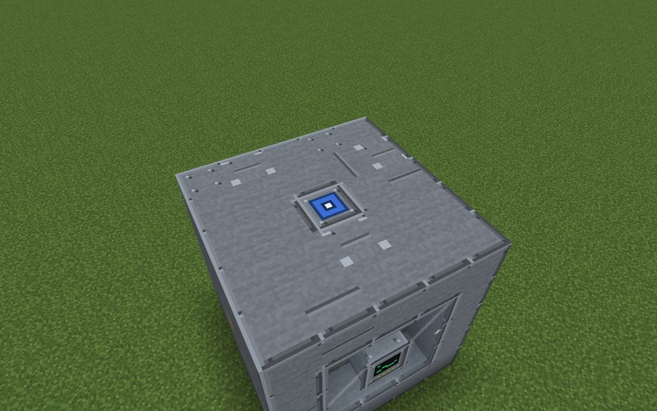

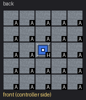

Parts in this step: Boiler Casing (A) ×24, Fluid Output Port (H) ×1

### Finished

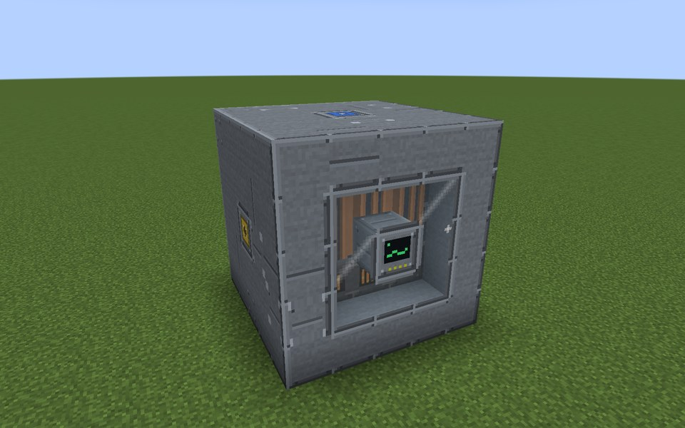
