# Large Gas Tank

The Large Gas Tank stores a single gas in the air inside a closed box. It holds 64,000 mB for every interior block,
the same density as the single Gas Tank, so a 32x32x32 tank stores almost 1.9 billion mB.

* **Capacity:** interior volume × 64,000 mB. A 3x3x3 tank has one interior block (64,000 mB), the 5x5x5 example below
  has 27 (1,728,000 mB).
* **One gas:** the tank takes the first gas that arrives and only that gas until it is empty again.
* **Transfer:** Gas Input Ports fill the tank, Gas Output Ports give the gas out (Pipster gas pipes). The tank does not
  limit the rate; the pipes do.

The example below is a 5x5x5 tank with a Gas Input Port on the left and a Gas Output Port on the right.

## Rules
* **Size:** at least 3x3x3, at most 32 in every direction. The box does not have to be a cube.
* **Frame (edges and corners):** Gas Tank Casing only.
* **Walls:** Gas Tank Casing, Turbine Sight Glass, Inspection Hatch, plus controller and ports (in the faces, not on
  edges).
* **Ports:**
  * Gas Input Port: gas in.
  * Gas Output Port: gas out.
* **Inside:** air only.
* **Controller:** the Large Gas Tank Controller faces out; the block right behind it must be an interior block.

## Running it
Connect gas pipes to the ports. The screen (controller or Inspection Hatch) shows the state, the stored gas, amount,
capacity, interior volume and the gas taken and given per tick.

* Building the tank bigger or smaller re-forms it with the new capacity. When it re-forms smaller, it keeps only what
  fits.
* When the tank breaks, the gas stays, but nothing moves until it forms again.
* The tank never overheats and has no incidents.
* For testing, the Creative Gas Tank (creative menu only) gives out any gas without limit.

## Common error messages
| Message | What to do |
|---|---|
| The controller must sit in a wall, front facing out | Place the controller in a wall face, front facing out, with the interior behind it. |
| Structure too small ((size)) | Build at least 3 in every direction. |
| Wrong block at (position) (expected: (allowed parts)) | Edges need Gas Tank Casing; the inside must be empty. |
| Port not allowed here: (position) ((port type)) | Only Gas Input and Gas Output Ports work here. |
| Structure too large or not closed near (position) | Close the box or keep it within 32 blocks in every direction. |
| Second controller at (position) | Remove the extra controller. |

## Step by step

The example below is 5 wide, 5 high and 5 deep. The example forms as shown (checked in the game when the pictures were taken).

Each step shows the plant from the front left after one more layer is placed (from the bottom up), and a top-down map of that layer: the back of the plant at the top, the front with the controller at the bottom. The letters match the parts lists.

**All parts of the example:**

| | Key | Block | Count |
|---|---|---|---|
| 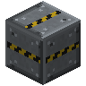 | A | Gas Tank Casing | 87 |
|  | B | Turbine Sight Glass | 8 |
|  | D | Gas Input Port | 1 |
|  | E | Gas Output Port | 1 |
| 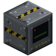 | C | Large Gas Tank Controller | 1 |

### Step 1: Layer 1

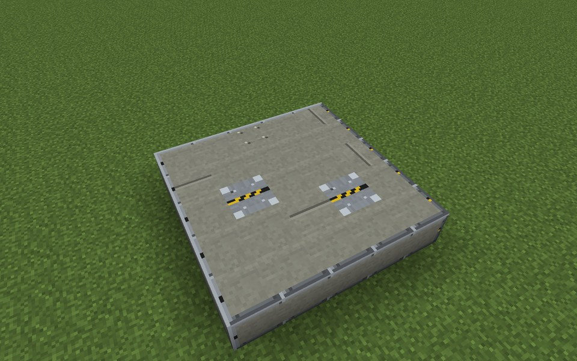

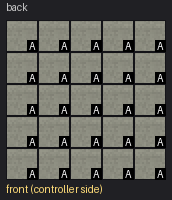

Parts in this step: Gas Tank Casing (A) ×25

### Step 2: Layer 2

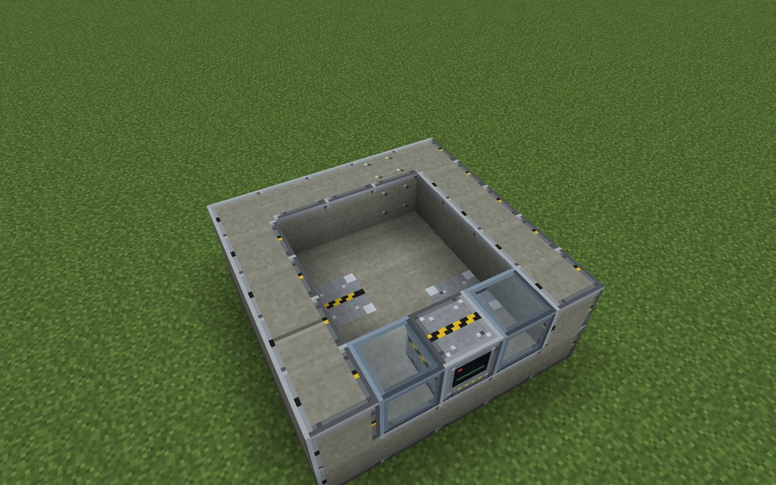

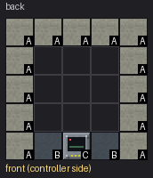

Parts in this step: Gas Tank Casing (A) ×13, Large Gas Tank Controller (C) ×1, Turbine Sight Glass (B) ×2

### Step 3: Layer 3

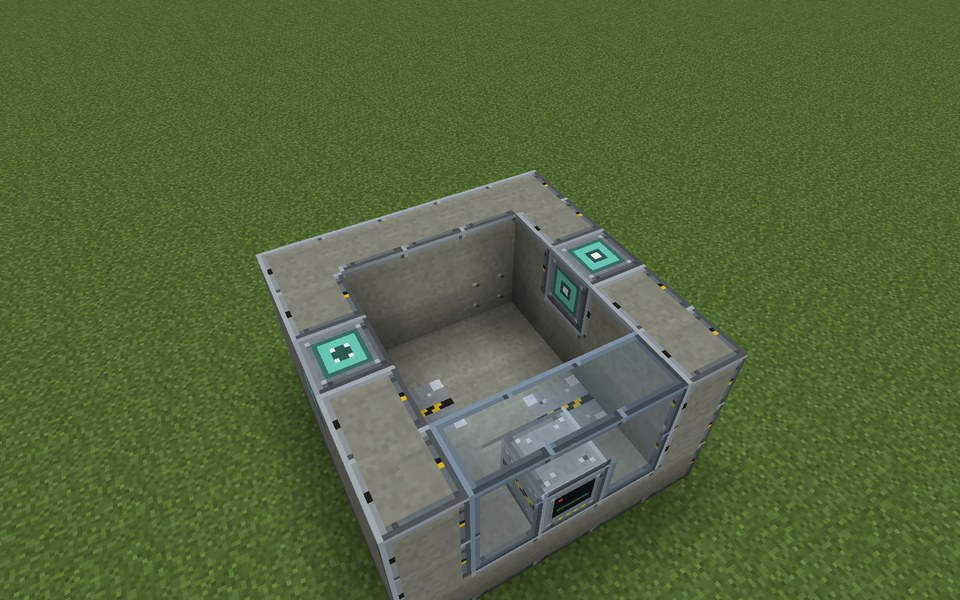

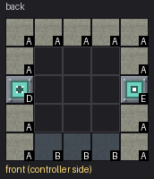

Parts in this step: Gas Input Port (D) ×1, Gas Output Port (E) ×1, Gas Tank Casing (A) ×11, Turbine Sight Glass (B) ×3

### Step 4: Layer 4

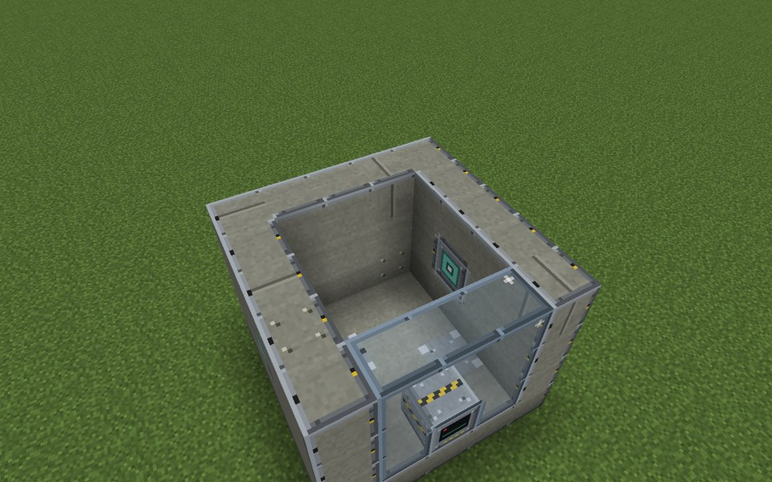

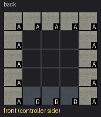

Parts in this step: Gas Tank Casing (A) ×13, Turbine Sight Glass (B) ×3

### Step 5: Layer 5

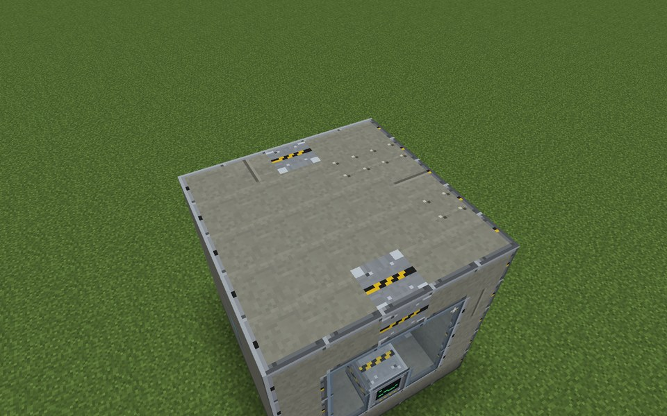

Parts in this step: Gas Tank Casing (A) ×25

### Finished

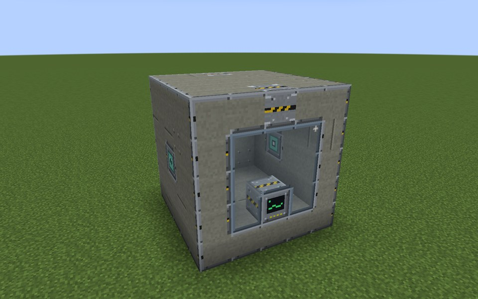
