# Little Star

The Little Star is a small artificial star held by six Containment Rods. It burns Hydrogen to Helium and delivers
electricity directly. It needs a huge ignition charge (2,000,000,000 E, `littleStarIgnitionEnergy`) and keeps drawing
power for its rods, so a plant must feed some of its output back or keep a store.

* **Output:** every mB of Hydrogen burned gives 1,000 E (times `generatorOutputMultiplier`, divided by
  `fuelConsumptionMultiplier`); 2 % of it heats the shell instead.
* **Star:** the core holds 10 mB per interior block. With a steady feed the star settles at the mass where its burn
  equals the feed, so the feed sets the power. The rods set the core temperature (hotter burns faster).
* **Rods:** 2,000 E/t per rod at full insertion (12,000 E/t for six), taken only from the input buffer that Energy
  Input Ports fill (100,000,000 E, up to 50,000,000 E/t in). The star's output goes into a separate 50,000,000 E
  output buffer that Energy Output Ports push out. Rods wear slowly and recover while the plant is off and cool.
* **Shell cooling:** above 100 °C the shell boils water to steam (10 HU per mB water, Fluid Input / Output Ports) or
  gives heat through Heat Ports. Tanks: 64,000 mB Hydrogen, 64,000 mB Helium, 32,000 mB water, 64,000 mB steam.
* **Helium ash** leaves the core into the helium tank (Gas Output Port). If the helium share in the core passes 50 %,
  it ignites at once (helium flash): hotter, less stable, a burst of shell heat.

The example below is the smallest star, 9x9x9: Stellar Frame on the edges, Stellar Containment Glass in the faces, a
Containment Rod Drive in the center of each face and two Containment Rods on each axis towards the center. Its core
holds 3,430 mB and starts with a feed of 96 mB/t. It has no Stellar Diagnostics, so no automatic control.

## Rules
* **Size:** a cube with an odd edge, at least 9x9x9, at most `maxStructureSize` (default 16, so 15 is the largest odd
  edge).
* **Frame (edges and corners):** Stellar Frame only.
* **Faces:** Stellar Containment Glass, Stellar Frame, Stellar Diagnostics, plus controller and ports (not on edges).
  There is no casing and no Inspection Hatch for this plant.
* **Rod drives:** exactly one Containment Rod Drive in the center of each of the six faces, and nowhere else.
* **Ports:**
  * Energy Input Port: ignition charge and rod power. Energy Output Port: the star's output.
  * Gas Input Port: Hydrogen in. Gas Output Port: Helium out.
  * Fluid Input Port: shell cooling water in. Fluid Output Port: steam out.
  * Heat Port: shell heat out to an adjacent consumer.
* **Inside:** Containment Rods on the six axes from each drive towards the center, beginning 2 blocks from the center
  (edges 9 and 11) or 3 blocks (edges 13 and 15) and reaching the face. Everything else inside is air.
* **Required:** the 6 Containment Rod Drives. Stellar Diagnostics in a face is optional and enables automatic control.

## Running it
Fill the input buffer, at least 500 mB Hydrogen (the ignition seed) and 1,000 mB water, then press **Start**. Phases:
charging the ignition, compression (rods drive in), ignition, burning. Charging only uses energy above the containment
reserve the rods need after ignition (14,400,000 E).

* **Feed:** `-`/`+` by 10 mB/t (up to 10 % of the core capacity per tick).
* **Rods:** `-`/`+` by 5 % (20–100 %; more insertion: hotter, brighter). Rods that hold too little against the star's
  pressure, too much helium, a hot shell or missing rod power lower the stability.
* **Auto** (needs Stellar Diagnostics): feeds, trims the rods and fades the star out safely when stability, shell
  temperature or helium get critical.
* **Stop** lets the star fade out safely; running out of Hydrogen does the same.
* **Breach:** zero stability, a shell at 1,400 °C or a broken structure breach the containment: the star is lost,
  living things nearby are hurt, the rods lose half their condition and the plant fails. With `incidentTerrainDamage`
  the Stellar Containment Glass shatters (frame and machinery stay); `safeMode` prevents all damage. Let the shell cool
  below 100 °C, then press **Reset**. A start needs rods at 50 % condition or more.

**CC: Tweaked:** readings `temperature()`, `stability()`, `energyStored()`, `powerOutput()`, `netPower()`,
`fuelLevel()`, `controlRodPosition()`, `coolantTemperature()` (shell), `steamFlow()`; commands `start()`, `shutdown()`,
`reset()`, `setFeed(mbPerTick)`, `setControlRodTarget(percent)`, `setAuto(boolean)`.

## Common error messages
| Message | What to do |
|---|---|
| The Little Star must be a cube with odd edge length (is (size)) | Make all three edges equal and odd (9, 11, 13, 15). |
| A containment rod drive belongs exactly in the centre of each face (near (position)) | Put one Containment Rod Drive in each face centre and remove drives elsewhere. |
| Wrong block at (position) (expected: containment_rod) | Complete the rod line on that axis. |
| Wrong block at (position) (expected: air) | Everything inside except the rods must be air. |
| Wrong block at (position) (expected: (allowed parts)) | Edges need Stellar Frame; faces only glass, frame, drives, diagnostics, ports. |
| Missing parts: containment_rod_drive:6 | Place all six drives. |
| Structure too small ((size)) | The edge must be at least 9. |
| Port not allowed here: (position) ((port type)) | Item ports do not work here. |

## Sight glass

The faces of a Little Star are Stellar Glass anyway, so the star is always visible.

## Step by step

The example below is 9 wide, 9 high and 9 deep. The example forms as shown (checked in the game when the pictures were taken).

Each step shows the plant from the front left after one more layer is placed (from the bottom up), and a top-down map of that layer: the back of the plant at the top, the front with the controller at the bottom. The letters match the parts lists.

**All parts of the example:**

| | Key | Block | Count |
|---|---|---|---|
|  | B | Stellar Containment Glass | 281 |
| 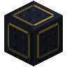 | A | Stellar Frame | 92 |
| 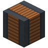 | D | Containment Rod | 12 |
| 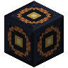 | C | Containment Rod Drive | 6 |
|  | F | Energy Input Port | 1 |
|  | G | Energy Output Port | 1 |
|  | J | Fluid Input Port | 1 |
|  | K | Fluid Output Port | 1 |
|  | H | Gas Input Port | 1 |
|  | I | Gas Output Port | 1 |
| 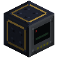 | E | Little Star Controller | 1 |

### Step 1: Layer 1

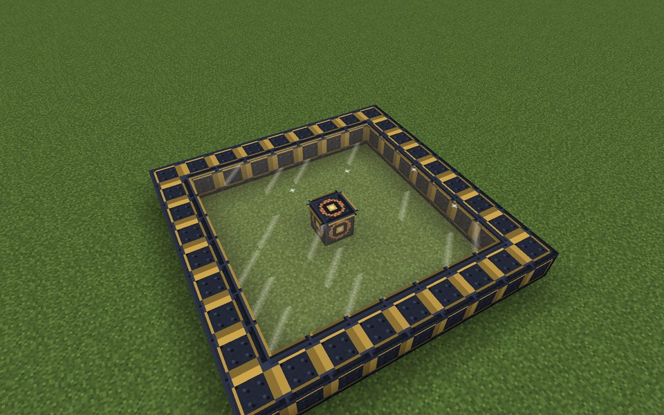

Parts in this step: Containment Rod Drive (C) ×1, Stellar Frame (A) ×32, Stellar Containment Glass (B) ×48

### Step 2: Layer 2

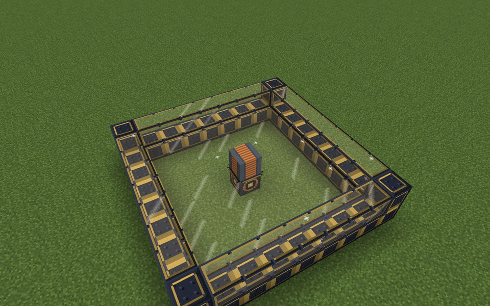

Parts in this step: Containment Rod (D) ×1, Stellar Frame (A) ×4, Stellar Containment Glass (B) ×28

### Step 3: Layer 3

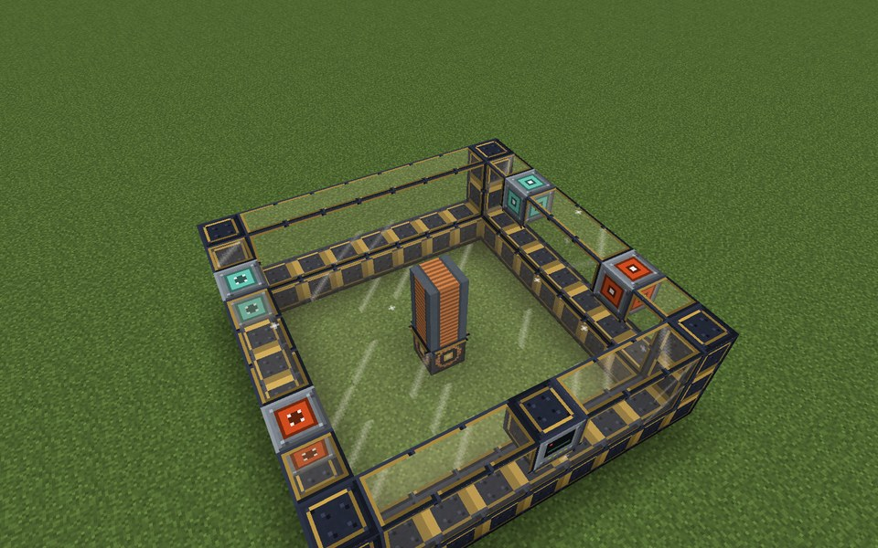

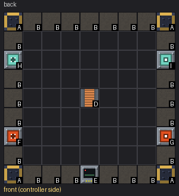

Parts in this step: Containment Rod (D) ×1, Energy Input Port (F) ×1, Energy Output Port (G) ×1, Gas Input Port (H) ×1, Gas Output Port (I) ×1, Little Star Controller (E) ×1, Stellar Frame (A) ×4, Stellar Containment Glass (B) ×23

### Step 4: Layer 4

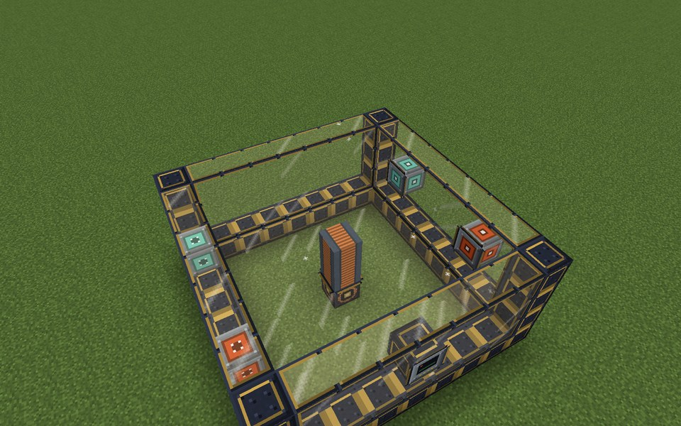

Parts in this step: Stellar Frame (A) ×4, Stellar Containment Glass (B) ×28

### Step 5: Layer 5

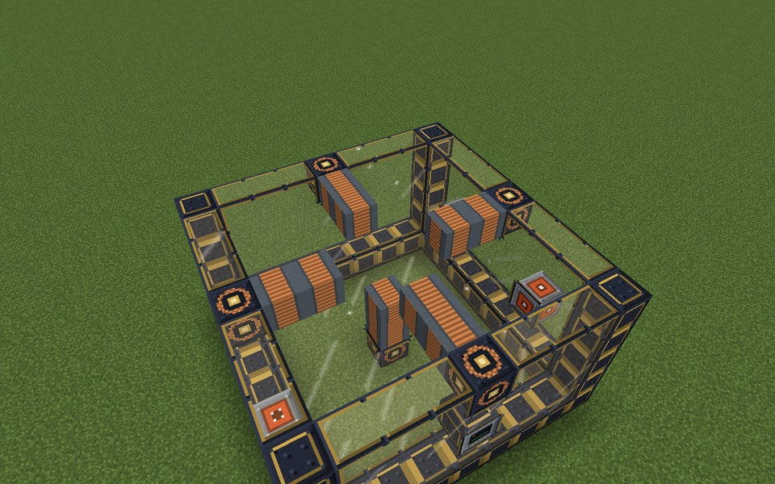

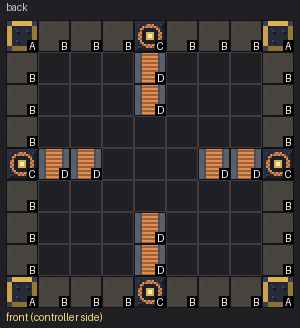

Parts in this step: Containment Rod (D) ×8, Containment Rod Drive (C) ×4, Stellar Frame (A) ×4, Stellar Containment Glass (B) ×24

### Step 6: Layer 6

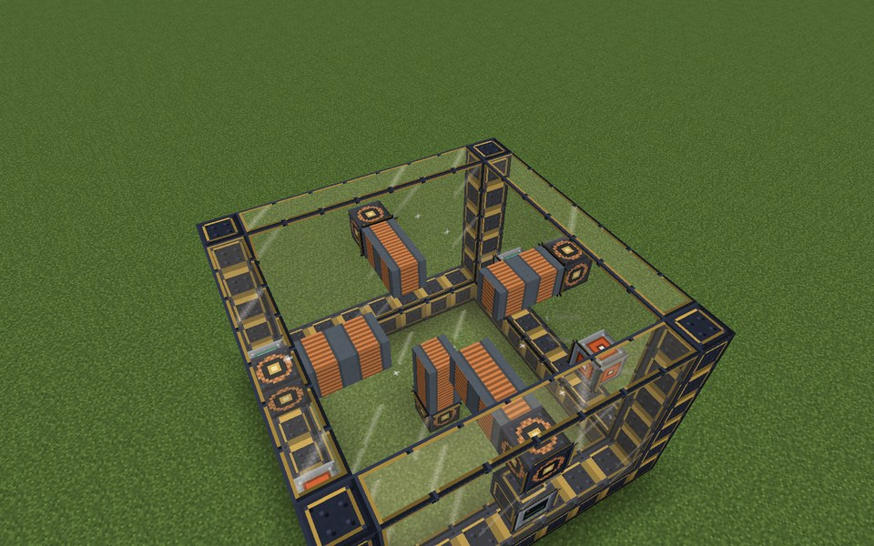

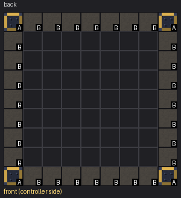

Parts in this step: Stellar Frame (A) ×4, Stellar Containment Glass (B) ×28

### Step 7: Layer 7

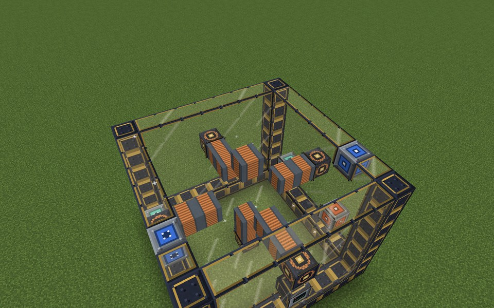

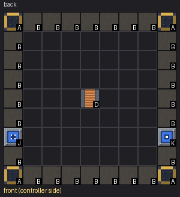

Parts in this step: Containment Rod (D) ×1, Fluid Input Port (J) ×1, Fluid Output Port (K) ×1, Stellar Frame (A) ×4, Stellar Containment Glass (B) ×26

### Step 8: Layer 8

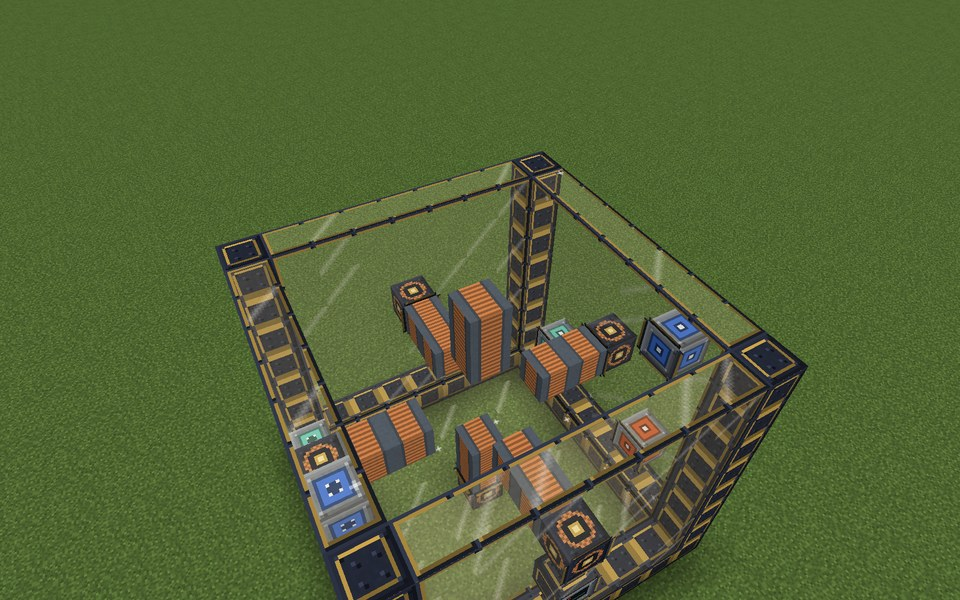

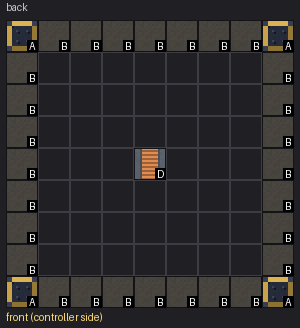

Parts in this step: Containment Rod (D) ×1, Stellar Frame (A) ×4, Stellar Containment Glass (B) ×28

### Step 9: Layer 9

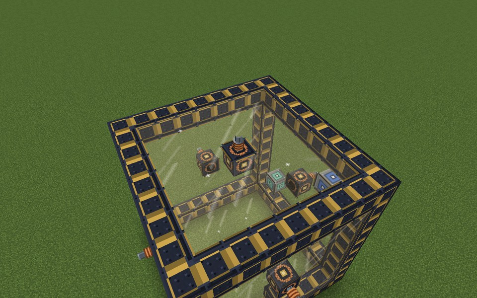

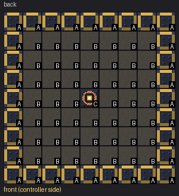

Parts in this step: Containment Rod Drive (C) ×1, Stellar Frame (A) ×32, Stellar Containment Glass (B) ×48

### Finished

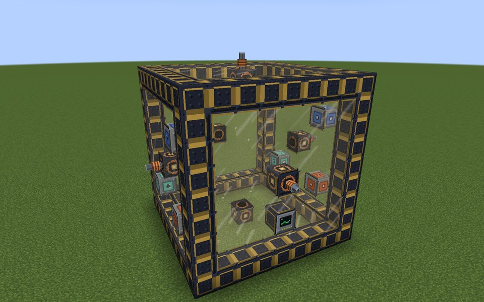

### In operation

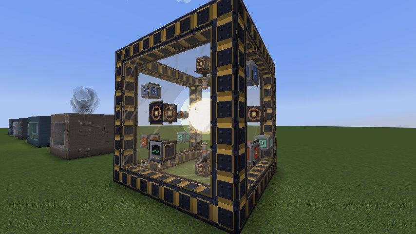
