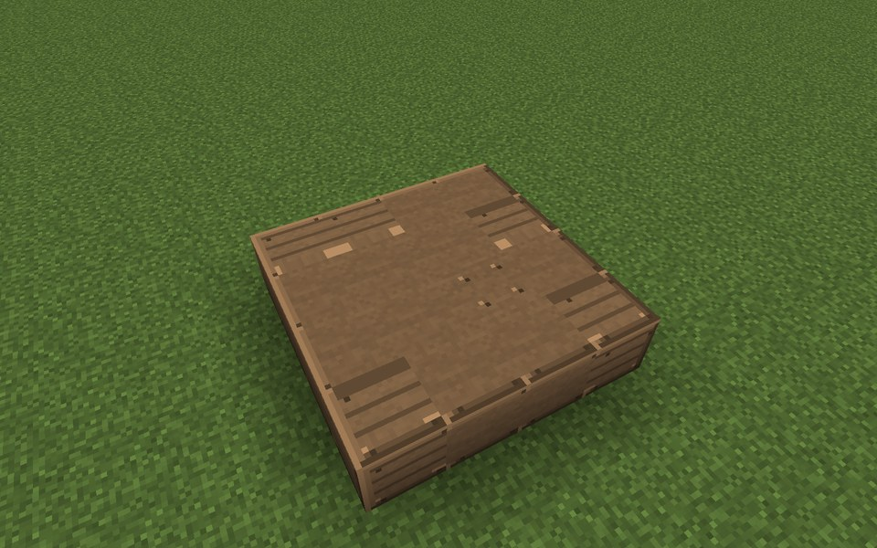
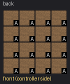
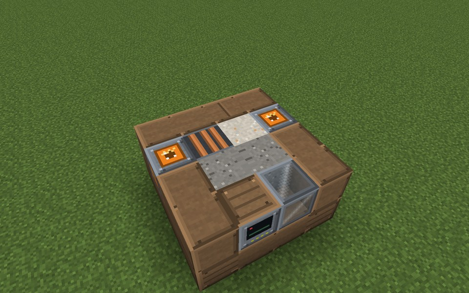
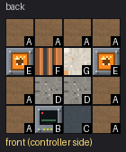
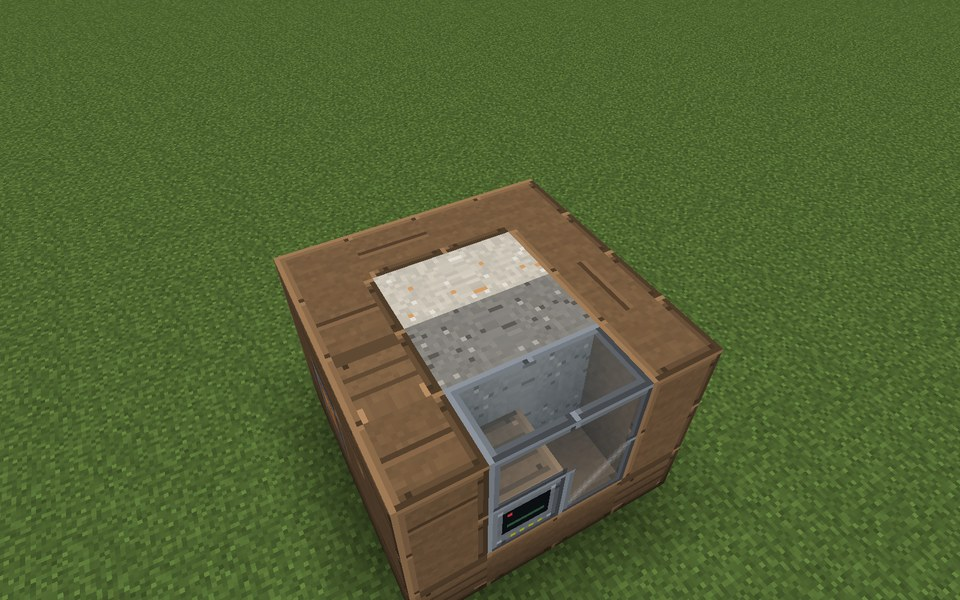
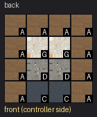
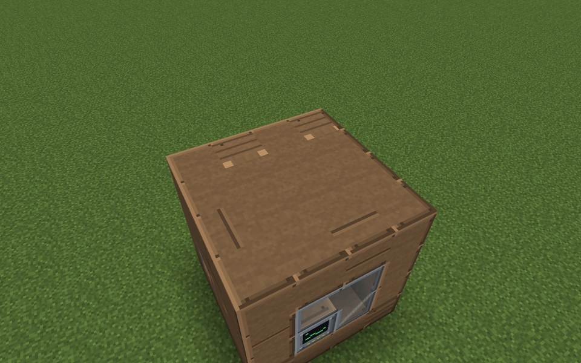
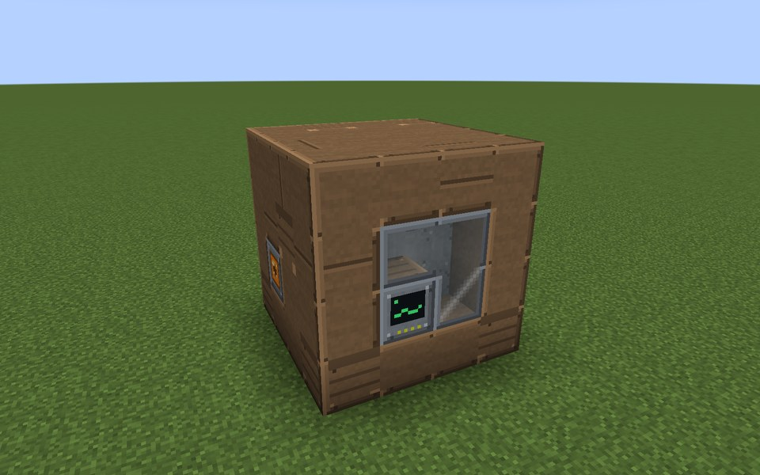

# Molten-Salt Store

The Molten-Salt Store stores heat (HU), not energy. It takes heat in through its Heat Ports from a neighboring heat
source (Solar Thermal Field, Gas Turbine or Gas Engine exhaust, Little Star shell, tokamak …) and gives it out again
through the same kind of port to a neighboring consumer, for example an Industrial Boiler or a Stirling Generator.
It is the buffer that lets a solar thermal plant run its boiler at night.

* **Thermal Salt:** 2,000 HU per kelvin and block. It is liquid between 290 °C and 565 °C: below 290 °C it gives no
  heat (it has to be heated up first), at 565 °C it takes no more. Loss about 1 % of the excess heat per minute.
* **Thermal Concrete:** cheaper, 800 HU per kelvin and block, usable from 20 °C up to 400 °C, never freezes, loses
  about 2.5 % per minute.
* **Mixed stores:** the capacities add up; the lower and upper temperature and the loss are averaged, weighted by heat
  capacity.
* **Heat Exchanger Tubes** limit the transfer: 100 HU/t per tube in each direction.

The example below is 4x4x4 with a 2x2x2 inside: a front row of four Thermal Concrete, three Thermal Salt and one Heat
Exchanger Tubes block. It holds 9,200 HU per kelvin and moves at most 100 HU/t; its Heat Ports sit in the two side
walls.

## Rules
* **Size:** at least 4x3x3 in practice (a 3x3x3 box has a single interior block, which cannot hold both the heat exchanger tube and the salt or concrete the store needs), at most 16 in every direction (`maxStructureSize`).
* **Frame (edges and corners):** Salt Tank Casing only.
* **Walls:** Salt Tank Casing, Boiler Sight Glass, Inspection Hatch, plus controller and ports (in the faces, not on
  edges).
* **Ports:** Heat Port only. Each one takes heat from and gives heat to the block right in front of it (another
  plant's Heat Port or a Stirling Generator).
* **Inside:** Thermal Salt, Thermal Concrete and Heat Exchanger Tubes only. No air: fill the interior completely.
* **Required:** at least 1 Heat Exchanger Tubes block and at least 1 block of Thermal Salt or Thermal Concrete.
* **Controller:** the Molten-Salt Store Controller faces out; the block right behind it must be an interior block.

## Running it
Put a Heat Port of the store right against a Heat Port of the heat source and another against the consumer. The
screen shows the salt state ("Solid (heat above 290 °C first)", "Molten", "Full", or "Ready (concrete never freezes)"
for concrete-only stores), temperature, usable heat, room for heat, heat in and out, output limit, transfer limit,
salt and concrete blocks, tubes and heat loss.

* **Output limit:** `-`/`+` change the heat the store hands out by 50 HU/t (at most the tube limit). Use it so the
  store does not drain itself into a consumer faster than you want.
* A store with salt starts cold and solid. It gives heat only after it has been charged above 290 °C.
* The store has no incidents.

**CC: Tweaked:** readings `temperature()`, `heatStored()` (usable HU above the lower limit), `powerOutput()` (HU/t
handed out); command `setHeatOutput(huPerTick)` (0 to 100 per tube).

## Common error messages
| Message | What to do |
|---|---|
| Wrong block at (position) (expected: heat_exchanger_tube\|thermal_concrete\|thermal_salt) | Fill every interior block; air is not allowed. |
| Missing parts: heat_exchanger_tube:1 | Add at least one Heat Exchanger Tubes block. |
| Missing parts: thermal_salt:1 | Add Thermal Salt or Thermal Concrete. |
| Port not allowed here: (position) ((port type)) | Only Heat Ports work on this store. |
| Structure too small ((size)) | Build at least 4x3x3 (two interior blocks: one tube, one salt or concrete). |
| Structure too large or not closed near (position) | Close the box or keep it within `maxStructureSize`. |
| The controller must sit in a wall, front facing out | Place the controller in a wall face, front facing out, with the interior behind it. |

## Sight glass

Every wall block that is not on an edge may be **Boiler Sight Glass** instead of the casing. The plant works the same, and through the glass you see what happens inside while it runs. The example below has Boiler Sight Glass in its front.

## Step by step

The example below is 4 wide, 4 high and 4 deep. The example forms as shown (checked in the game when the pictures were taken).

Each step shows the plant from the front left after one more layer is placed (from the bottom up), and a top-down map of that layer: the back of the plant at the top, the front with the controller at the bottom. The letters match the parts lists.

**All parts of the example:**

| | Key | Block | Count |
|---|---|---|---|
|  | A | Salt Tank Casing | 50 |
|  | D | Thermal Concrete | 4 |
|  | C | Boiler Sight Glass | 3 |
|  | G | Thermal Salt | 3 |
|  | E | Heat Port | 2 |
|  | F | Heat Exchanger Tubes | 1 |
|  | B | Molten-Salt Store Controller | 1 |

### Step 1: Layer 1

Parts in this step: Salt Tank Casing (A) ×16

### Step 2: Layer 2

Parts in this step: Boiler Sight Glass (C) ×1, Heat Exchanger Tubes (F) ×1, Heat Port (E) ×2, Molten-Salt Store Controller (B) ×1, Salt Tank Casing (A) ×8, Thermal Concrete (D) ×2, Thermal Salt (G) ×1

### Step 3: Layer 3

Parts in this step: Boiler Sight Glass (C) ×2, Salt Tank Casing (A) ×10, Thermal Concrete (D) ×2, Thermal Salt (G) ×2

### Step 4: Layer 4

Parts in this step: Salt Tank Casing (A) ×16

### Finished

### In operation

From the left: Battery Hall, Molten-Salt Store and Gravity Store, each with a sight-glass front.
