# SMES

The SMES (superconducting magnetic energy storage) stores a lot of energy at an enormous rate with almost no loss, as
long as its coils stay superconducting. The coils start warm; Cryocoolers and a liquid Helium charge cool them down.
Helium comes from fusion (tokamak Gas Output Port) or the Little Star.

* **Capacity:** 50,000,000 E per Superconducting Coil (`smesCoilCapacity`).
* **Rate:** 250,000 E/t per Power Converter in each direction, only while superconducting (below 9 K).
* **Cooling:** each Cryocooler draws 400 E/t (from the store, or from the input while the coils are still warm). With
  a Helium charge of 200 mB per coil the coolers reach 4.5 K; without it they stop at about 20 K and the coils never
  become superconducting. While cold the Helium boils off slowly (0.01 mB/t per coil). Heat load grows with the
  transfer.
* **Quench:** a store that warms to 9 K with energy inside loses its superconductivity. With Dump Resistors the
  energy leaves in a controlled way (2,000,000 E/t per resistor, a tenth of it as heat through Heat Ports) and half
  the Helium boils off. Without resistors the energy turns into heat in the coils at once, the whole Helium charge
  boils off and a cold burst hurts and freezes living things nearby (nothing in `safeMode`).
* Helium tank 64,000 mB.

The example below is 7x5x5: 25 Superconducting Coils, a row of 5 Power Converters, and a back row of 6 Cryocoolers and
9 Dump Resistors. It stores 1,250,000,000 E at 1,250,000 E/t each way and needs 5,000 mB Helium.

## Rules
* **Size:** at least 5x4x5 (width x height x depth), at most 16 in every direction (`maxStructureSize`).
* **Frame (edges and corners):** Cryostat Casing only.
* **Walls:** Cryostat Casing, Reactor Sight Glass, Inspection Hatch, plus controller and ports (in the faces, not on
  edges).
* **Ports:**
  * Energy Input Port / Energy Output Port: charging and discharging.
  * Gas Input Port: Helium in. Gas Output Port: Helium out of the tank.
  * Heat Port: dump heat of a protected quench out to an adjacent consumer.
* **Inside:** air, Superconducting Coils, Power Converters, Cryocoolers, Dump Resistors.
* **Required:** at least 1 Superconducting Coil, 1 Power Converter and 1 Cryocooler. Dump Resistors are optional
  but strongly recommended.
* **Controller:** the SMES Controller faces out; the block right behind it must be an interior block.

## Running it
Fill the Helium charge (the screen shows "Helium charge needed"), give it energy and wait until the coils are cold.
States: "Warm (coolers off)", "Cooling down", "Superconducting", "Warning: coils warming up" (7 K), "QUENCH: energy
being dumped". The screen also shows energy, Helium, coil temperature (K), rate, input, output, cooler power, dump heat,
quenches and part counts.

* **I/O** switches the Cryocoolers. Switching them off with energy stored leads to a quench.
* Breaking the structure while charged also quenches it, and so does draining the Helium below the needed charge.
* Cold fog at the controller warns of a warming cryostat.

**CC: Tweaked:** readings `energyStored()`, `powerOutput()`, `coilTemperature()` (K), `fuelLevel()` (Helium mB),
`reactorState()`; command `setCooling(boolean)`.

## Common error messages
| Message | What to do |
|---|---|
| Missing parts: (part:count) | Add at least one Superconducting Coil, Power Converter and Cryocooler. |
| Wrong block at (position) (expected: (allowed parts)) | Edges need Cryostat Casing; inside only SMES parts and air. |
| Structure too small ((size)) | Build at least 5 wide, 4 high, 5 deep. |
| Port not allowed here: (position) ((port type)) | Item and fluid ports do not work here. |
| Structure too large or not closed near (position) | Close the box or keep it within `maxStructureSize`. |
| The controller must sit in a wall, front facing out | Place the controller in a wall face, front facing out, with the interior behind it. |

## Sight glass

Every wall block that is not on an edge may be **Reactor Sight Glass** instead of the casing. The plant works the same, and through the glass you see what happens inside while it runs. The example below has Reactor Sight Glass in its front.

## Step by step

The example below is 7 wide, 5 high and 5 deep. The example forms as shown (checked in the game when the pictures were taken).

Each step shows the plant from the front left after one more layer is placed (from the bottom up), and a top-down map of that layer: the back of the plant at the top, the front with the controller at the bottom. The letters match the parts lists.

**All parts of the example:**

| | Key | Block | Count |
|---|---|---|---|
|  | A | Cryostat Casing | 111 |
|  | D | Superconducting Coil | 25 |
|  | B | Reactor Sight Glass | 14 |
|  | H | Dump Resistor | 9 |
|  | I | Cryocooler | 6 |
|  | F | Power Converter | 5 |
|  | J | Energy Input Port | 1 |
|  | E | Energy Output Port | 1 |
|  | K | Gas Input Port | 1 |
|  | G | Gas Output Port | 1 |
|  | C | SMES Controller | 1 |

### Step 1: Layer 1

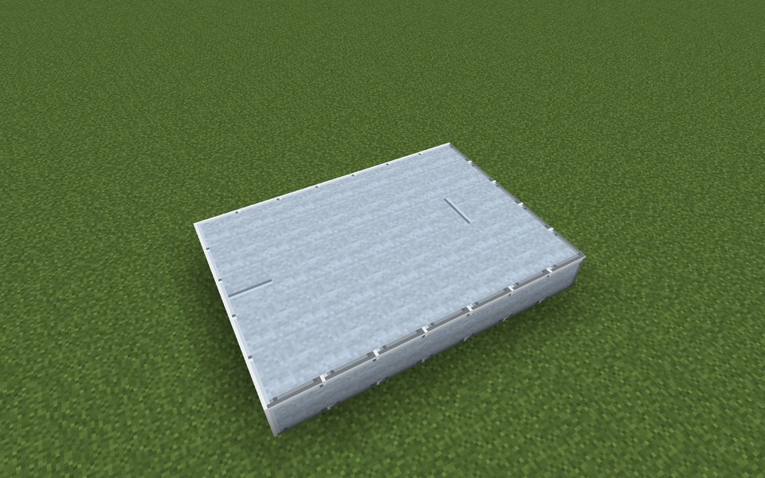

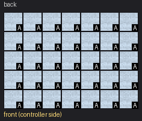

Parts in this step: Cryostat Casing (A) ×35

### Step 2: Layer 2

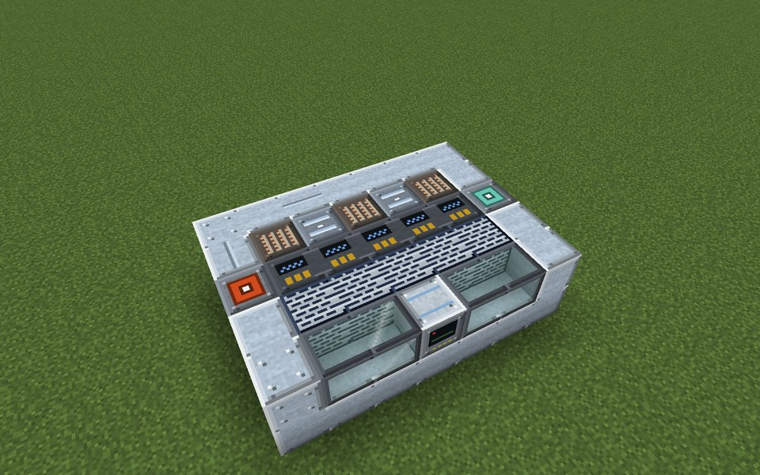

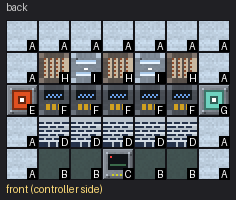

Parts in this step: Cryocooler (I) ×2, Cryostat Casing (A) ×13, Dump Resistor (H) ×3, Energy Output Port (E) ×1, Gas Output Port (G) ×1, Reactor Sight Glass (B) ×4, Superconducting Coil (D) ×5, SMES Controller (C) ×1, Power Converter (F) ×5

### Step 3: Layer 3

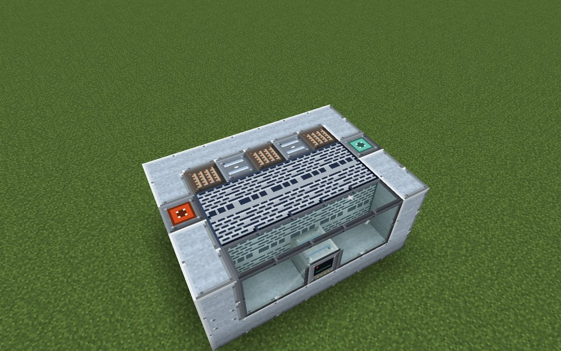

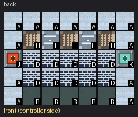

Parts in this step: Cryocooler (I) ×2, Cryostat Casing (A) ×13, Dump Resistor (H) ×3, Energy Input Port (J) ×1, Gas Input Port (K) ×1, Reactor Sight Glass (B) ×5, Superconducting Coil (D) ×10

### Step 4: Layer 4

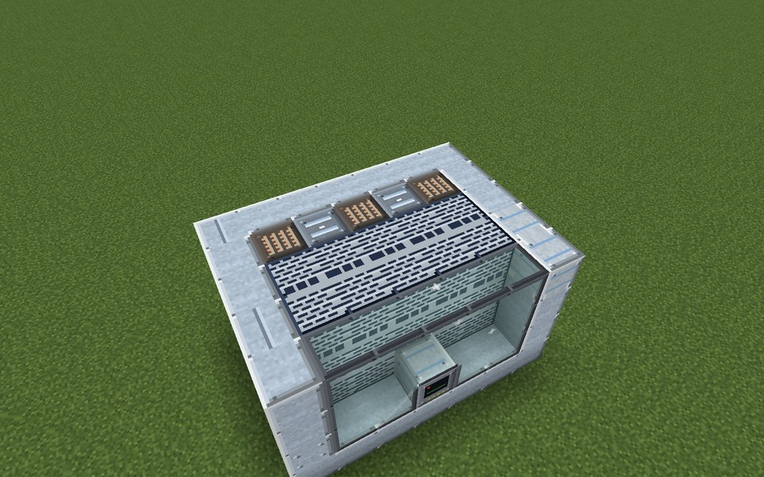

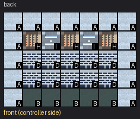

Parts in this step: Cryocooler (I) ×2, Cryostat Casing (A) ×15, Dump Resistor (H) ×3, Reactor Sight Glass (B) ×5, Superconducting Coil (D) ×10

### Step 5: Layer 5

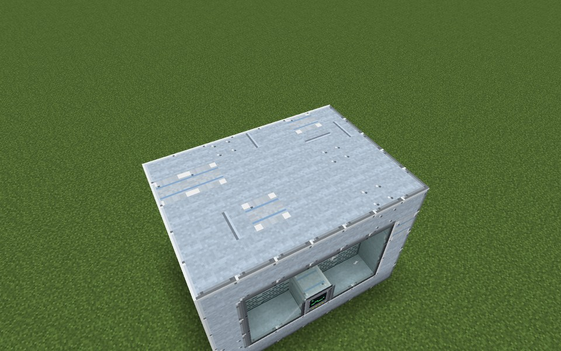

Parts in this step: Cryostat Casing (A) ×35

### Finished

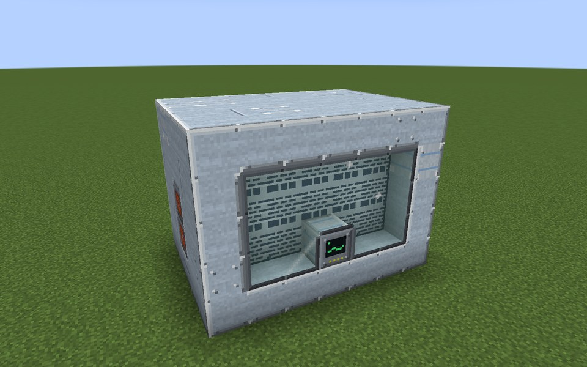

### In operation

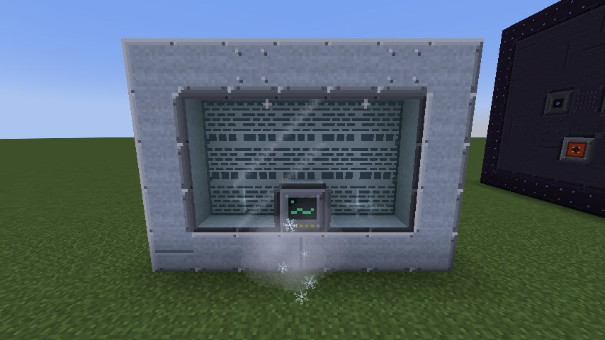
