# Micro Black Hole Plant

The Micro Black Hole Plant holds a tiny singularity and feeds it with Compressed Matter (from the Matter Compressor).
Matter that falls in releases 30 % of its mass energy, which the Radiation Collectors turn into electricity. The plant
also splits off Singularity Capsules, which start a Hawking Reactor and are needed to craft a Dimension Core.

* **Matter:** one Compressed Matter = 1 mass unit (ME) = 10,000,000 E (`energyPerMassUnit`). The plant stores up to
  1,000 ME. Each Matter Injector feeds up to 0.05 ME/t.
* **Singularity:** forming it costs 10,000,000,000 E (`singularityIgnitionEnergy`, input buffer 20,000,000,000 E) and
  45 ME of matter. Only 2 % of the accreted matter stays in the singularity; Hawking evaporation shrinks it, faster
  the smaller it is. The Eddington limit (0.005 x mass per tick) caps the useful feed; matter above it is blown away
  as heat.
* **Mass window:** from 30 ME up to 50 ME in a 9x9x9 plant, +10 ME per block of edge above 9. Below the window the
  singularity evaporates, above it the containment cannot hold it.
* **Power:** up to 50,000 E/t per Radiation Collector. Containment costs 2,000 E/t per ME, from the input buffer first,
  then from the output buffer (100,000,000 E).
* **Cooling:** the collectors heat up (2 % of the output, plus blown-away matter). Coolant Channels carry it away as
  Hot Coolant, up to 400 mB/t water per channel (10 HU per mB). Hot collectors lose efficiency.

The example below is 9x9x9: vacuum within one block of the center, a closed shell of 98 Gravitational Containment
Coils around it, 144 Radiation Collectors and 74 Coolant Channels further out; two Matter Injectors and a Gravimetry
block sit in the side walls. Two injectors feed at most 0.1 ME/t, worth up to 300,000 E/t.

## Rules
* **Size:** a cube with an odd edge, at least 9x9x9, at most `maxStructureSize` (default 16, so 15 is the largest odd
  edge).
* **Frame (edges and corners):** Singularity Frame only.
* **Walls:** Singularity Casing, Reactor Sight Glass, Inspection Hatch, Matter Injector, Gravimetry, plus controller
  and ports (in the faces, not on edges).
* **Ports:**
  * Energy Input Port: ignition and containment power. Energy Output Port: output.
  * Item Input Port: Compressed Matter in. Item Output Port: Singularity Capsules out.
  * Fluid Input Port: water in. Fluid Output Port: Hot Coolant out.
* **Inside** (by distance from the center, counted in the largest axis difference):
  * Distance 0 and 1: air (the vacuum).
  * Distance 2: Gravitational Containment Coils, a closed shell.
  * Further out: air, Radiation Collectors, Coolant Channels.
* **Required:** at least 1 Radiation Collector and 1 Matter Injector. Gravimetry is optional and enables the automatic
  control.

## Running it
Fill the input buffer, load at least 45 Compressed Matter, connect water and a Hot Coolant drain, then press **Start**.
Phases: charging the ignition, forming the singularity (200 ticks), running.

* **Auto** (needs Gravimetry, on by default when present): feeds up to the Eddington limit and uses the jets to hold
  the mass near 40 % of the window (higher when the injectors could not hold a smaller one). Without it, set the matter feed (`-`/`+` by 0.01 ME/t) and the jets (`-`/`+` by
  5 %, share of the accreted matter blown off) yourself.
* **Kapsel** (the capsule button) splits a 3 ME Singularity Capsule into the output. It costs 1,000,000,000 E from the
  input buffer and works only while running in the lower part of the window (the rest must stay above 25 % of the
  window and not above 60 %).
* **Stop** lets the singularity shrink and dissolves it through the collectors. **Reset** clears a failure once the
  collectors have cooled down.
* **Failures:** a singularity that evaporates (or runs out of matter) ends in a radiation flash; one that grows past the
  window or loses containment power ends in a gravity shock. Both hurt living things nearby (nothing in `safeMode`).
  Violet sparkles at the controller warn of low stability.

**CC: Tweaked:** readings `singularityMass()`, `stability()`, `powerOutput()`, `netPower()`, `energyStored()`,
`fuelLevel()` (ME), `reactorState()`, `alarmState()`; commands `start()`, `shutdown()`, `reset()`,
`setFeed(mePerTick)`, `setJet(share)`, `setAuto(boolean)`, `splitCapsule()`.

## Common error messages
| Message | What to do |
|---|---|
| The Little Star must be a cube with odd edge length (is (size)) | This message appears for this plant too: make all edges equal and odd. |
| Wrong block at (position) (expected: air) | Keep the center and the blocks next to it empty. |
| Wrong block at (position) (expected: gravitational_coil) | Close the coil shell two blocks around the center. |
| Wrong block at (position) (expected: air\|coolant_channel\|radiation_collector) | Only collectors, coolant channels or air in the outer interior. |
| Missing parts: (part:count) | Add at least one Radiation Collector and one Matter Injector. |
| Structure too small ((size)) | The edge must be at least 9. |
| Port not allowed here: (position) ((port type)) | Gas and Heat Ports do not work here. |

## Sight glass

Every wall block that is not on an edge may be **Reactor Sight Glass** instead of the casing. The plant works the same, and through the glass you see what happens inside while it runs. The example below has Reactor Sight Glass in its front.

## Step by step

The example below is 9 wide, 9 high and 9 deep. The example forms as shown (checked in the game when the pictures were taken).

Each step shows the plant from the front left after one more layer is placed (from the bottom up), and a top-down map of that layer: the back of the plant at the top, the front with the controller at the bottom. The letters match the parts lists.

**All parts of the example:**

| | Key | Block | Count |
|---|---|---|---|
|  | B | Singularity Casing | 237 |
|  | F | Radiation Collector | 144 |
|  | G | Gravitational Containment Coil | 98 |
|  | A | Singularity Frame | 92 |
|  | E | Coolant Channel | 74 |
|  | C | Reactor Sight Glass | 48 |
|  | L | Matter Injector | 2 |
|  | H | Energy Input Port | 1 |
|  | J | Energy Output Port | 1 |
|  | I | Fluid Input Port | 1 |
|  | K | Fluid Output Port | 1 |
|  | M | Gravimetry | 1 |
|  | N | Item Input Port | 1 |
|  | D | Micro Black Hole Plant Controller | 1 |

### Step 1: Layer 1

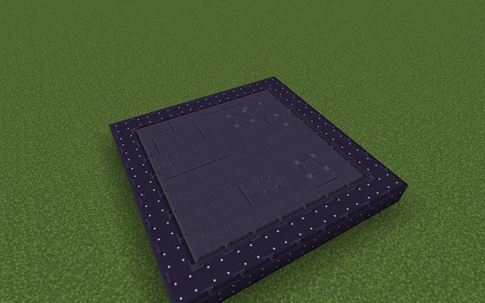

Parts in this step: Singularity Casing (B) ×49, Singularity Frame (A) ×32

### Step 2: Layer 2

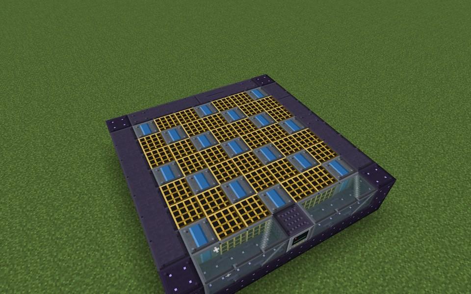

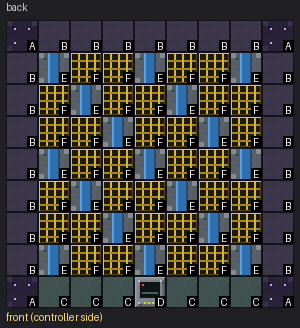

Parts in this step: Coolant Channel (E) ×17, Radiation Collector (F) ×32, Reactor Sight Glass (C) ×6, Singularity Casing (B) ×21, Micro Black Hole Plant Controller (D) ×1, Singularity Frame (A) ×4

### Step 3: Layer 3

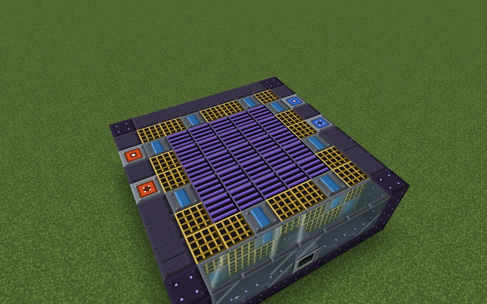

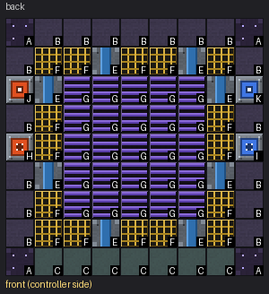

Parts in this step: Coolant Channel (E) ×8, Energy Input Port (H) ×1, Energy Output Port (J) ×1, Fluid Input Port (I) ×1, Fluid Output Port (K) ×1, Gravitational Containment Coil (G) ×25, Radiation Collector (F) ×16, Reactor Sight Glass (C) ×7, Singularity Casing (B) ×17, Singularity Frame (A) ×4

### Step 4: Layer 4

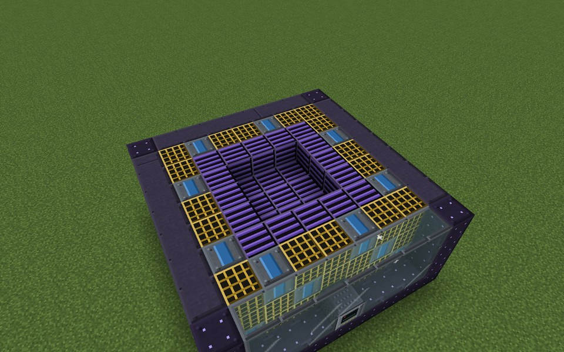

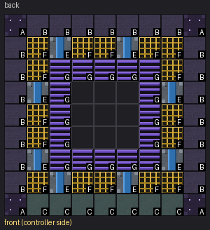

Parts in this step: Coolant Channel (E) ×8, Gravitational Containment Coil (G) ×16, Radiation Collector (F) ×16, Reactor Sight Glass (C) ×7, Singularity Casing (B) ×21, Singularity Frame (A) ×4

### Step 5: Layer 5

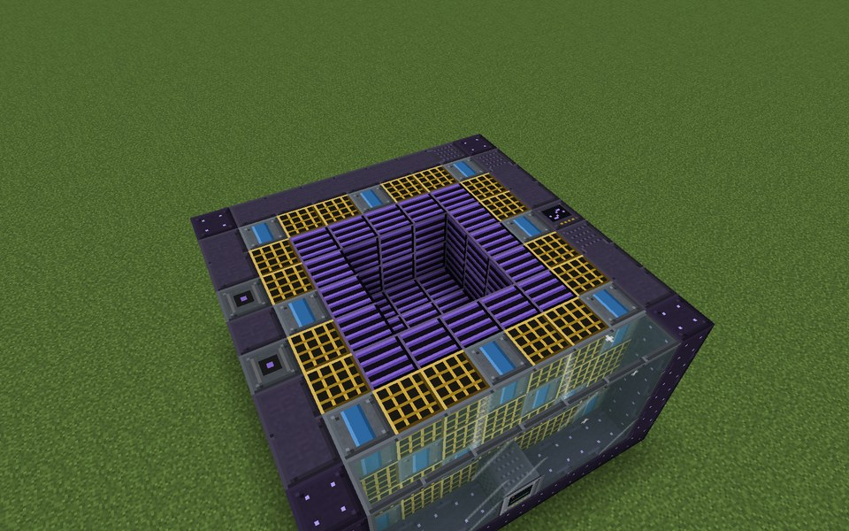

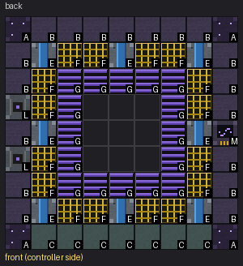

Parts in this step: Coolant Channel (E) ×8, Gravimetry (M) ×1, Gravitational Containment Coil (G) ×16, Matter Injector (L) ×2, Radiation Collector (F) ×16, Reactor Sight Glass (C) ×7, Singularity Casing (B) ×18, Singularity Frame (A) ×4

### Step 6: Layer 6

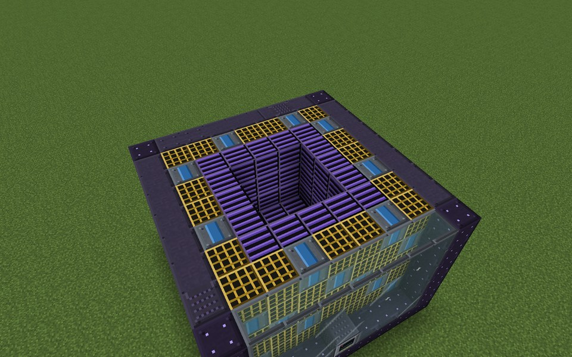

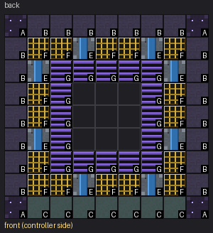

Parts in this step: Coolant Channel (E) ×8, Gravitational Containment Coil (G) ×16, Radiation Collector (F) ×16, Reactor Sight Glass (C) ×7, Singularity Casing (B) ×21, Singularity Frame (A) ×4

### Step 7: Layer 7

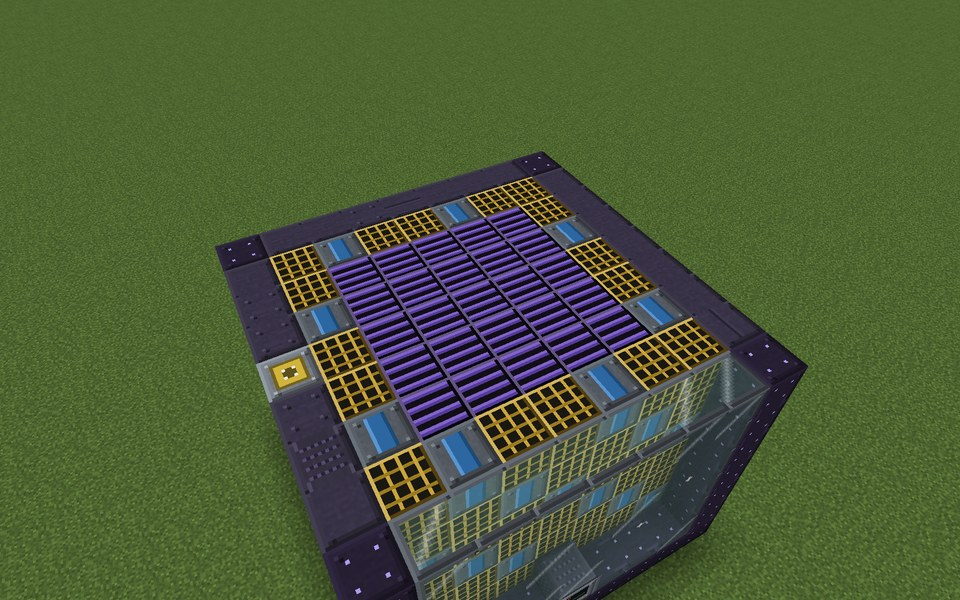

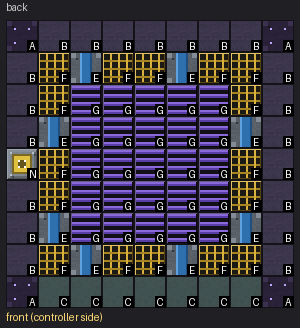

Parts in this step: Coolant Channel (E) ×8, Gravitational Containment Coil (G) ×25, Item Input Port (N) ×1, Radiation Collector (F) ×16, Reactor Sight Glass (C) ×7, Singularity Casing (B) ×20, Singularity Frame (A) ×4

### Step 8: Layer 8

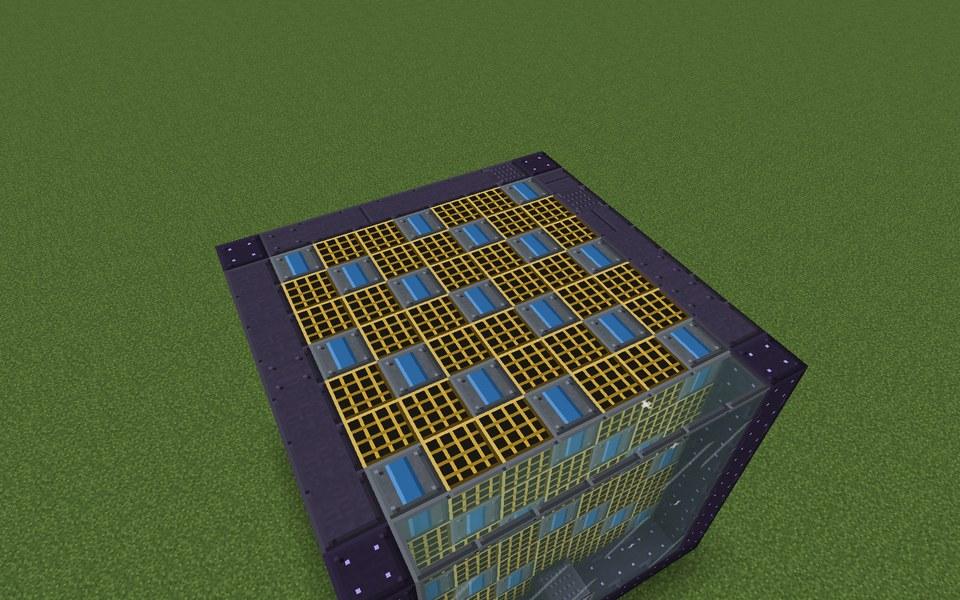

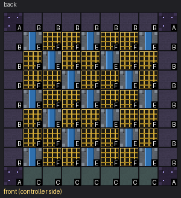

Parts in this step: Coolant Channel (E) ×17, Radiation Collector (F) ×32, Reactor Sight Glass (C) ×7, Singularity Casing (B) ×21, Singularity Frame (A) ×4

### Step 9: Layer 9

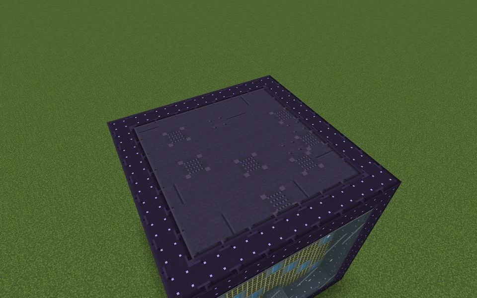

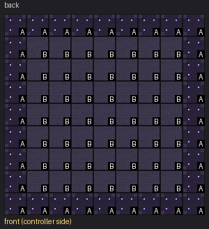

Parts in this step: Singularity Casing (B) ×49, Singularity Frame (A) ×32

### Finished

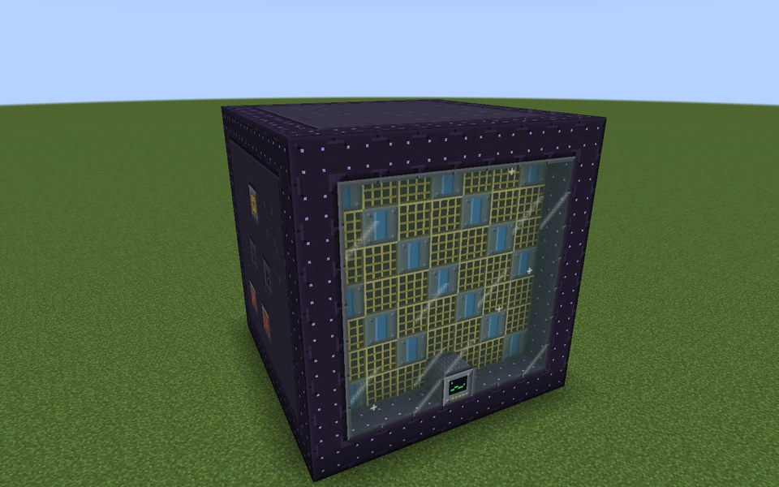

### In operation

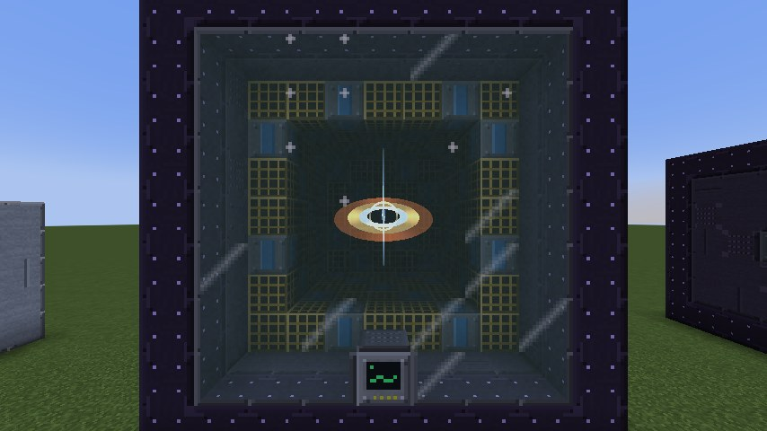
