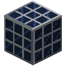
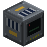
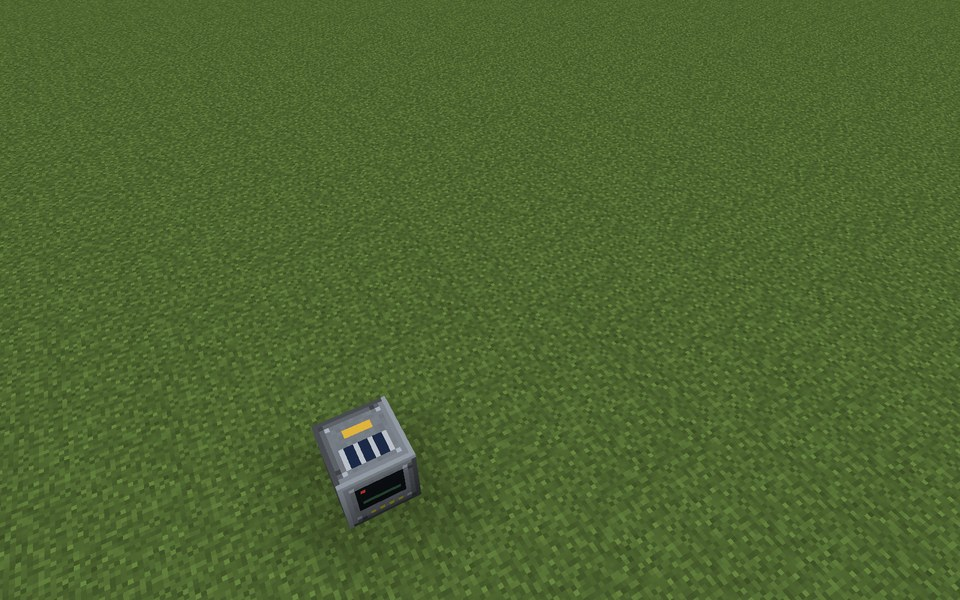
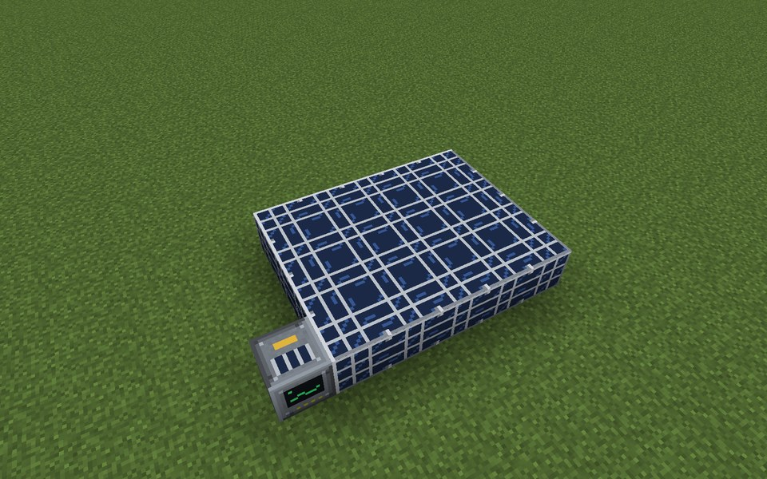
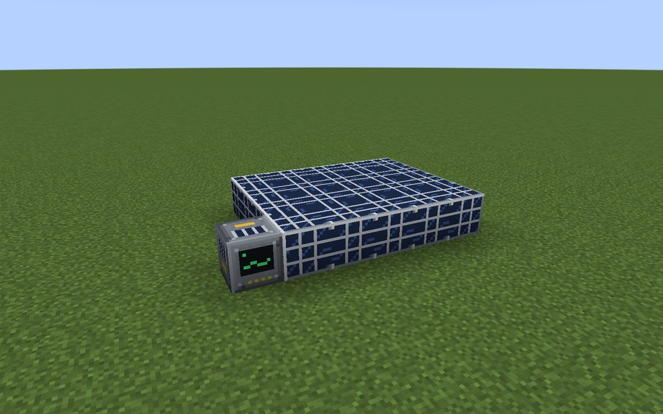

# Solar Array

The Solar Array makes energy from sunlight. PV Modules connected to a Solar Array Controller form one array of any
shape; only modules with open sky produce. It needs no fuel and no maintenance and is a good first source of steady
daytime power.

* **Output:** 6 E/t per PV Module in full sun (`solarModuleOutput`, times `generatorOutputMultiplier`).
* **Sun:** follows the vanilla sky brightness: full at clear noon, less in the morning, evening and in rain or
  thunder, nothing at night. Dimensions without sky light give nothing.
* **Open sky:** a module counts only if the sky above it is free. The controller checks this when the array forms and
  every 200 ticks.
* **Buffer:** 200,000 E. The controller pushes energy into all six neighbors; cables can also pull it from any side.

The example below is a Solar Array Controller at the edge of a 5 x 4 field of PV Modules: 20 modules, 120 E/t at
clear noon.

## Rules
* **Shape:** any shape. Every PV Module that touches the controller or another module of the array face to face
  belongs to it.
* **Limits:** at most 256 modules (`maxSolarModules`), all within 32 blocks of the controller on every axis.
* **Ports:** none. Energy leaves directly from the controller block.
* **No casing, no walls.**
* **Required:** at least 1 PV Module.

## Running it
Place the controller, lay modules next to it and connect a cable to the controller. The array has no buttons. Its
screen shows the status, energy, PV modules, how many are under open sky, sunlight, output and peak output.

* Keep the field free of overhangs: a module under a roof or overhang produces nothing.
* A Capacitor Bank, Battery Hall or Energy Cell behind the array carries the night.
* Modules connect through each other, so one controller serves a large field; only face contact counts.
* The array has no incidents.

**CC: Tweaked:** readings `powerOutput()`, `energyStored()`. No commands.

## Common error messages
| Message | What to do |
|---|---|
| Missing parts: solar_panel | Place at least one PV Module touching the controller. |
| Too many modules (limit (limit)) near (position) | Use fewer modules per controller or raise `maxSolarModules`; split a big field into several arrays. |
| Part of the structure is not loaded (position) | Load the chunks of the whole array. |

## Step by step

The example below is 6 wide, 1 high and 4 deep. The example forms as shown (checked in the game when the pictures were taken).

**All parts of the example:**

| | Key | Block | Count |
|---|---|---|---|
|  | B | PV Module | 20 |
|  | A | Solar Array Controller | 1 |

### Step 1: Controller

Parts in this step: Solar Array Controller (A) ×1

### Step 2: Modules next to each other

Parts in this step: PV Module (B) ×20

### Finished

