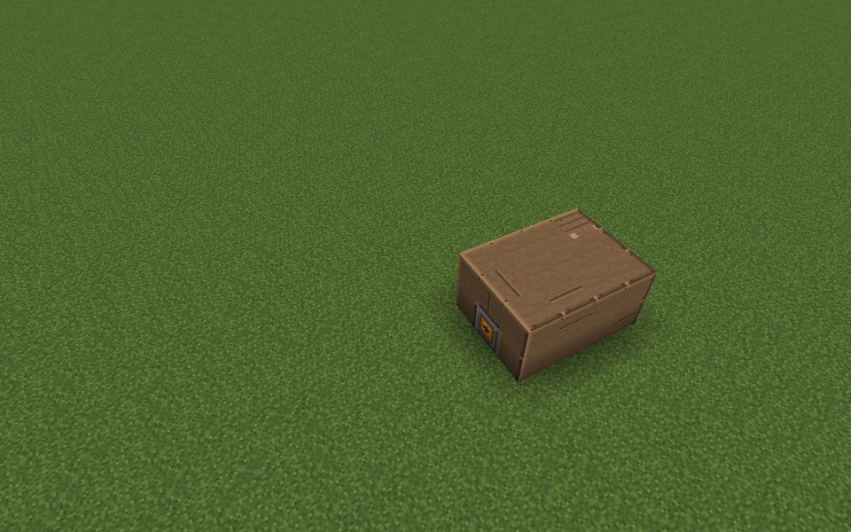
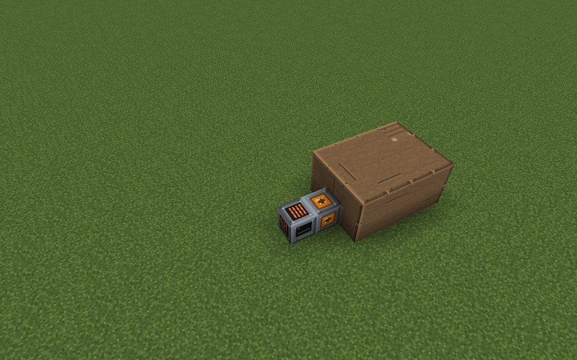
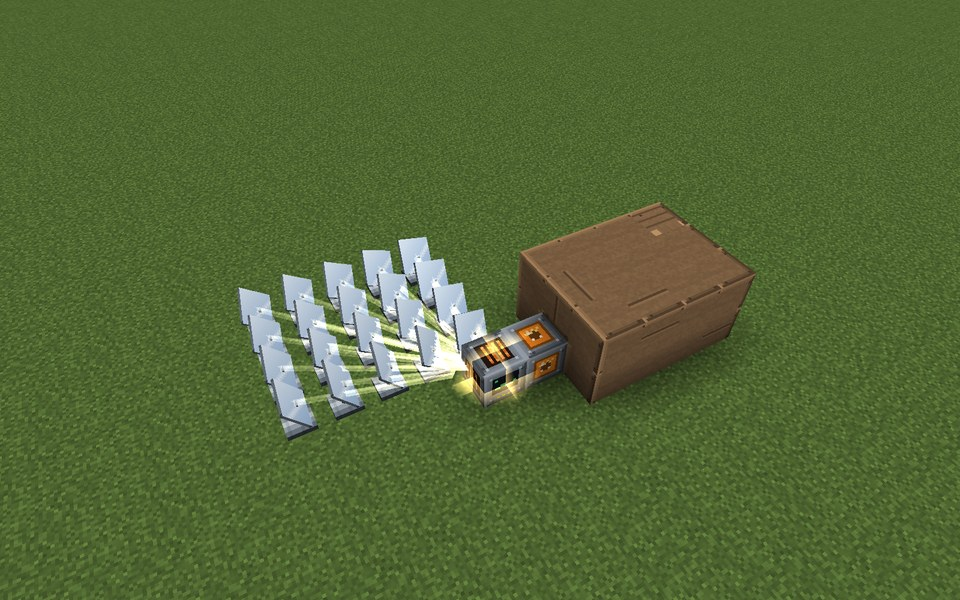
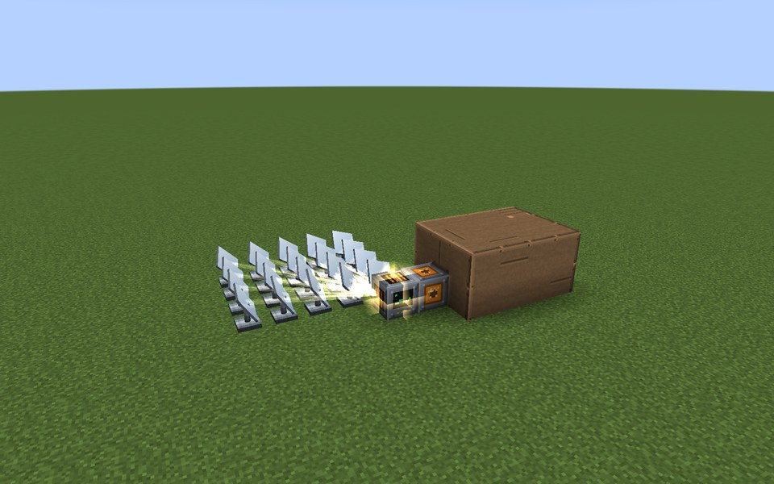
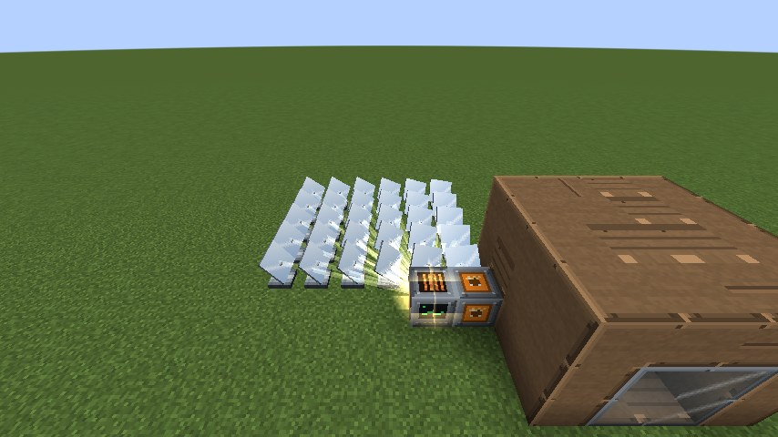

# Solar Thermal Field

The Solar Thermal Field concentrates sunlight on a Solar Receiver: Heliostats (mirrors) connected to the receiver
focus the sun, and the receiver hands the heat through its Heat Port to a neighbor. There is no buffer: heat that
nobody takes in the same tick is lost (the mirrors defocus). Pair it with a Molten-Salt Store to keep the heat, and an
Industrial Boiler or Stirling Generator to use it.

* **Heat:** 8 HU/t per Heliostat in full direct sun (`heliostatHeat`), times the sun factor squared: a concentrating
  plant needs direct light, so clouds, rain and low sun cost it more than a Solar Array.
* **Open sky:** a heliostat counts only with free sky above it. The receiver checks this when the field forms and
  every 200 ticks.
* **Heat Ports:** only Heat Ports that touch the receiver or a heliostat join the field. Each one hands heat to the
  block right in front of it: another plant's Heat Port (e.g. of a Molten-Salt Store or Industrial Boiler) or a
  Stirling Generator.

The example below has a small Molten-Salt Store half sunk into the ground (Thermal Concrete and one Heat Exchanger
Tubes block, its Heat Port at ground level), the Solar Receiver with its own Heat Port touching the store's port, and
a 5 x 4 field of 20 Heliostats joined to the receiver. In full sun the field focuses 160 HU/t; the store's single tube
takes at most 100 HU/t of it.

## Rules
* **Shape:** any shape. Every Heliostat that touches the receiver or another heliostat of the field face to face
  belongs to it.
* **Limits:** at most 512 heliostats (`maxHeliostats`), all within 32 blocks of the receiver on every axis.
* **Ports:** Heat Ports only, touching the receiver or a heliostat. Their outward side points away from the block they
  touch.
* **No casing, no walls.**
* **Required:** at least 1 Heliostat.

## Running it
Place the Solar Receiver, lay heliostats next to it, put a Heat Port against the receiver and the consumer's Heat Port
right in front of that. The field has no buttons. Its screen shows the status, heliostats, how many are under open sky,
sunlight, focused heat, heat delivered and peak heat.

* While formed the heliostats show their stands and the receiver draws the mirror plates, turned towards the sun and
  the receiver. Light beams run from the mirrors while a consumer takes the heat.
* Size the consumer to the field: a store takes at most 100 HU/t per Heat Exchanger Tubes block, a boiler at most
  40 HU/t per tube through its Heat Ports.
* A Molten-Salt Store with salt only gives heat back above 290 °C; charge it in the sun first.
* The field has no incidents.

**CC: Tweaked:** reading `powerOutput()` (heat delivered, HU/t). No commands.

## Common error messages
| Message | What to do |
|---|---|
| Missing parts: heliostat | Place at least one Heliostat touching the receiver. |
| Too many modules (limit (limit)) near (position) | Use fewer heliostats per receiver or raise `maxHeliostats`. |
| Part of the structure is not loaded (position) | Load the chunks of the whole field. |

## Step by step

The example below is 10 wide, 3 high and 6 deep. The example forms as shown (checked in the game when the pictures were taken).

**All parts of the example:**

| | Key | Block | Count |
|---|---|---|---|
|  | A | Salt Tank Casing | 32 |
|  | G | Heliostat | 20 |
|  | B | Heat Port | 2 |
|  | D | Heat Exchanger Tubes | 1 |
|  | E | Molten-Salt Store Controller | 1 |
|  | F | Solar Receiver | 1 |
|  | C | Thermal Concrete | 1 |

### Step 1: Heat store: a molten-salt store with a heat port

Parts in this step: Heat Exchanger Tubes (D) ×1, Heat Port (B) ×1, Molten-Salt Store Controller (E) ×1, Salt Tank Casing (A) ×32, Thermal Concrete (C) ×1

### Step 2: Receiver and its heat port, touching the store's port

Parts in this step: Heat Port (B) ×1, Solar Receiver (F) ×1

### Step 3: Heliostats joined to the receiver

Parts in this step: Heliostat (G) ×20

### Finished

### In operation

