# Steam Turbine

The Steam Turbine turns steam into energy. Steam drives a rotor with real inertia: it spins up slowly, keeps turning
for a while without steam and delivers its full output at the rated speed of 1,800 rpm. Used steam leaves as Exhaust
Steam, 1:1; a Condenser turns it back into water.

* **Blades:** each Rotor Blade passes up to 25 mB/t steam. Each mB carries 1 E into the rotor, times the blade
  efficiency (100 % at 1,800 rpm, at least 30 % while starting, less when overspeeding).
* **Coils:** each Generator Coil takes up to 120 E/t out of the rotor, scaled with the speed (full at 1,800 rpm).
  About one coil per five blades keeps the rotor near its rated speed; too many coils hold it down.
* **Steam sources:** Industrial Boiler, Heat Exchanger (fission reactor or tokamak hot coolant), Little Star shell
  cooling. Every fluid in `#quantavolt:steam` is accepted, which includes `#c:steam` of other mods.
* **Tanks and buffer:** 32,000 mB steam, 32,000 mB Exhaust Steam, 1,000,000 E. Energy Output Ports push the energy
  into neighbors.

The example below is 5x5x5: the Rotor Shaft runs through the center from the controller wall to the back wall, two
slices with four Rotor Blades each, then one slice with two Generator Coils. It passes up to 200 mB/t steam and its
coils can take 240 E/t.

## Rules
* **Size:** at least 5x5x5 (width x height x depth), at most 16 in every direction (`maxStructureSize`). Width and
  height must be odd (the shaft needs a center).
* **Frame (edges and corners):** Turbine Casing only.
* **Walls:** Turbine Casing, Turbine Sight Glass, Inspection Hatch, plus controller and ports (in the faces, not on
  edges).
* **Ports:**
  * Fluid Input Port: steam in.
  * Fluid Output Port: Exhaust Steam out (to a Condenser).
  * Energy Output Port: energy out.
* **Inside:**
  * The center line of the interior, from the controller wall straight to the opposite wall, must be Rotor Shaft
    blocks along its whole length. So the controller belongs on one of the two end walls of the shaft.
  * Everything else inside: air, Rotor Blades or Generator Coils.
  * Every slice across the shaft holds either blades or coils, never both.
* **Required:** at least 1 Rotor Blade and 1 Generator Coil.
* **Controller:** the Steam Turbine Controller faces out; the block right behind it must be an interior block.

## Running it
Pipe steam into the Fluid Input Port, take Exhaust Steam out of the Fluid Output Port and connect a cable to the Energy
Output Port. The screen (controller or Inspection Hatch) shows the tanks, energy, speed, steam flow, flow setpoint,
power, blade efficiency, generator state and protection.

* **Flow setpoint:** `-`/`+` change it by 25 mB/t (one blade); default 100 mB/t, at most blades x 25 mB/t.
* **I/O** engages or disengages the generator. Disengaged, the rotor spins up without load.
* **S** switches the overspeed trip. With the trip on (default), the steam valve closes above 2,600 rpm and opens again
  below 1,800 rpm ("Tripped (overspeed): steam valve closed"). Above 2,200 rpm the screen shows "Overspeed: reduce
  steam or engage the generator" and sparks fly from the controller.
* **Trip off:** above 2,600 rpm the blades wear and finally the rotor bursts in an explosion (bigger rotors burst
  harder). Blocks are only destroyed with `incidentTerrainDamage`; in `safeMode` the trip cannot be switched off.
  Rebuilding the turbine (forming it again) replaces worn blades.
* "Generator overloaded: fewer coils or more steam/fuel" means steam flows but the rotor stays below 60 % of its
  rated speed.
* Output scales with `generatorOutputMultiplier`.

**CC: Tweaked:** readings `turbineRpm()`, `powerOutput()`, `energyStored()`, `steamFlow()`; commands
`setFlow(mbPerTick)`, `setGenerator(boolean)`, `setOverspeedTrip(boolean)`.

## Common error messages
| Message | What to do |
|---|---|
| The controller must sit in a wall, front facing out | Put the controller in an end wall of the shaft, facing out, with the interior behind it. |
| Structure too small ((size)) | Build at least 5x5x5. |
| The turbine cross-section must be odd ((size)) | Make width and height odd (5, 7, 9 …). |
| Wrong block at (position) (expected: rotor_shaft) | The center line from the controller wall to the back wall must be Rotor Shaft all the way. |
| Wrong block at (position) (expected: (allowed parts)) | Edges need Turbine Casing; inside only air, Rotor Blades and Generator Coils. |
| Blades and coils in the same slice near (position) | Move blades and coils into separate slices across the shaft. |
| Missing parts: (part:count) | Add at least one Rotor Blade and one Generator Coil. |
| Port not allowed here: (position) ((port type)) | Only fluid in/out and energy out ports work here. |
| Structure too large or not closed near (position) | Close the box or keep it within `maxStructureSize`. |
| Second controller at (position) | Remove the extra controller. |

## Sight glass

Every wall block that is not on an edge may be **Turbine Sight Glass** instead of the casing. The plant works the same, and through the glass you see what happens inside while it runs. The example below has Turbine Sight Glass in its front.

## Step by step

The example below is 5 wide, 5 high and 5 deep. The example forms as shown (checked in the game when the pictures were taken).

Each step shows the plant from the front left after one more layer is placed (from the bottom up), and a top-down map of that layer: the back of the plant at the top, the front with the controller at the bottom. The letters match the parts lists.

**All parts of the example:**

| | Key | Block | Count |
|---|---|---|---|
|  | A | Turbine Casing | 86 |
|  | D | Rotor Blade | 8 |
|  | B | Turbine Sight Glass | 8 |
|  | E | Rotor Shaft | 3 |
|  | H | Generator Coil | 2 |
|  | I | Energy Output Port | 1 |
|  | F | Fluid Input Port | 1 |
|  | G | Fluid Output Port | 1 |
|  | C | Steam Turbine Controller | 1 |

### Step 1: Layer 1

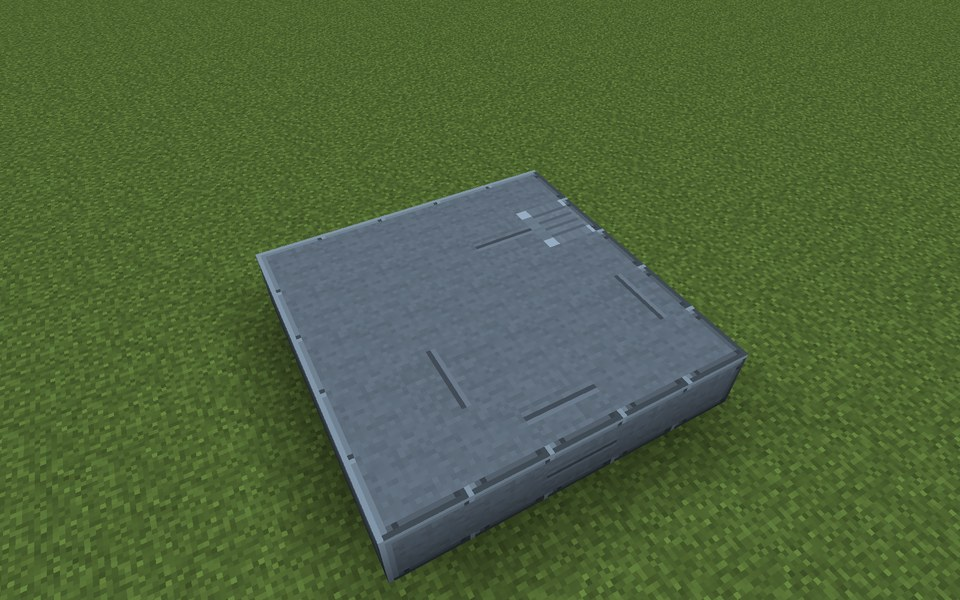

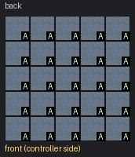

Parts in this step: Turbine Casing (A) ×25

### Step 2: Layer 2

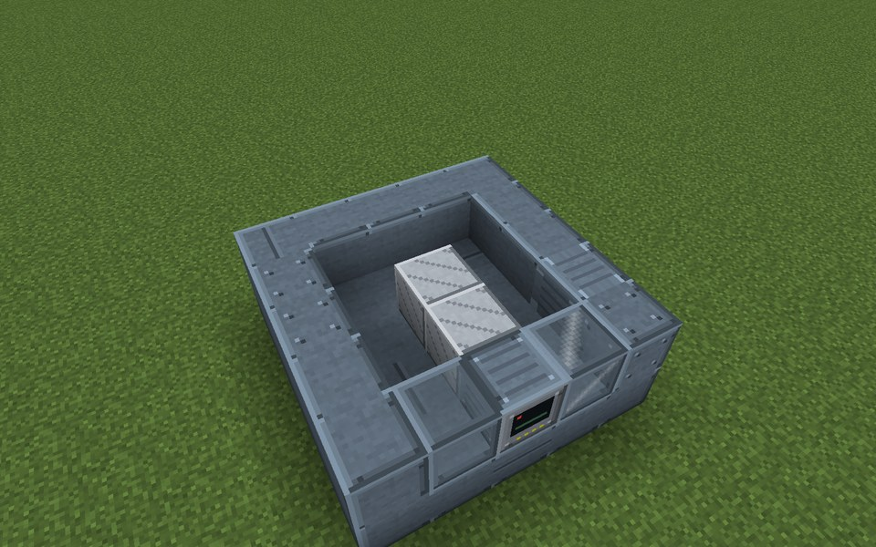

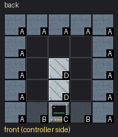

Parts in this step: Rotor Blade (D) ×2, Turbine Casing (A) ×13, Steam Turbine Controller (C) ×1, Turbine Sight Glass (B) ×2

### Step 3: Layer 3

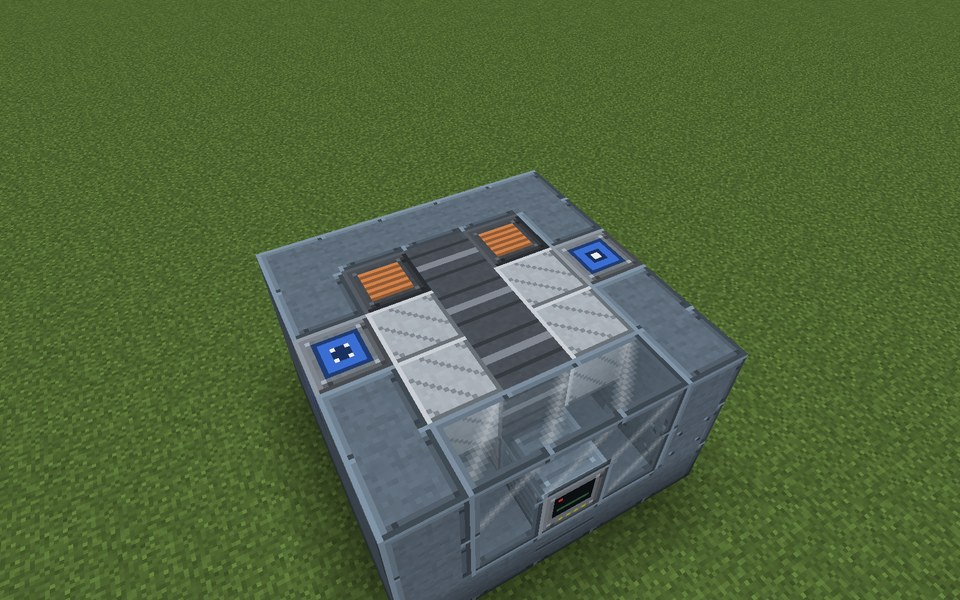

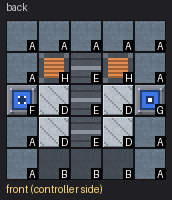

Parts in this step: Fluid Input Port (F) ×1, Fluid Output Port (G) ×1, Generator Coil (H) ×2, Rotor Blade (D) ×4, Rotor Shaft (E) ×3, Turbine Casing (A) ×11, Turbine Sight Glass (B) ×3

### Step 4: Layer 4

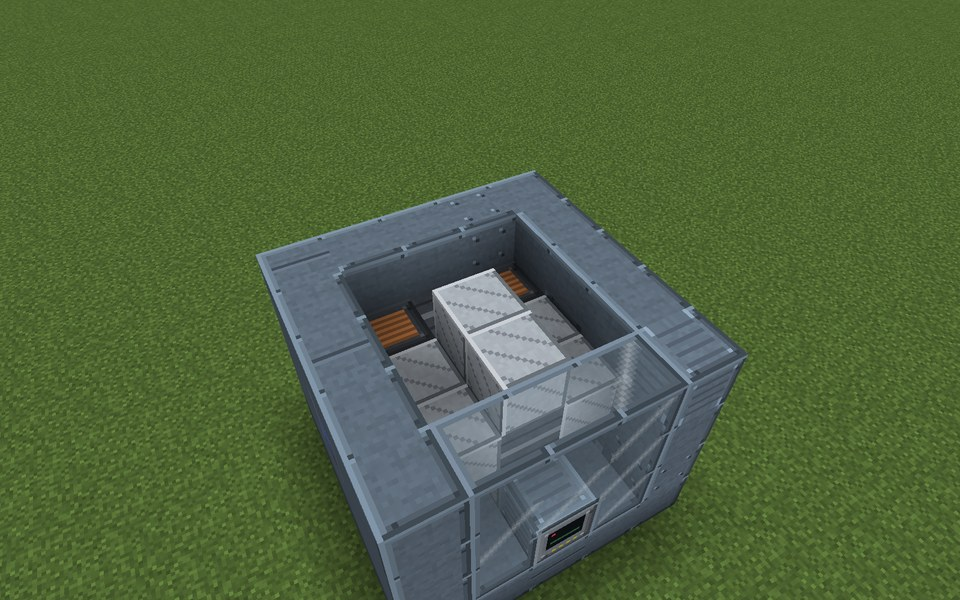

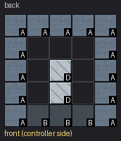

Parts in this step: Rotor Blade (D) ×2, Turbine Casing (A) ×13, Turbine Sight Glass (B) ×3

### Step 5: Layer 5

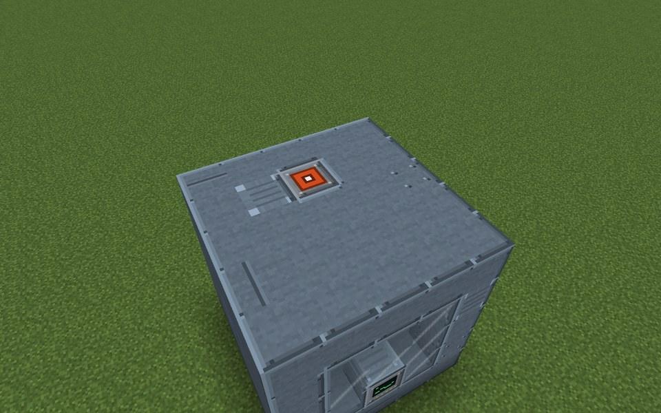

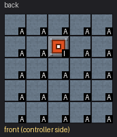

Parts in this step: Energy Output Port (I) ×1, Turbine Casing (A) ×24

### Finished

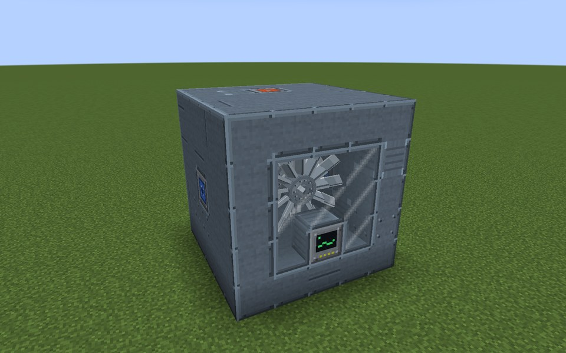

### In operation

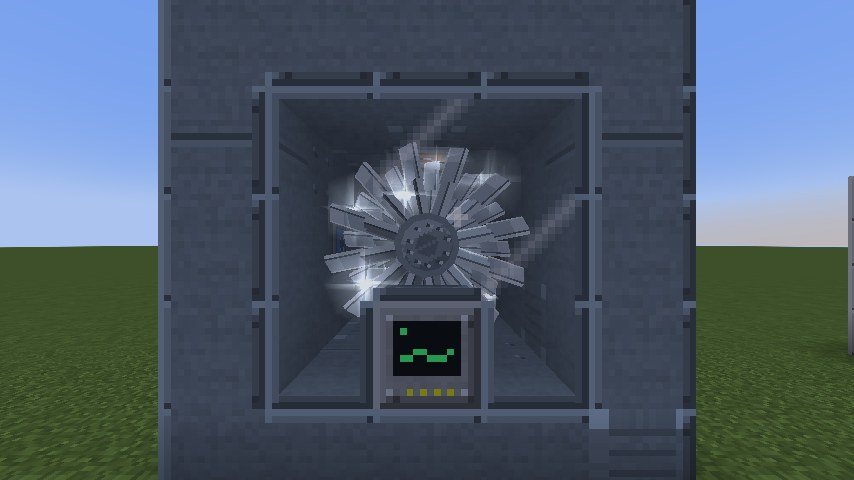
