# Tokamak

The Tokamak fuses Deuterium and Tritium in a magnetically confined plasma ring. It needs a large startup energy
(800,000,000 E, `fusionStartupEnergy`) and power for its magnets, then delivers heat: through Heat Ports to boilers
(or other heat consumers) and/or as Hot Coolant for a Heat Exchanger.

* **Fuel:** Deuterium and Tritium through Gas Input Ports (tanks 64,000 mB each). Each D-T reaction gives 30,000 HU;
  20 % heats the plasma, 80 % goes as neutrons into the blanket. A slower D-D reaction needs a hotter plasma.
* **Tritium breeding:** Lithium Carbonate (item tag `quantavolt:breeding_lithium`, 2,000 units each) in the Item Input
  Port feeds the Breeding Blankets; the neutrons breed Tritium from it (up to 1.25 per reaction with full blanket
  coverage). Auxiliary heating can run a D-D plasma to breed the first Tritium.
* **Plasma:** each Vacuum Chamber block holds 10 mB of plasma. Confinement needs the magnetic field and enough
  Toroidal Field Coils (full at 8 per interior layer). Helium ash dilutes the plasma unless the Divertors pump it out
  (Gas Output Port: Helium and surplus Tritium).
* **Power use:** the magnets draw 100 E/t per field coil at full field, the vacuum pumps 200 E/t while pumping. Energy
  buffer 120,000,000,000 E, up to 50,000,000 E/t in.
* **Heat out:** the blanket heat moves through the Coolant Channels into a 500,000 HU buffer, which leaves through
  Heat Ports and as Hot Coolant (water in, Hot Coolant out, 10 HU per mB).

The example below is 11x5x11: the central solenoid column in the middle, three rings of Vacuum Chamber around it and an
outer ring of 24 Toroidal Field Coils, 24 Breeding Blankets, 24 Coolant Channels, 8 Plasma Injectors (middle layer)
and 16 Divertors; Plasma Diagnostics sits in the roof.

## Rules
* **Size:** at least 11x5x11 (width x height x depth), at most 16 in every direction (`maxStructureSize`). The
  footprint (width x depth) must be square with an odd edge (11, 13, 15).
* **Frame (edges and corners):** Tokamak Casing only.
* **Walls:** Tokamak Casing, Reactor Sight Glass, Inspection Hatch, Plasma Diagnostics, plus controller and ports (in
  the faces, not on edges).
* **Ports:**
  * Energy Input Port: startup energy and magnet power.
  * Gas Input Port: Deuterium and Tritium in. Gas Output Port: Helium and surplus Tritium out.
  * Item Input Port: Lithium Carbonate in.
  * Fluid Input Port: water in. Fluid Output Port: Hot Coolant out.
  * Heat Port: heat out to an adjacent consumer (another plant's Heat Port, Stirling Generator).
* **Inside** (seen from above, square rings around the center, every layer the same rule):
  * Centre column: Poloidal Field Coil (Central Solenoid), full height.
  * Rings between the center and the outermost interior ring: Vacuum Chamber only.
  * Outermost interior ring: Toroidal Field Coils, Plasma Injectors, Divertors, Breeding Blankets, Coolant Channels
    or Tokamak Viewports (a viewport there continues a sight glass in the wall to the plasma).
  * No air anywhere inside.
* **Required:** at least 8 Toroidal Field Coils, 1 Plasma Injector, 1 Divertor, 1 Coolant Channel and 1 Plasma
  Diagnostics (wall).

## Running it
Charge the energy buffer through the Energy Input Ports, fill Deuterium and Tritium, give it water or a heat consumer,
then press **Start**. The phases are: pumping vacuum, ramping magnets, injecting fuel / waiting for startup energy,
ignition, heating, stable burn. Ignition starts when the plasma is at least half the chamber capacity and the buffer
holds the startup energy.

* **Fuel injection:** `-`/`+` by 0.5 mB/t (default 4 mB/t, at most 2 mB/t per Plasma Injector).
* **Auxiliary heating:** `-`/`+` by 1,000 E/t (at most 5,000 E/t per Plasma Injector).
* **Stop** ramps everything down safely. **Auto** re-ignites after a collapse (costs the startup energy again).
* **Collapse:** fuel starvation, instability (too dense plasma, helium, overloaded divertors, hot blanket), lost
  magnet power or an empty startup buffer end the burn. A large collapse is a disruption that hurts living things
  nearby (nothing in `safeMode`). A blanket without heat sink (above 900 °C) triggers a controlled shutdown.
* Fuel use scales with `fuelConsumptionMultiplier`.

**CC: Tweaked:** readings `plasmaTemperature()`, `stability()`, `energyStored()`, `powerOutput()` (HU/t), `netPower()`,
`fusionRate()`, `tritiumBreedingRate()`, `fuelLevel()`, `coolantTemperature()`, `alarmState()`, `reactorState()`;
commands `start()`, `shutdown()`, `setInjectionTarget(mbPerTick)`, `setAuxHeating(ePerTick)`, `setAutoRestart(boolean)`.

## Common error messages
| Message | What to do |
|---|---|
| The tokamak needs a square footprint with odd edge length (is (size)) | Make width and depth equal and odd. |
| Wrong block at (position) (expected: poloidal_field_coil) | The center column must be Poloidal Field Coils from floor to roof. |
| Wrong block at (position) (expected: vacuum_chamber) | Fill the inner rings completely with Vacuum Chamber. |
| Wrong block at (position) (expected: toroidal_field_coil\|plasma_injector\|…) | Only component blocks belong in the outer interior ring (no air). |
| Missing parts: (part:count) | Add the missing parts (8 Toroidal Field Coils, injector, divertor, coolant channel, Plasma Diagnostics). |
| Structure too small ((size)) | Build at least 11 wide, 5 high, 11 deep. |
| Port not allowed here: (position) ((port type)) | Energy Output Ports and item outputs do not work here. |
| The controller must sit in a wall, front facing out | Place the controller in a wall face with the component ring behind it. |

## Sight glass

Every wall block that is not on an edge may be **Reactor Sight Glass** instead of the casing. The plant works the same, and through the glass you see what happens inside while it runs. The example below has Reactor Sight Glass in its front. To see the plasma ring, also put Tokamak Viewports into the outer component ring directly behind the glass (the example has seven of them); each viewport takes the place of a component there.

## Step by step

The example below is 11 wide, 5 high and 11 deep. The example forms as shown (checked in the game when the pictures were taken).

Each step shows the plant from the front left after one more layer is placed (from the bottom up), and a top-down map of that layer: the back of the plant at the top, the front with the controller at the bottom. The letters match the parts lists.

**All parts of the example:**

| | Key | Block | Count |
|---|---|---|---|
| 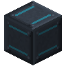 | A | Tokamak Casing | 328 |
| 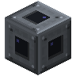 | G | Vacuum Chamber | 144 |
|  | B | Reactor Sight Glass | 26 |
|  | D | Coolant Channel | 21 |
| 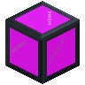 | E | Tokamak Viewport | 21 |
| 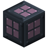 | J | Breeding Blanket | 18 |
| 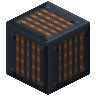 | H | Toroidal Field Coil | 18 |
| 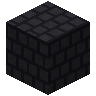 | F | Divertor | 12 |
| 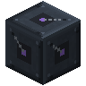 | L | Plasma Injector | 6 |
| 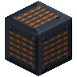 | K | Poloidal Field Coil (Central Solenoid) | 3 |
|  | M | Energy Input Port | 1 |
|  | N | Fluid Input Port | 1 |
|  | I | Fluid Output Port | 1 |
| 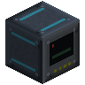 | C | Tokamak Controller | 1 |
| 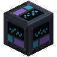 | R | Plasma Diagnostics | 1 |
|  | O | Gas Input Port | 1 |
|  | P | Gas Output Port | 1 |
|  | Q | Heat Port | 1 |

### Step 1: Layer 1

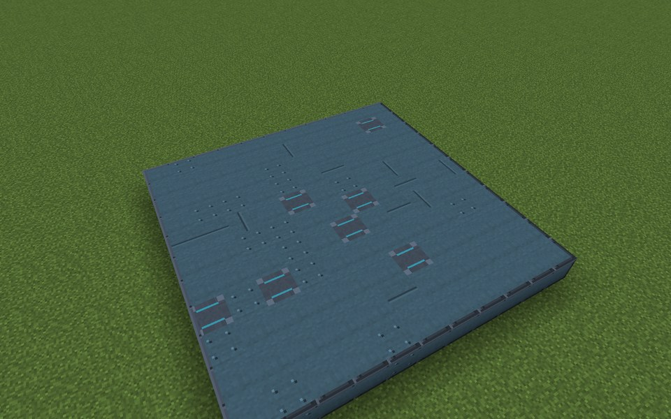

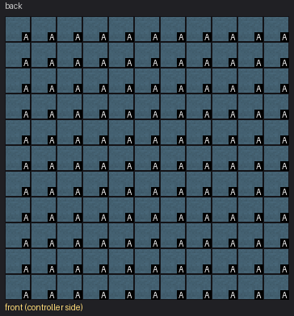

Parts in this step: Tokamak Casing (A) ×121

### Step 2: Layer 2

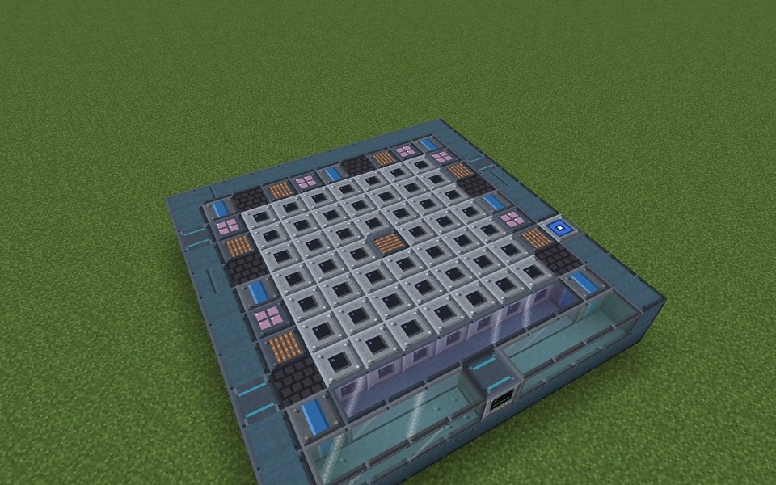

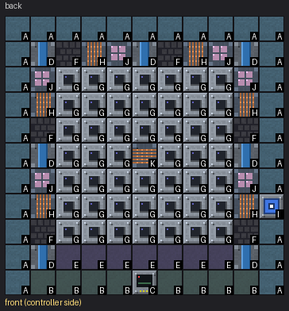

Parts in this step: Breeding Blanket (J) ×6, Coolant Channel (D) ×7, Divertor (F) ×6, Fluid Output Port (I) ×1, Tokamak Controller (C) ×1, Poloidal Field Coil (Central Solenoid) (K) ×1, Reactor Sight Glass (B) ×8, Tokamak Casing (A) ×30, Tokamak Viewport (E) ×7, Toroidal Field Coil (H) ×6, Vacuum Chamber (G) ×48

### Step 3: Layer 3

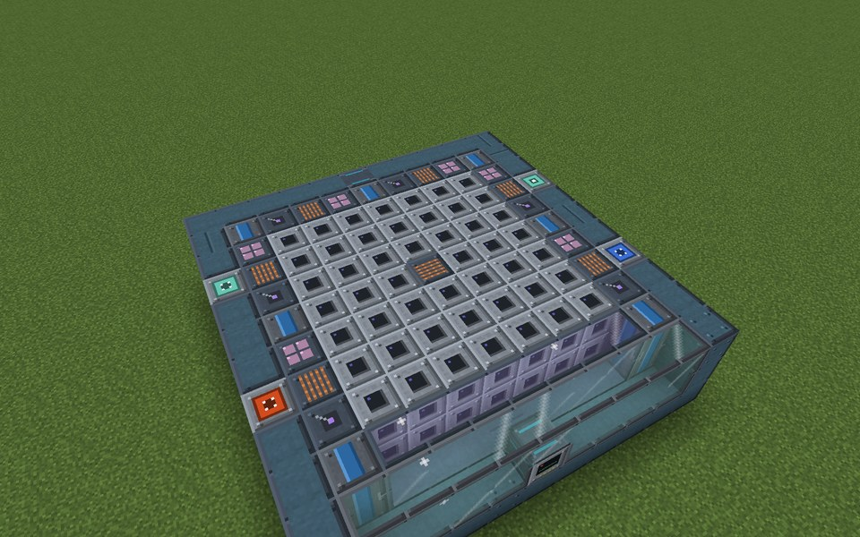

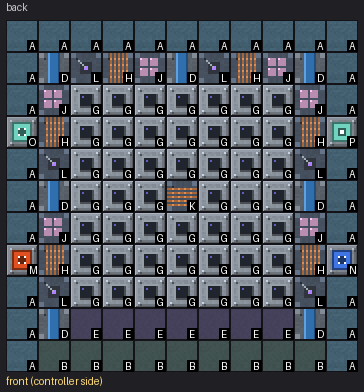

Parts in this step: Breeding Blanket (J) ×6, Coolant Channel (D) ×7, Energy Input Port (M) ×1, Fluid Input Port (N) ×1, Gas Input Port (O) ×1, Gas Output Port (P) ×1, Plasma Injector (L) ×6, Poloidal Field Coil (Central Solenoid) (K) ×1, Reactor Sight Glass (B) ×9, Tokamak Casing (A) ×27, Tokamak Viewport (E) ×7, Toroidal Field Coil (H) ×6, Vacuum Chamber (G) ×48

### Step 4: Layer 4

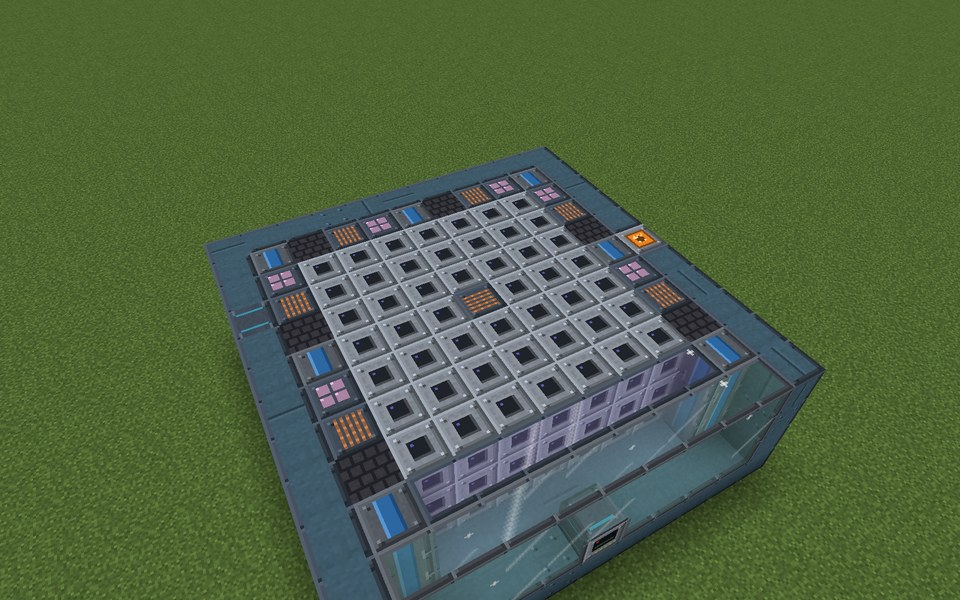

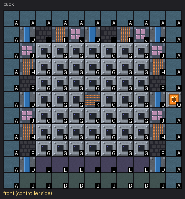

Parts in this step: Breeding Blanket (J) ×6, Coolant Channel (D) ×7, Divertor (F) ×6, Heat Port (Q) ×1, Poloidal Field Coil (Central Solenoid) (K) ×1, Reactor Sight Glass (B) ×9, Tokamak Casing (A) ×30, Tokamak Viewport (E) ×7, Toroidal Field Coil (H) ×6, Vacuum Chamber (G) ×48

### Step 5: Layer 5

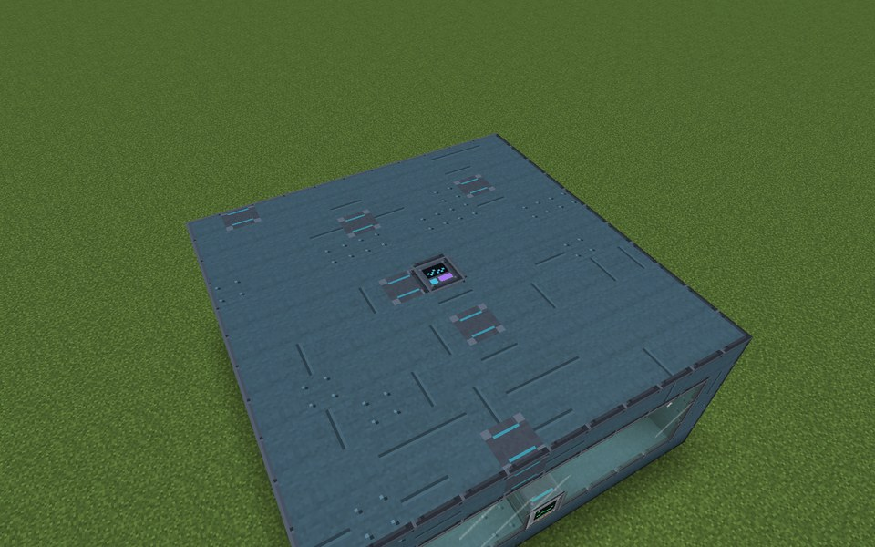

Parts in this step: Plasma Diagnostics (R) ×1, Tokamak Casing (A) ×120

### Finished

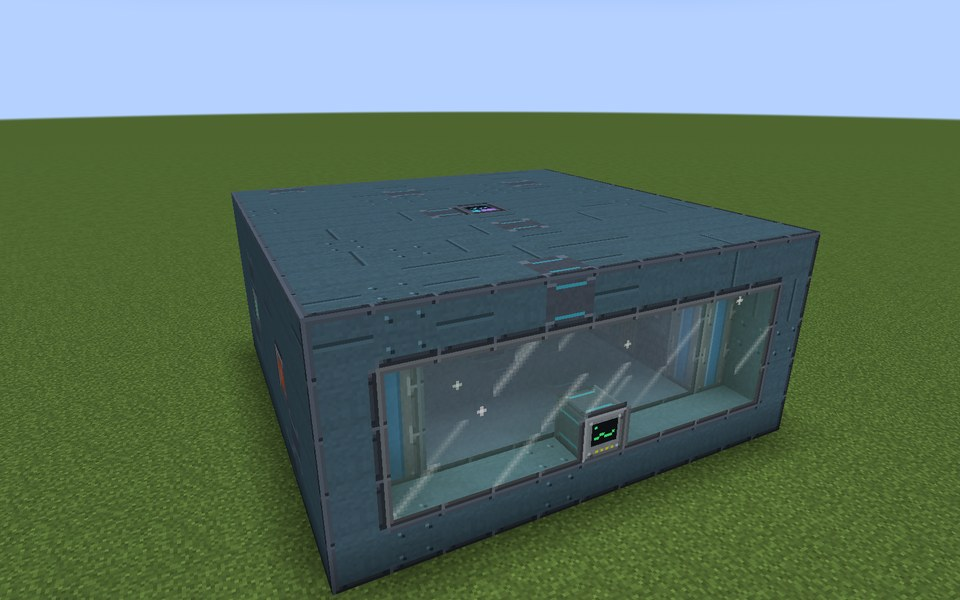

### In operation

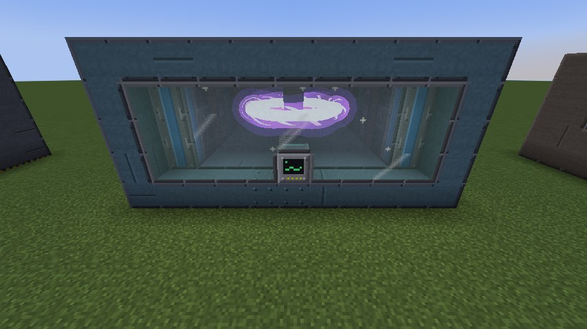
