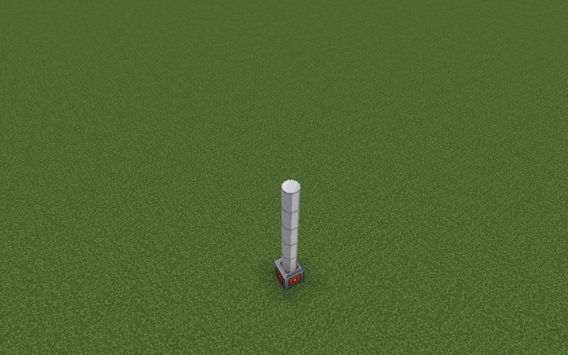
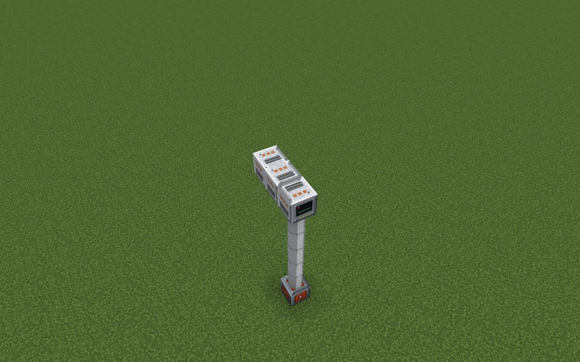
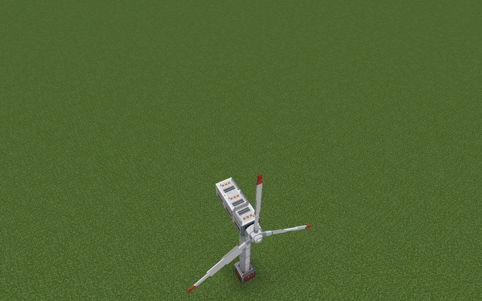
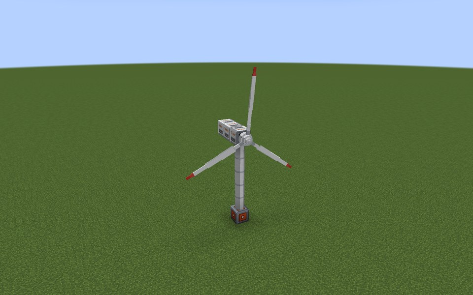
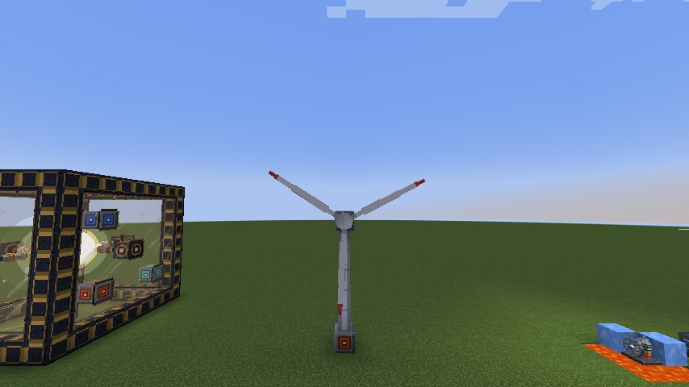

# Wind Turbine

The Wind Turbine makes energy from the wind: a rotor of blade arms in front of the nacelle, generators behind it and a
tower below. It needs no fuel; its output changes with the wind, the height, the weather and the free space around
the rotor.

* **Wind** (1.0 = rated wind): a base wind that changes slowly over time and by region (about 0.27 to 1.23), times
  the height factor (hub height above sea level / 30)^0.25 (at most 1.5), times rain (1.2) or thunder (1.5), times
  the clearance. The End has a steady weak wind (0.6); dimensions with a ceiling such as the Nether have none.
* **Rotor power:** `windPowerFactor` (default 10) x π x (blade length + ½)² x wind³ x Cp. Cp: 0.40 with two arms,
  0.47 with three, 0.49 with four.
* **Generators:** each Wind Generator delivers at most 200 E/t. The rotor speed follows the wind with inertia
  (longer blades react slower) and the output follows the rotor speed.
* **Cut-in:** the rotor turns from wind 0.3 (0.2 with four arms). Above 1.6 it feathers its blades (storm shutdown)
  until the wind falls below 1.3.
* **Clearance:** solid blocks in the rotor circle 2, 4, 6 and 8 blocks in front of the rotor and behind the nacelle
  reduce the wind (1.5 x the share of blocked samples).
* Buffer 100,000 E; Energy Output Ports in the tower push it out.

The example below has a tower of five Wind Turbine Tower segments with the Energy Output Port at its foot, the
controller on top with two Wind Generators behind it, and a hub with three arms of four Wind Rotor Blade Segments
(up, left, right). At rated wind it takes about 300 E/t from the wind; its generators allow up to 400 E/t.

## Rules
* **Nacelle:** the Wind Turbine Controller faces the rotor (sideways). Directly in front of it sits the Wind Rotor Hub.
  Directly behind it, in a line, 1 to 3 Wind Generators.
* **Rotor:** 2 to 4 arms of Wind Rotor Blade Segments start at the hub, going up, down, left and right in the plane
  across the controller's facing. All arms must have the same length: at least 2 and at most 8 blocks
  (`maxWindBladeLength`).
* **Rotor circle:** every block within blade length + ½ of the hub in that plane, except hub and blades, must be air.
* **Tower:** straight down from the controller, a column of Wind Turbine Tower segments and Energy Output Ports, at
  least 4 blocks (`minWindTowerHeight`, ports count), at most 128. The column ends at the first other block.
* **Ports:** Energy Output Ports only, inside the tower column. At least one is required.
* **Required:** hub, 2 arms, 1 Wind Generator, the tower and 1 Energy Output Port.

## Running it
Connect a cable to the Energy Output Port in the tower. The turbine has no buttons. Its screen shows the state ("Too
little wind", "Turning", "Storm shutdown (blades feathered)", "No wind in this dimension"), energy, wind at the hub,
height factor, free inflow, rotor speed, output, possible output, generator limit, blades, blade length, generators and
hub height above sea level.

* Build high and in the open: the height factor reaches its maximum about 150 blocks above sea level, and trees or
  buildings within 8 blocks in front of the rotor or behind the nacelle steal wind.
* Turbines close to each other see nearly the same wind.
* While formed the hub and blades are drawn as a spinning rotor; the blade blocks are passable.
* Output scales with `generatorOutputMultiplier`. The turbine has no incidents.

**CC: Tweaked:** readings `windSpeed()` (% of rated wind), `turbineRpm()`, `powerOutput()`, `energyStored()`,
`reactorState()` (`calm`, `running`, `storm`, `no_wind`). No commands.

## Common error messages
| Message | What to do |
|---|---|
| The controller must sit in a wall, front facing out | The controller must face sideways, towards the hub. |
| Missing parts: wind_rotor_hub:1 | Put the Wind Rotor Hub directly in front of the controller. |
| A wind rotor needs 2 to 4 blade arms at the hub (found (count)) | Add blade arms (up, down, left, right of the hub). |
| All blade arms must be equally long near (position) ((lengths)) | Make every arm the same length. |
| Blade arms must be at least 2 blocks long (are (length)) | Lengthen the arms to 2 or more. |
| Structure too large or not closed near (position) | An arm is longer than `maxWindBladeLength`, more than 3 generators, or a tower above 128. |
| Missing parts: wind_generator:1 | Put a Wind Generator directly behind the controller. |
| The tower below the nacelle is too short ((segments)) | Extend the tower to `minWindTowerHeight` (default 4). |
| Port not allowed here: (position) ((port type)) | Only Energy Output Ports may sit in the tower. |
| Missing parts: energy_output_port:1 | Put an Energy Output Port into the tower column. |
| The rotor circle is blocked at (position) | Clear that block: the whole rotor circle must be air. |

## Step by step

The example below is 9 wide, 11 high and 4 deep. The example forms as shown (checked in the game when the pictures were taken).

**All parts of the example:**

| | Key | Block | Count |
|---|---|---|---|
|  | F | Wind Rotor Blade Segment | 12 |
|  | B | Wind Turbine Tower | 5 |
|  | D | Wind Generator | 2 |
|  | A | Energy Output Port | 1 |
|  | E | Wind Rotor Hub | 1 |
|  | C | Wind Turbine Controller | 1 |

### Step 1: Tower with the energy output port at its foot

Parts in this step: Energy Output Port (A) ×1, Wind Turbine Tower (B) ×5

### Step 2: Nacelle: controller on the tower, generators behind it

Parts in this step: Wind Generator (D) ×2, Wind Turbine Controller (C) ×1

### Step 3: Rotor: hub in front of the controller, equal blade arms

Parts in this step: Wind Rotor Blade Segment (F) ×12, Wind Rotor Hub (E) ×1

### Finished

### In operation

