# Items and Blocks

Every item and block of QuantaVolt as it looks in the inventory. Recipes: [Recipes](Recipes).

## Items

| | | | |
|---|---|---|---|
| 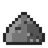 Ash | 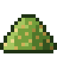 Biomass |  Build Projector |  Compressed Matter |
| 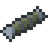 Depleted Fuel Rod | 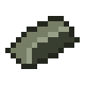 Depleted Uranium | 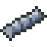 Empty Fuel Rod |  Enriched Uranium |
|  Gas Prospector | 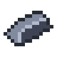 Lead Ingot | 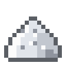 Lithium Carbonate | 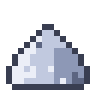 Lithium Dust |
|  Radiation Suit Boots | 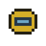 Radiation Suit Hood |  Radiation Suit Jacket |  Radiation Suit Trousers |
| 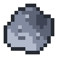 Raw Lead | 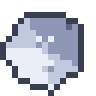 Raw Lithium |  Raw Uranium | 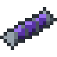 Singularity Capsule |
| 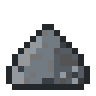 Steel Blend |  Steel Ingot | 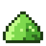 Uranium Dust | 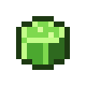 Uranium Fuel Pellet |
|  Uranium Fuel Rod | 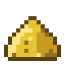 Yellowcake |  |  |

## Blocks

| | | | |
|---|---|---|---|
|  Basic Dynamo |  Battery Cell |  Battery Cooler |  Battery Hall Casing |
|  Battery Hall Controller | 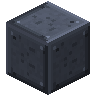 Block of Lead | 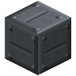 Boiler Casing |  Boiler Sight Glass |
|  Breeding Blanket |  Capacitor Bank Controller |  Capacitor Module |  Centrifuge Cascade Controller |
|  Centrifuge Casing |  Chemical Processor | 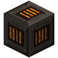 Combustion Chamber |  Combustion Liner |
|  Compressor Blade |  Condenser |  Containment Rod |  Containment Rod Drive |
|  Control Rod |  Coolant Channel | 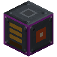 Creative Battery | 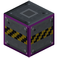 Creative Gas Tank |
|  Crusher | 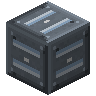 Cryocooler | 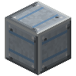 Cryostat Casing | 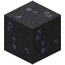 Deepslate Lead Ore |
| 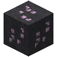 Deepslate Lithium Ore | 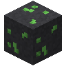 Deepslate Uranium Ore |  Derrick Frame | 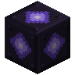 Dimension Core |
| 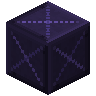 Dimensional Casing | 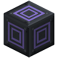 Dimensional Stabiliser | 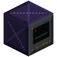 Dimensional Store Controller |  Divertor |
|  Drill Pipe | 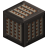 Dump Resistor |  Electric Heater |  Electrolyzer |
| 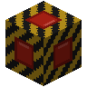 Emergency Shutdown |  Emergency Vent |  Energy Cell |  Energy Input Port |
|  Energy Output Port |  Energy Transformer | 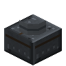 Engine Cylinder | 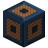 Engine Generator |
|  Fission Reactor Controller |  Fluid Input Port |  Fluid Output Port |  Fluid Tank |
|  Fuel Assembly |  Fuel Fabricator |  Gas Centrifuge |  Gas Compressor |
|  Gas Derrick Controller | 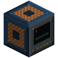 Gas Engine Controller |  Gas Flare |  Gas Input Port |
|  Gas Output Port |  Gas Tank |  Gas Tank Casing |  Gas Turbine Casing |
|  Gas Turbine Controller |  Gasifier Casing |  Gasifier Controller |  Generator Coil |
|  Geothermal Heat Exchanger |  Graphite Moderator | 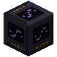 Gravimetry | 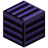 Gravitational Containment Coil |
| 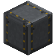 Gravity Shaft Casing | 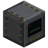 Gravity Store Controller | 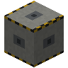 Gravity Weight | 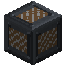 Gravity Winch |
| 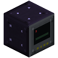 Hawking Reactor Controller |  Heat Exchanger | 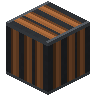 Heat Exchanger Tubes |  Heat Port |
| 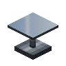 Heliostat | 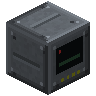 Industrial Boiler Controller | 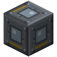 Inspection Hatch |  Inverter |
|  Isotope Separator |  Item Input Port |  Item Output Port |  Large Gas Tank Controller |
| 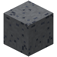 Lead Concrete | 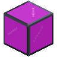 Lead Glass | 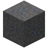 Lead Ore | 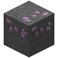 Lithium Ore |
|  Little Star Controller |  Matter Compressor |  Matter Injector |  Micro Black Hole Plant Controller |
|  Molten-Salt Store Controller |  Plasma Diagnostics |  Plasma Injector |  Poloidal Field Coil (Central Solenoid) |
|  Power Converter |  Pump |  PV Module |  Radiation Collector |
|  Reaction Chamber |  Reactor Casing |  Reactor Instrumentation |  Reactor Sight Glass |
|  Reinforced Concrete |  Reinforced Glass |  Rotor Blade |  Rotor Shaft |
|  Safety Valve |  Salt Tank Casing |  Sensor Module |  Singularity Casing |
|  Singularity Frame |  SMES Controller |  Solar Array Controller |  Solar Receiver |
|  Steam Turbine Controller |  Stellar Containment Glass |  Stellar Diagnostics |  Stellar Frame |
|  Stirling Generator |  Superconducting Coil |  Thermal Concrete |  Thermal Salt |
|  Thermoelectric Generator |  Tokamak Casing |  Tokamak Controller |  Tokamak Viewport |
|  Toroidal Field Coil |  Transfer Channel |  Turbine Casing |  Turbine Sight Glass |
|  Uranium Ore |  Vacuum Chamber |  Wellhead |  Wind Generator |
|  Wind Rotor Blade Segment |  Wind Rotor Hub |  Wind Turbine Controller |  Wind Turbine Tower |
