# Machines

Every QuantaVolt block that works on its own, without forming a multiblock. Plants (boilers, turbines, reactors …) are
described on their build pages; see [Getting Started](Getting-Started) for the overview and [Recipes](Recipes) for
the crafting recipes.

Numbers are defaults. Where a value comes from the [server configuration](Configuration), the key is named.

General rules:

* Energy is in E (1 E = 1 FE), fluids and gases in mB, heat in HU. See [Energy, Fluids and Gases](Energy-Fluids-Gases).
* Generators **push** energy into neighbors by themselves. Fluid and gas outputs are **pulled** by pipes (the machine
  does not push them).
* Gases go in and out only through Pipster's gas pipes.
* QuantaVolt has no wrench. Machines are mined with a pickaxe. Its two hand tools, the Gas Prospector and the Build
  Projector, are listed under [Tools](#tools).
* Machines with a front (Energy Cell, Electric Heater, Energy Transformer, Sensor Module …) face you when you place
  them.

---

## Generators

### 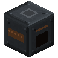 Basic Dynamo

Burns furnace fuel and makes energy.

| | |
|---|---|
| Input | 1 fuel slot: any item with a furnace burn time (a bucket's container is returned, e.g. an empty bucket from a lava bucket) |
| Output | 40 E/t while burning (`basicDynamoOutput`, times `generatorOutputMultiplier`) |
| Burn time | Vanilla burn time, divided by `fuelConsumptionMultiplier` (coal: 1,600 ticks) |
| Buffer | 50,000 E, pushes up to 400 E/t into all six neighbors |

A new fuel item is only started when the buffer has room for at least one tick of output. While it burns, the
front shows a flickering fire, the dynamo gives light like a lit furnace and crackles with flames and smoke.

### 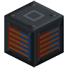 Thermoelectric Generator

Makes power from a temperature difference between its six neighbors. It consumes nothing.

| Neighbor | Side | Weight |
|---|---|---|
| Lava (source or flowing), blocks in tag `quantavolt:thermoelectric/hot_strong` (empty by default) | hot | 3 |
| Magma Block, Fire, Soul Fire, Campfire, Soul Campfire (tag `quantavolt:thermoelectric/hot`) | hot | 1 |
| Packed Ice, Blue Ice (tag `quantavolt:thermoelectric/cold_strong`) | cold | 3 |
| Water, Ice, Snow Block, Powder Snow, Frosted Ice (tag `quantavolt:thermoelectric/cold`) | cold | 1 |

* Output = 6 E/t × the smaller of hot weight and cold weight (times `generatorOutputMultiplier`). One hot side alone
  produces nothing.
* A hot or cold block that touches several Thermoelectric Generators is split evenly between them.
* Neighbors are checked every 20 ticks. Buffer 20,000 E; energy is pushed into all neighbors.

### 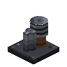 Stirling Generator

Turns heat into electricity with a flywheel engine.

| | |
|---|---|
| Heat in | Up to 240 HU/t in total: from HEAT ports or an Electric Heater on any side, and from hot blocks in the 3×3 area directly below |
| Ground heat (per block below) | Lava source 25, lit Soul Campfire 12, Soul Fire 12, lit Campfire 10, Fire 8, Magma Block 6 HU/t |
| Cooling | The four sides and the top: Packed Ice / Blue Ice count 3, water and the other cold blocks of the thermoelectric list count 1 |
| Output | At most 100 E/t (`stirlingMaxOutput`), times `generatorOutputMultiplier` |
| Buffer | 20,000 E, pushed into all neighbors |

* The hot head has to warm up: the engine starts at 500 °C and draws more heat the hotter the head gets. Above
  700 °C the generator refuses outside heat.
* Efficiency is 55 % of the Carnot efficiency between the hot head and the cold side. The cold side is
  20 °C + 200 / (1 + cooling weight) °C, so good cooling raises the output.
* A hot block below several Stirling Generators is split between them. The area below and the cooling are checked
  every 40 ticks.

### 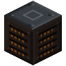 Geothermal Heat Exchanger

Boils water into steam with heat from the ground.

| | |
|---|---|
| Heat sources | Lava source blocks (25 HU/t each) and Magma Blocks (6 HU/t each) in the area 5×5 blocks wide and 6 blocks deep below it |
| Nether | ×1.5 |
| Limit | 1,000 HU/t |
| Conversion | 1 HU → 1 mB Steam, 1 mB water → 10 mB Steam |
| Tanks | Water 8,000 mB (in, any side), Steam 16,000 mB (out, any side) |

The area is counted every 200 ticks (unloaded chunks are skipped). A source inside the areas of several exchangers is
split between them.

---

## Storage and logistics

### 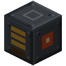 Energy Cell

| | |
|---|---|
| Capacity | 1,000,000 E |
| Rate | 2,000 E/t in and 2,000 E/t out |
| Sides | Accepts energy on every side except the front; pushes energy out of the front |

###  Fluid Tank

32,000 mB of any single fluid, insert and extract on every side. The tank is see-through: the fluid inside rises
with the fill level and shows the fluid's own texture and color.

### 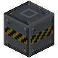 Gas Tank

64,000 mB of any single gas (Pipster gas system), insert and extract on every side. For more, build a
[Large Gas Tank](Build-Large-Gas-Tank) (64,000 mB per interior block, up to 32x32x32).

### Creative Battery and Creative Gas Tank

Only in the creative menu, no recipe. Meant for testing plants and for creative builds.

* **Creative Battery:** an endless energy source. It pushes up to 1,000,000,000 E/t into every neighbor and accepts any
  amount from every side (the energy disappears).
* **Creative Gas Tank:** an endless supply of one gas. Choose the gas in its screen with `<` and `>`; every gas known
  to Pipster is offered, including other mods' gases. Pipster gas pipes in Extract mode take it from every side.

###  Pump

Pumps water from an infinite source.

| | |
|---|---|
| Source | The block directly below must be a water source with at least two horizontally adjacent water sources (the vanilla infinite-water rule); checked every 40 ticks. Blocks are never removed. |
| Rate | 100 mB/t of water for 10 E/t |
| Buffers | Energy 10,000 E (input up to 1,000 E/t), water 8,000 mB |
| Sides | Energy in and water out on every side |

The screen shows whether an infinite source was found.

### 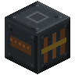 Energy Transformer

A buffer between two networks that limits its output, e.g. to protect thin cables.

| | |
|---|---|
| Buffer | 1,000,000 E |
| Input | Every side except the front |
| Output | Pushed out of the front, at most the set rate (default 1,000 E/t; buttons ×2 and ÷2; 1 to 1,000,000 E/t) |

###  Emergency Vent

Accepts any gas and Steam / Exhaust Steam on every side and releases it into the air, up to 2,000 mB/t of gas and
2,000 mB/t of steam (tanks of 4,000 mB each). Use it where a plant's output could back up.

###  Sensor Module

Turns a reading of the machine on its back side into a redstone signal (place it while looking at the machine, so
its back touches the machine). For a plant, put it against the controller.

| | |
|---|---|
| Readings | The same readings as the [ComputerCraft](ComputerCraft) peripheral (energy stored, temperature, power output …); the button cycles through the numeric readings the machine has. Default: energy stored. |
| Modes | *signal above threshold*, *signal below threshold*, *analog* (threshold = full signal 15) |
| Threshold | Default 100; buttons ×2 and ÷2 |
| Update | Every 10 ticks |

---

## Processing

All processing machines take energy on every side (buffer 50,000 E, up to 1,000 E/t in), take inputs on any side and
give outputs from any side. Inputs are taken when a job starts, the energy is drawn every tick of the job.

| Machine | Recipe | Time | Energy |
|---|---|---|---|
| 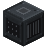 **Crusher** (1 input, 2 output slots) | Raw Uranium or uranium ore → 2 Uranium Dust | 100 t | 20 E/t |
| | Raw Lithium or lithium ore → 2 Lithium Dust | 100 t | 20 E/t |
|  **Chemical Processor** (1 input, 1 output, 8,000 mB water tank) | Uranium Dust + 250 mB water → Yellowcake | 160 t | 30 E/t |
| | Lithium Dust + 250 mB water → Lithium Carbonate | 160 t | 30 E/t |
|  **Fuel Fabricator** (2 inputs, 1 output) | Enriched Uranium → 4 Uranium Fuel Pellets | 100 t | 40 E/t |
| | 4 Uranium Fuel Pellets + 1 Empty Fuel Rod → Uranium Fuel Rod | 200 t | 40 E/t |
| 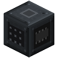 **Matter Compressor** (1 input, 1 output) | 8 compressible blocks → 1 Compressed Matter | 40 t | 500 E/t |

The inputs are item tags, so materials of other mods can join; see [Materials and Ores](Materials-and-Ores).

---

## Gas machines

### 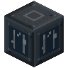 Electrolyzer

Two modes, switched with the button in the screen or from a computer.

| | Electrolysis (default) | Fuel cell |
|---|---|---|
| In | Water + energy (any side) | Hydrogen + Oxygen (any side) |
| Out | Hydrogen + Oxygen (any side) | Water (any side) + energy pushed into all neighbors |
| Per mB water | 100 E → 10 mB Hydrogen + 5 mB Oxygen | 10 mB Hydrogen + 5 mB Oxygen → 1 mB water + 50 E |
| Rate | Up to 5 mB water per tick (500 E/t) | Up to 5 mB water per tick (250 E/t) |

Tanks: water 8,000 mB, hydrogen 32,000 mB, oxygen 16,000 mB; energy buffer 100,000 E (input up to 2,000 E/t); fuel
cell output buffer 20,000 E. It stops when an output tank is full. The fuel cell gives back half the energy the
electrolysis used.

### 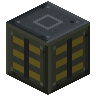 Gas Compressor

Turns Hydrogen, Syngas or Natural Gas into its compressed form (same gas, marked as high pressure).

| | |
|---|---|
| Rate | Up to 100 mB/t, 2 E per mB |
| Tanks | 16,000 mB in, 16,000 mB out (any side) |
| Energy | 50,000 E buffer, up to 1,000 E/t in |

Compressed gas releases 25 % more heat in the Gas Turbine (natural gas 10 instead of 8 HU/mB, hydrogen 7 instead of 6 HU/mB, syngas 5 instead of
4 HU/mB). The Gas Engine and the Industrial Boiler take only uncompressed gas.

###  Isotope Separator

Hydrogen → Deuterium for the Tokamak.

| | |
|---|---|
| Recipe | 10 mB Hydrogen + 400 E → 1 mB Deuterium, up to 2 per tick |
| Tanks | 16,000 mB Hydrogen in, 16,000 mB Deuterium out (any side) |
| Energy | 40,000 E buffer, up to 4,000 E/t in |

Only uncompressed hydrogen is separated.

###  Gas Flare

Burns surplus fuel gas without using it, for example natural gas a derrick delivers faster than the plants burn it.
The counterpart of the Emergency Vent, which releases gas unburnt.

| | |
|---|---|
| Accepts | Gases that burn: Hydrogen, Syngas, Natural Gas (compressed forms too), on every side. Oxygen, Helium, Deuterium and Tritium are refused. |
| Rate | Up to 500 mB/t, no energy gained |
| Buffer | 2,000 mB, one gas at a time |
| Redstone mode | Button `>`: *Always* (default), *With a redstone signal*, *Without a redstone signal* |

* While the redstone mode holds it, the flare keeps what is in its buffer and takes nothing more once the buffer is
  full, so the gas backs up in the pipes.
* While it burns it gives light (level 13) and shows its own flame with smoke above it. The flame follows the client
  option `particleDensity` (0 = no flame).
* The screen shows the state (*Burning*, *Waiting for gas*, *Held by redstone*), the redstone mode, the gas, the
  rate burning now, the total burnt and the buffer.

---

## Heat machines

###  Heat Exchanger

Turns hot coolant from a reactor or engine into steam. Two separate loops that never mix:

| | |
|---|---|
| Primary | Hot Coolant in → water out (1 mB water back per mB hot coolant) |
| Secondary | Feedwater in → Steam out |
| Rate | Up to 100 mB/t of Hot Coolant → 1,000 mB/t of Steam from 100 mB/t of feedwater (10 HU per mB hot coolant) |
| Tanks | Hot coolant 8,000, returned water 8,000, feedwater 8,000, steam 32,000 mB |

Water you put in always goes to the feedwater tank; water you pull out always comes from the primary return tank.

###  Condenser

Turns turbine Exhaust Steam back into water (10 mB exhaust → 1 mB water).

| | |
|---|---|
| Rate | 200 mB/t of exhaust by air, +200 mB/t for each adjacent water source block, at most 1,400 mB/t |
| Tanks | Exhaust 16,000 mB (in, any side), water 8,000 mB (out, any side) |

### 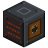 Electric Heater

Turns energy into heat for the block in front of it (a Heat Port of a plant, or a Stirling Generator).

| | |
|---|---|
| Conversion | 1 E → 0.9 HU, at most 400 HU/t |
| Energy | Every side except the front; buffer 100,000 E, up to 2,000 E/t in |

Heat nobody takes is not lost: it stays in the buffer as energy.

---

## Tools

###  Gas Prospector

Right-click any block: it reports the natural gas field of the region that block lies in (kind, share and amount
left, current rate), the direction of the nearest field among the eight neighbouring regions and the corners of the
region. No energy, never used up. Details: [Natural Gas](Natural-Gas#gas-prospector).

###  Build Projector

Right-click a plant controller with it (main hand) to choose the plant's size and project its plan into the world:
missing blocks as small floating copies, blocks in the way in red frames, with a material list. Sneak + right-click
ends the projection. Details: [Build Projector](Build-Projector).

---

## Multiblock parts with their own function

These are placed in a plant's walls; they do nothing on their own.

| Part | Plants | Function |
|---|---|---|
| Item / Fluid / Gas / Energy Input Port, Item / Fluid / Gas / Energy Output Port, Heat Port | all plants (each allows certain types) | Connect pipes, cables and other plants. Right-click opens the screen of the formed plant. |
| Inspection Hatch | box-shaped plants (also the Large Gas Tank) | Right-click opens the screen of the formed plant from any side. |
| Safety Valve | Industrial Boiler | Blows off steam above 380 °C, up to 1,000 HU/t each. |
| Reactor Instrumentation | Fission Reactor | Enables the automatic SCRAM. |
| Emergency Shutdown | Fission Reactor | A redstone signal at it scrams the reactor. |
| Plasma Diagnostics | Tokamak | Required part. |
| Stellar Diagnostics | Little Star | Enables automatic control. |
| Gravimetry | Micro Black Hole Plant (optional), Hawking Reactor (required) | Enables automatic control. |
| Matter Injector | Micro Black Hole Plant, Hawking Reactor | Feeds matter (0.05 mass units per tick each). |

Details are on [Safety and Incidents](Safety-and-Incidents) and the build pages.
