# Recipes

All recipes are normal datapack recipes and can be changed with a datapack. The pictures show the
crafting table in the game.

## Materials

### Steel Blend ×1

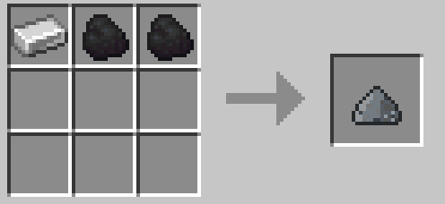

Shapeless: any Iron Ingot, any Coals ×2

### Steel Ingot ×1

Blast Furnace: Steel Blend → Steel Ingot

### Biomass ×2

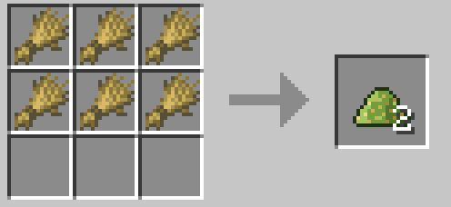

Shapeless: Wheat ×6

### Biomass ×1

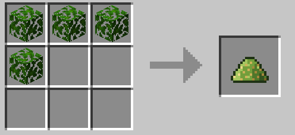

Shapeless: any Leaves ×4

### Biomass ×1

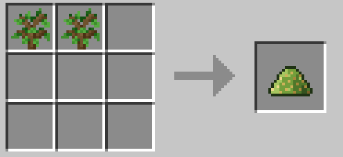

Shapeless: any Saplings ×2

### Thermal Salt ×2

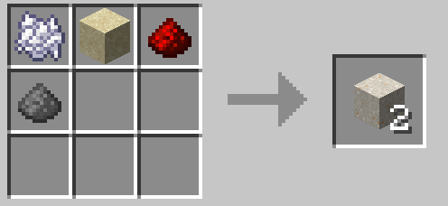

Shapeless: Bone Meal, any Sand, any Redstone Dust, Gunpowder

### Thermal Concrete ×4

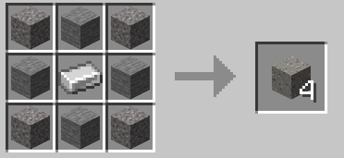

Ingredients: Gravel ×4, Stone ×4, any Iron Ingot

### Empty Fuel Rod ×2

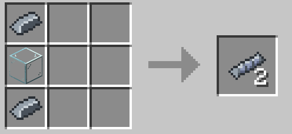

Ingredients: any Structural Steel ×2, any Glass Blocks

### Lead Ingot ×1

Furnace: any Raw Lead → Lead Ingot

### Lead Ingot ×1

Blast Furnace: any Raw Lead → Lead Ingot

### Lead Ingot ×1

Furnace: any Lead Ore → Lead Ingot

### Lead Ingot ×9

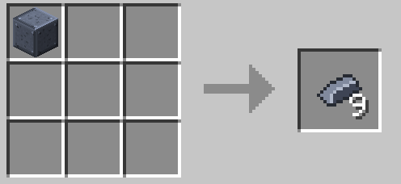

Shapeless: Block of Lead

### Block of Lead ×1

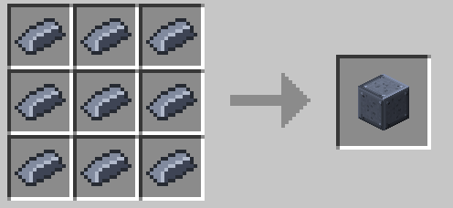

Ingredients: any Lead Ingot ×9

## Ports and shared parts

### Energy Input Port ×1

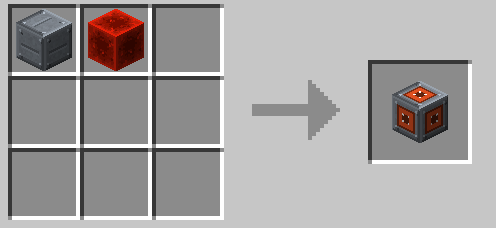

Shapeless: Boiler Casing, any Redstone Block

### Energy Input Port ×1

Shapeless: Energy Output Port

### Energy Output Port ×1

Shapeless: Energy Input Port

### Fluid Input Port ×1

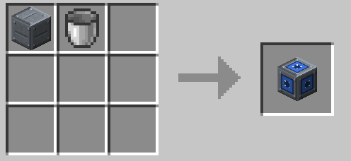

Shapeless: Boiler Casing, Bucket

### Fluid Input Port ×1

Shapeless: Fluid Output Port

### Fluid Output Port ×1

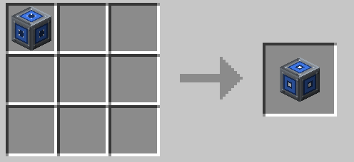

Shapeless: Fluid Input Port

### Gas Input Port ×1

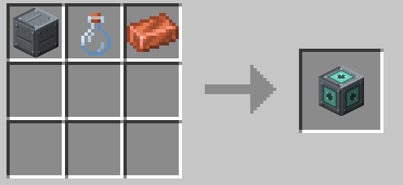

Shapeless: Boiler Casing, Glass Bottle, any Copper Ingot

### Gas Input Port ×1

Shapeless: Gas Output Port

### Gas Output Port ×1

Shapeless: Gas Input Port

### Item Input Port ×1

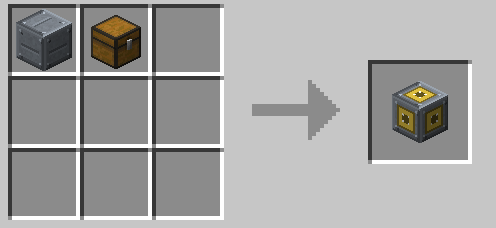

Shapeless: Boiler Casing, any Chests

### Item Input Port ×1

Shapeless: Item Output Port

### Item Output Port ×1

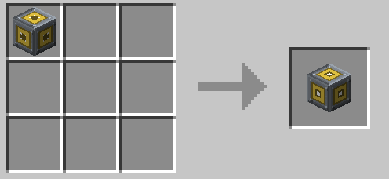

Shapeless: Item Input Port

### Heat Port ×1

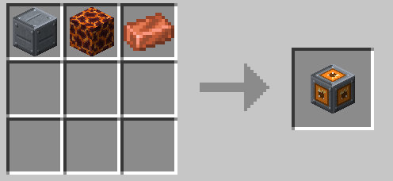

Shapeless: Boiler Casing, Magma Block, any Copper Ingot

### Inspection Hatch ×1

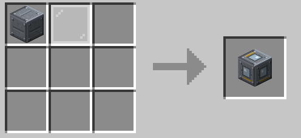

Shapeless: Boiler Casing, any Glass Panes

### Sensor Module ×1

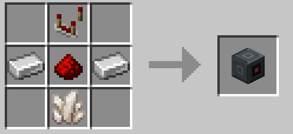

Ingredients: Comparator, any Iron Ingot ×2, any Redstone Dust, Quartz

### Energy Transformer ×1

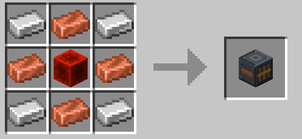

Ingredients: any Iron Ingot ×4, any Copper Ingot ×4, any Redstone Block

### Heat Exchanger Tubes ×2

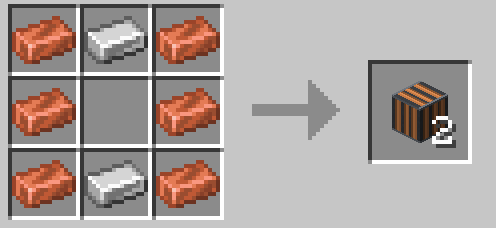

Ingredients: any Copper Ingot ×6, any Iron Ingot ×2

### Coolant Channel ×2

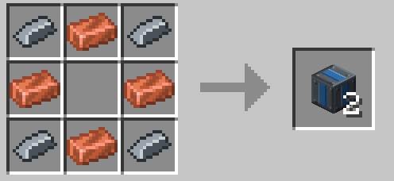

Ingredients: any Structural Steel ×4, any Copper Ingot ×4

### Rotor Shaft ×4

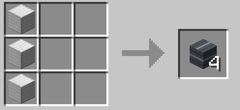

Ingredients: any Iron Block ×3

### Rotor Blade ×2

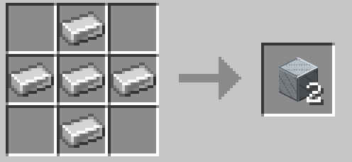

Ingredients: any Iron Ingot ×5

### Generator Coil ×2

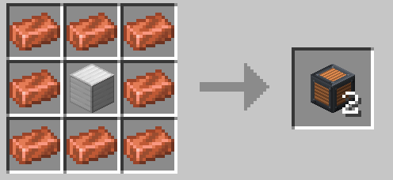

Ingredients: any Copper Ingot ×8, any Iron Block

### Emergency Vent ×1

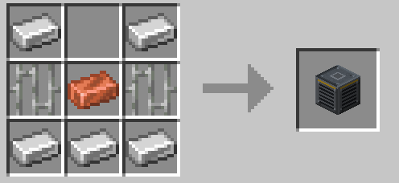

Ingredients: any Iron Ingot ×5, Iron Bars ×2, any Copper Ingot

## Single machines

### Basic Dynamo ×1

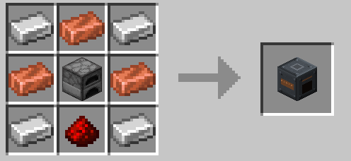

Ingredients: any Iron Ingot ×4, any Copper Ingot ×3, Furnace, any Redstone Dust

### Energy Cell ×1

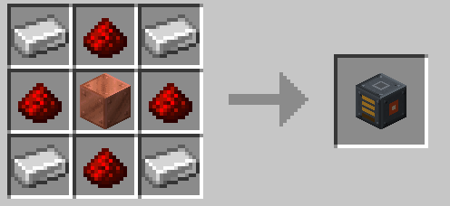

Ingredients: any Iron Ingot ×4, any Redstone Dust ×4, any Copper Block

### Fluid Tank ×1

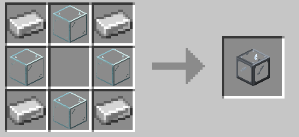

Ingredients: any Iron Ingot ×4, any Glass Blocks ×4

### Gas Tank ×1

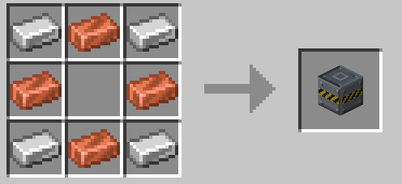

Ingredients: any Iron Ingot ×4, any Copper Ingot ×4

### Pump ×1

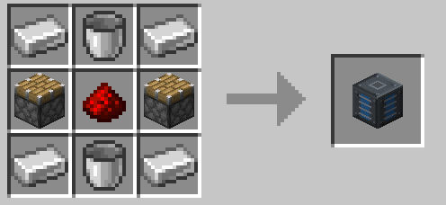

Ingredients: any Iron Ingot ×4, Bucket ×2, Piston ×2, any Redstone Dust

### Electrolyzer ×1

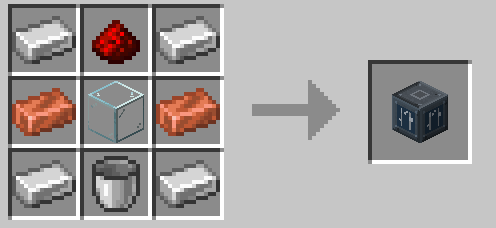

Ingredients: any Iron Ingot ×4, any Redstone Dust, any Copper Ingot ×2, any Glass Blocks, Bucket

### Gas Compressor ×1

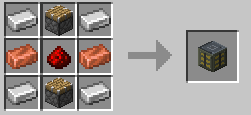

Ingredients: any Iron Ingot ×4, Piston ×2, any Copper Ingot ×2, any Redstone Dust

### Condenser ×1

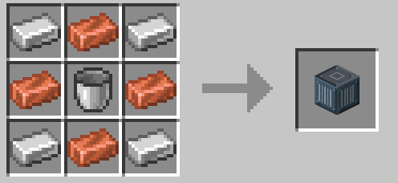

Ingredients: any Iron Ingot ×4, any Copper Ingot ×4, Bucket

### Heat Exchanger ×1

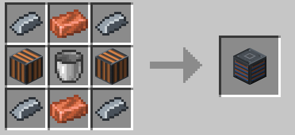

Ingredients: any Structural Steel ×4, any Copper Ingot ×2, Heat Exchanger Tubes ×2, Bucket

### Electric Heater ×1

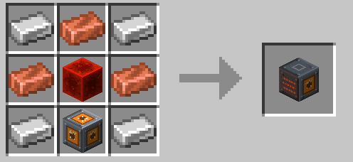

Ingredients: any Iron Ingot ×4, any Copper Ingot ×3, any Redstone Block, Heat Port

### Crusher ×1

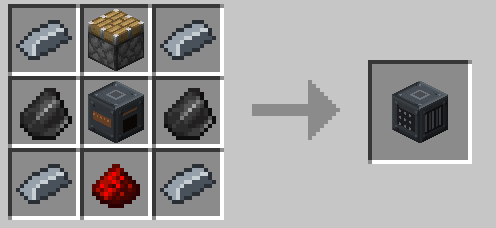

Ingredients: any Structural Steel ×4, Piston, Flint ×2, Basic Dynamo, any Redstone Dust

### Chemical Processor ×1

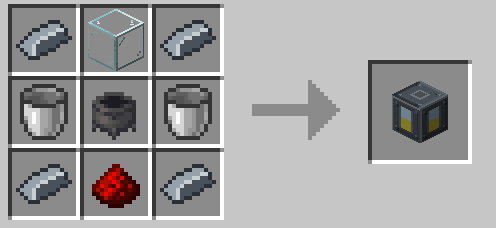

Ingredients: any Structural Steel ×4, any Glass Blocks, Bucket ×2, Cauldron, any Redstone Dust

### Isotope Separator ×1

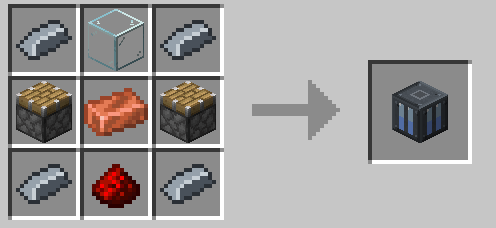

Ingredients: any Structural Steel ×4, any Glass Blocks, Piston ×2, any Copper Ingot, any Redstone Dust

### Fuel Fabricator ×1

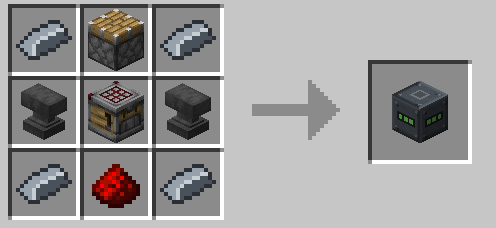

Ingredients: any Structural Steel ×4, Piston, Anvil ×2, Crafter, any Redstone Dust

### Stirling Generator ×1

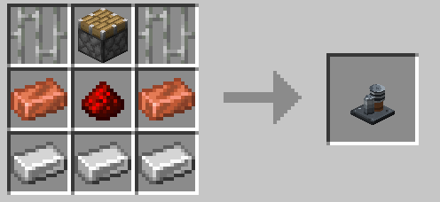

Ingredients: Iron Bars ×2, Piston, any Copper Ingot ×2, any Redstone Dust, any Iron Ingot ×3

### Thermoelectric Generator ×1

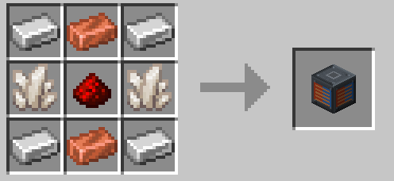

Ingredients: any Iron Ingot ×4, any Copper Ingot ×2, Quartz ×2, any Redstone Dust

### Geothermal Heat Exchanger ×1

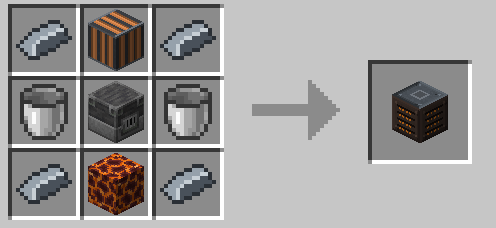

Ingredients: any Structural Steel ×4, Heat Exchanger Tubes, Bucket ×2, Blast Furnace, Magma Block

### Matter Compressor ×1

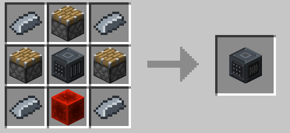

Ingredients: any Structural Steel ×4, Piston ×3, Crusher, any Redstone Block

## Industrial Boiler

### Industrial Boiler Controller ×1

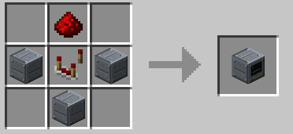

Ingredients: any Redstone Dust, Boiler Casing ×3, Comparator

### Boiler Casing ×4

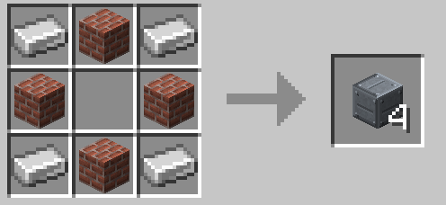

Ingredients: any Iron Ingot ×4, Bricks ×4

### Boiler Sight Glass ×2

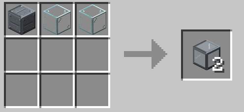

Shapeless: Boiler Casing, any Glass Blocks ×2

### Combustion Chamber ×1

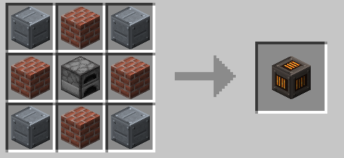

Ingredients: Boiler Casing ×4, Bricks ×4, Furnace

### Safety Valve ×1

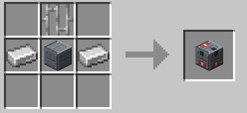

Ingredients: Iron Bars, any Iron Ingot ×2, Boiler Casing

## Steam Turbine

### Steam Turbine Controller ×1

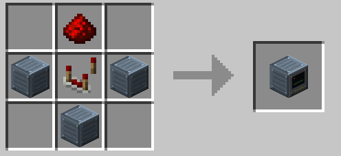

Ingredients: any Redstone Dust, Turbine Casing ×3, Comparator

### Turbine Casing ×8

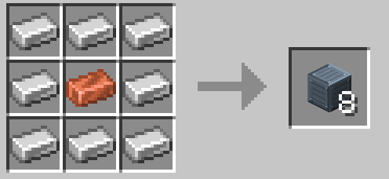

Ingredients: any Iron Ingot ×8, any Copper Ingot

### Turbine Sight Glass ×2

Shapeless: Turbine Casing, any Glass Blocks ×2

## Gasifier

### Gasifier Controller ×1

Ingredients: any Redstone Dust, Gasifier Casing ×3, Comparator

### Gasifier Casing ×4

Ingredients: any Iron Ingot ×4, Bricks ×4, any Coals

### Reaction Chamber ×1

Ingredients: Gasifier Casing ×4, Blast Furnace ×4, Magma Block

## Gas Turbine

### Gas Turbine Controller ×1

Ingredients: any Redstone Dust, Gas Turbine Casing ×3, Comparator

### Gas Turbine Casing ×8

Ingredients: any Iron Ingot ×8, any Gold Ingot

### Compressor Blade ×2

Ingredients: any Iron Ingot ×3

### Combustion Liner ×1

Ingredients: Gas Turbine Casing ×4, Blaze Rod ×4, Blast Furnace

## Gas Engine

### Gas Engine Controller ×1

Ingredients: any Redstone Dust, any Structural Steel ×2, Comparator, Engine Cylinder

### Engine Cylinder ×1

Ingredients: any Structural Steel ×7, Piston, Blast Furnace

### Engine Generator ×1

Ingredients: any Structural Steel ×4, any Copper Ingot ×4, Generator Coil

## Centrifuge Cascade

### Centrifuge Cascade Controller ×1

Ingredients: any Redstone Dust, Centrifuge Casing ×3, Comparator

### Centrifuge Casing ×4

Ingredients: any Structural Steel ×4, any Iron Ingot ×4

### Gas Centrifuge ×1

Ingredients: any Structural Steel ×6, any Copper Ingot ×2, Rotor Shaft

## Fission Reactor

### Fission Reactor Controller ×1

Ingredients: any Redstone Dust, Reactor Casing ×3, Comparator

### Reactor Casing ×4

Ingredients: any Structural Steel ×4, Polished Deepslate ×4

### Reactor Sight Glass ×2

Shapeless: Reactor Casing, any Glass Blocks ×2

### Fuel Assembly ×1

Ingredients: any Structural Steel ×4, Empty Fuel Rod ×4

### Control Rod ×2

Ingredients: any Structural Steel ×6, any Iron Block ×2, any Redstone Dust

### Graphite Moderator ×1

Ingredients: any Coals ×8, any Structural Steel

### Reactor Instrumentation ×1

Ingredients: any Glass Panes, Comparator ×2, Reactor Casing, any Redstone Dust

### Emergency Shutdown ×1

Ingredients: Stone Button, any Redstone Dust ×2, Reactor Casing

## Tokamak

### Tokamak Controller ×1

Ingredients: Diamond ×2, any Redstone Dust, Tokamak Casing ×3, Comparator

### Tokamak Casing ×4

Ingredients: any Structural Steel ×4, Obsidian ×4

### Tokamak Viewport ×2

Ingredients: any Structural Steel ×4, Reactor Sight Glass ×4

### Poloidal Field Coil (Central Solenoid) ×2

Ingredients: any Copper Block ×6, any Structural Steel ×2, any Redstone Block

### Toroidal Field Coil ×2

Ingredients: any Copper Block ×8, any Structural Steel

### Vacuum Chamber ×4

Ingredients: any Structural Steel ×4, any Glass Blocks ×4

### Plasma Injector ×1

Ingredients: any Structural Steel ×4, Piston ×2, Gas Input Port ×2, Blaze Rod

### Divertor ×1

Ingredients: Obsidian ×4, any Structural Steel ×4, Coolant Channel

### Breeding Blanket ×2

Ingredients: any Structural Steel ×4, Lithium Carbonate ×4, Coolant Channel

### Plasma Diagnostics ×1

Ingredients: any Glass Panes, Comparator ×2, Tokamak Casing, Observer

## Little Star

### Little Star Controller ×1

Ingredients: Diamond Block ×4, Nether Star, any Structural Steel ×3, Tokamak Controller

### Stellar Frame ×4

Ingredients: Tokamak Casing ×4, any Structural Steel ×4, Diamond

### Stellar Containment Glass ×4

Ingredients: Reactor Sight Glass ×4, Lithium Carbonate

### Containment Rod ×2

Ingredients: any Structural Steel ×6, Toroidal Field Coil ×2, Enriched Uranium

### Containment Rod Drive ×1

Ingredients: any Structural Steel ×7, Poloidal Field Coil (Central Solenoid), Redstone Block

### Stellar Diagnostics ×1

Ingredients: Plasma Diagnostics, any Structural Steel ×2, Comparator

## Solar and wind

### Solar Array Controller ×1

Ingredients: any Redstone Dust, any Structural Steel ×2, Comparator, PV Module

### PV Module ×2

Ingredients: any Glass Panes ×3, Lapis Lazuli ×2, any Copper Ingot, any Iron Ingot ×3

### Solar Receiver ×1

Ingredients: Heat Exchanger Tubes, any Structural Steel ×2, Comparator, Heliostat

### Heliostat ×2

Ingredients: any Glass Panes ×3, any Iron Ingot ×4

### Wind Turbine Controller ×1

Ingredients: any Redstone Dust, any Iron Ingot ×2, Comparator, Wind Turbine Tower

### Wind Turbine Tower ×8

Ingredients: any Iron Ingot ×6, White Concrete ×2

### Wind Generator ×1

Ingredients: any Iron Ingot ×4, any Copper Ingot ×4, Basic Dynamo

### Wind Rotor Hub ×1

Ingredients: any Iron Ingot ×4, any Copper Ingot ×4, any Iron Block

### Wind Rotor Blade Segment ×4

Ingredients: any Wool ×3, any Iron Ingot ×3

## Storage

### Capacitor Bank Controller ×1

Ingredients: any Redstone Dust, any Copper Ingot ×2, Comparator, Capacitor Module

### Capacitor Module ×2

Ingredients: any Copper Ingot ×4, any Redstone Dust ×2, Paper ×2, any Gold Ingot

### Battery Hall Controller ×1

Ingredients: any Redstone Dust, Battery Hall Casing ×3, Comparator

### Battery Hall Casing ×4

Ingredients: any Structural Steel ×4, Smooth Stone ×4

### Battery Cell ×1

Ingredients: any Copper Ingot ×4, any Redstone Dust ×2, Lithium Carbonate ×2, any Structural Steel

### Inverter ×1

Ingredients: any Structural Steel ×4, Quartz ×2, any Copper Ingot ×2, Comparator

### Battery Cooler ×1

Ingredients: any Structural Steel ×4, Iron Bars ×4, any Copper Ingot

### Molten-Salt Store Controller ×1

Ingredients: any Redstone Dust, Salt Tank Casing ×3, Comparator

### Salt Tank Casing ×4

Ingredients: any Structural Steel ×4, Terracotta ×4

### Gravity Store Controller ×1

Ingredients: any Redstone Dust, Gravity Shaft Casing ×3, Comparator

### Gravity Shaft Casing ×8

Ingredients: Gray Concrete ×4, any Iron Ingot ×4

### Gravity Weight ×4

Ingredients: Smooth Stone ×8, any Iron Block

### Gravity Winch ×1

Ingredients: any Structural Steel ×4, Iron Bars ×2, any Iron Ingot ×2, Generator Coil

### SMES Controller ×1

Ingredients: Diamond ×2, any Redstone Dust, Cryostat Casing ×3, Comparator

### Cryostat Casing ×4

Ingredients: any Structural Steel ×4, Tokamak Casing ×4

### Superconducting Coil ×1

Ingredients: Toroidal Field Coil ×4, any Copper Block ×4, Diamond

### Power Converter ×1

Ingredients: any Structural Steel ×4, Quartz Block ×2, Inverter ×2, any Redstone Block

### Cryocooler ×1

Ingredients: any Structural Steel ×4, Blue Ice ×2, Piston ×2, Heat Exchanger Tubes

### Dump Resistor ×1

Ingredients: any Structural Steel ×4, Bricks ×4, any Redstone Block

### Gas Tank Casing ×8

Ingredients: any Structural Steel ×4, Gas Tank ×4

### Large Gas Tank Controller ×1

Ingredients: any Redstone Dust, Gas Tank Casing ×3, Comparator

## Radiation and incident protection

### Lead Concrete ×8

Ingredients: any Sand ×4, Gravel ×4, any Lead Ingot

### Lead Glass ×5

Ingredients: any Glass Blocks ×5, any Lead Ingot ×4

### Radiation Suit Hood ×1

Ingredients: any Lead Ingot ×2, any Wool ×3, Lead Glass

### Radiation Suit Jacket ×1

Ingredients: any Wool ×5, any Lead Ingot ×3

### Radiation Suit Trousers ×1

Ingredients: any Wool ×4, any Lead Ingot ×3

### Radiation Suit Boots ×1

Ingredients: any Lead Ingot ×2, any Wool ×2

### Reinforced Concrete ×8

Ingredients: Smooth Stone ×8, any Structural Steel

### Reinforced Glass ×5

Ingredients: any Glass Blocks ×5, any Structural Steel ×4

## Black hole plants and dimensional store

### Micro Black Hole Plant Controller ×1

Ingredients: Netherite Block ×4, Little Star Controller, Singularity Casing ×3, SMES Controller

### Singularity Frame ×4

Ingredients: Stellar Frame ×4, Netherite Ingot ×4, Superconducting Coil

### Singularity Casing ×8

Ingredients: Singularity Frame ×4, Crying Obsidian ×4

### Gravitational Containment Coil ×4

Ingredients: Superconducting Coil ×4, Poloidal Field Coil (Central Solenoid) ×4, Nether Star

### Radiation Collector ×2

Ingredients: any Gold Ingot ×6, Stellar Containment Glass ×2, Diamond Block

### Matter Injector ×1

Ingredients: Singularity Casing ×4, Plasma Injector ×2, Hopper ×2, Heavy Core

### Gravimetry ×1

Ingredients: Stellar Diagnostics, Singularity Casing ×2, Recovery Compass

### Hawking Reactor Controller ×1

Ingredients: Singularity Capsule ×4, Singularity Casing ×4, Micro Black Hole Plant Controller

### Dimensional Store Controller ×1

Ingredients: Ender Eye ×4, any Redstone Dust, Dimensional Casing ×3, Comparator

### Dimensional Casing ×8

Ingredients: Singularity Frame ×4, End Stone Bricks ×4

### Dimension Core ×1

Ingredients: Stellar Containment Glass ×4, Superconducting Coil ×2, Singularity Capsule ×2, End Crystal

### Transfer Channel ×1

Ingredients: Dimensional Casing ×6, Ender Eye ×2, Power Converter

### Dimensional Stabiliser ×1

Ingredients: Dimensional Casing ×4, End Rod ×4, Gravitational Containment Coil

## Other

### Bone Meal ×1

Shapeless: Ash ×3

### Build Projector ×1

Ingredients: Spyglass, any Iron Ingot ×3, any Redstone Dust

### Derrick Frame ×8

Ingredients: any Structural Steel ×4, Iron Bars

### Drill Pipe ×4

Ingredients: any Structural Steel ×3

### Gas Derrick Controller ×1

Ingredients: any Redstone Dust, Derrick Frame ×3, Comparator

### Gas Flare ×1

Ingredients: Flint And Steel, Drill Pipe, any Iron Ingot ×2, Gas Tank

### Gas Prospector ×1

Ingredients: Compass, any Iron Ingot ×3, any Redstone Dust

### Reinforced Concrete ×8

Ingredients: Smooth Stone ×4, Ash ×4, any Structural Steel

### Thermal Concrete ×6

Ingredients: Ash ×4, Stone ×4, any Iron Ingot

### Wellhead ×1

Ingredients: any Structural Steel ×4, Lever, Piston ×3, Gas Tank
